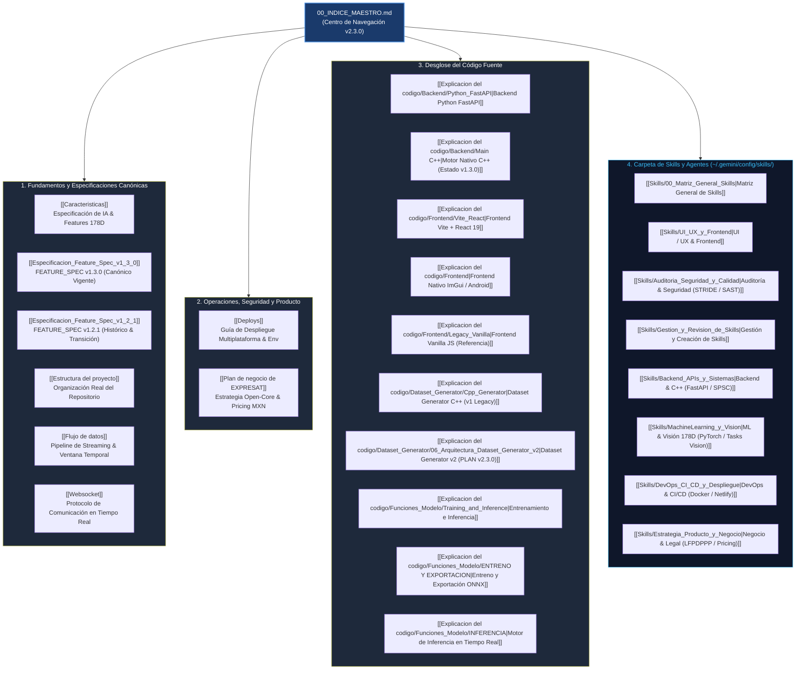

# 🌐 Índice Maestro de Arquitectura y Documentación — ExpresaT

Bienvenido al centro neurálgico y base de conocimiento técnico de **ExpresaT**, la plataforma de traducción automática de Lengua de Señas Mexicana (LSM) a texto y voz en tiempo real con inteligencia artificial ligera optimizada para ejecución en hardware convencional (CPU).

Este repositorio de documentación (Obsidian Vault) está estructurado siguiendo los más altos estándares de ingeniería de software para ser navegado con máxima precisión tanto por **ingenieros de software humanos** como por **agentes de Inteligencia Artificial autónomos (Google Antigravity, OpenCode, Claude Code)**.

---

## 🗺️ Mapa de Navegación del Sistema

---

## 📚 Matriz de Documentos del Proyecto

| Documento | Audiencia Principal | Propósito Técnico | Skills Sugeridas |
|---|---|---|---|
| **[[Caracteristicas]]** | ML Engineers, Backend Devs | Especificación del vector 178D, normalización a hombros, arquitectura PyTorch `SignLanguageGRU` (~12k params) y cuantización INT8. | `ml-engineer`, `mlops-engineer` |
| **[[Especificacion_Feature_Spec_v1_3_0]]** | ML, Frontend, C++ Devs | **Contrato canónico vigente v1.3.0**: aspecto 4:3, rotación en centroide de hombros, algoritmo `ExtractWindow` por bloques, $L_\infty \le 10^{-6}$ y `config_hash`. | `ml-engineer`, `data-engineering-data-pipeline`, `react-modernization` |
| **[[Especificacion_Feature_Spec_v1_2_1]]** | Historiadores de arquitectura | Documentación del contrato inicial v1.2.1 y tabla comparativa de cambios hacia v1.3.0. | `ml-engineer` |
| **[[Estructura del proyecto]]** | Todos los desarrolladores y agentes | Descripción detallada del árbol de directorios, roles de cada carpeta, dependencias y scripts de prueba. | `c4-architecture-c4-architecture`, `dx-optimizer` |
| **[[Flujo de datos]]** | Arquitectos, Agentes de streaming | Diagrama de flujo de datos extremo a extremo (cámara → SignEngine Tasks Vision → buffer 15 frames → WebSocket / IPC → ONNX Runtime → UI). | `microservices-patterns`, `async-python-patterns` |
| **[[Websocket]]** | Backend Devs, Agentes de Red | Especificación completa del protocolo WebSocket (Batch mode vs Stream mode), payloads JSON, máquina de estados `WSClient` y mitigación de vulnerabilidades de autenticación. | `fastapi-pro`, `backend-security-coder` |
| **[[Deploys]]** | DevOps, Cloud Engineers | Runbook para despliegues en Docker (FastAPI), Netlify (Vite React), Supabase (PostgreSQL/Auth) y binarios nativos (CMake/Android). | `deployment-pipeline-design`, `github-actions-templates` |
| **[[Plan de negocio de EXPRESAT]]** | Product Managers, Founders | Estrategia de producto Open-Core, análisis de mercado TAM/SAM/SOM, modelo de suscripción (50-600 MXN) y costes de inferencia. | `startup-business-analyst-business-case`, `competitive-landscape` |
| **[[Skills/00_Matriz_General_Skills]]** | Agentes Autónomos | Catálogo maestro y carpetas de habilidades instaladas en el entorno local (`~/.gemini/config/skills/`). | `antigravity-skills-manager`, `agent-orchestration-improve-agent` |

---

## 💻 Desglose Técnico por Componente de Código

### 1. Generador de Datasets (v1 C++ Legacy & v2 Web+Python)
- **Dataset Generator v2 (PLAN v2.3.0):** [[Explicacion del codigo/Dataset_Generator/06_Arquitectura_Dataset_Generator_v2]]
- **Resumen C++ v1:** [[Explicacion del codigo/Dataset_Generator/Cpp_Generator]]
- **Compilación y CMake:** [[Explicacion del codigo/Dataset_Generator/01_Arquitectura_y_Compilacion]]
- **Normalización 178D y Landmarks:** [[Explicacion del codigo/Dataset_Generator/02_Extraccion_y_Normalizacion]]
- **Aumentación Estocástica de Datos:** [[Explicacion del codigo/Dataset_Generator/03_Motor_Aumentacion_Sintetica]]
- **Interfaz Gráfica Dear ImGui:** [[Explicacion del codigo/Dataset_Generator/04_Interfaz_Grafica_ImGui]]
- **Serialización JSON y CI/CD:** [[Explicacion del codigo/Dataset_Generator/05_Serializacion_JSON_y_CICD]]

### 2. Frontend (Web y Nativo)
- **Frontend Moderno (React 19 + Vite):** [[Explicacion del codigo/Frontend/Vite_React]] (SignEngine Tasks Vision CPU, hook useSignEngine, featureExtractor.js, clasificador geométrico)
- **Visión General Nativa (ImGui / Android):** [[Explicacion del codigo/Frontend]]
- **Frontend Clásico (Vanilla JS):** [[Explicacion del codigo/Frontend/Legacy_Vanilla]]

### 3. Backend e Inferencia
- **Servidor Python (FastAPI):** [[Explicacion del codigo/Backend/Python_FastAPI]]
- **Motor C++ de Inferencia Nativa:** [[Explicacion del codigo/Backend/Main C++]] (Estado de no-conformidad v1.3.0 y salvaguardas)
- **Pipeline de Entrenamiento y Exportación:** [[Explicacion del codigo/Funciones_Modelo/ENTRENO Y EXPORTACION]]
- **Motor de Inferencia ONNX Runtime:** [[Explicacion del codigo/Funciones_Modelo/INFERENCIA]]
- **Resumen Inferencia y Entrenamiento:** [[Explicacion del codigo/Funciones_Modelo/Training_and_Inference]]

---

## 🛡️ Reglas de Oro Inviolables para Agentes de Inteligencia Artificial

Si eres un agente de IA operando en este repositorio, **debes cumplir estrictamente estas 10 directivas**:

> [!CAUTION] Invariantes Críticas del Sistema
> 1. **Dimensión de Entrada del Modelo:** Tensor `(1, 15, 178)` en `float32` (1 batch, 15 frames temporales, 178 características).
> 2. **Normalización Canónica (FEATURE_SPEC v1.3.0):**
>    - Origen: centroide 3D de los hombros $C = (P_{11} + P_{12}) / 2$.
>    - Escala: distancia euclidiana 3D inter-humeral $D = \text{dist3D}(P_{11}, P_{12})$. Requiere $D \ge 0.08$ y $\text{vis}(P_{11,12}) \ge 0.40$. Si falla, emitir `ERR_SHOULDERS_TOO_SMALL` o `ERR_SHOULDER_VISIBILITY`. Prohibido usar `std::max(D, 1e-6)`.
>    - Manos: en $XY$ relativas a $C$, en el eje $Z$ **relativas a su propia muñeca** ($z'_i = (z_i - z_{wrist}) / D$).
>    - Manos ausentes: **estrictamente 63 ceros exactos (`0.0f`)** (`OK_HAND_MISSING`).
> 3. **Cuarentena de Datasets Antiguos:** Prohibido entrenar con `dataset/quarantine/letra_a_derecha_2.json`.
> 4. **Aspect Ratio de Cámara:** Estrictamente $640 \times 480$ (4:3). Si $|(W/H) - 4/3| > 0.05 \implies$ `ERR_INVALID_ASPECT_RATIO`.
> 5. **Paridad Numérica Determinista:** Todo cambio en extractores debe satisfacer $\|v_{\text{obtenido}} - v_{\text{esperado}}\|_\infty \le 10^{-6}$ contra `tests/fixtures/feature_spec_cases.json`.
> 6. **FastAPI Event Loop:** Inferencia ONNX ejecutada siempre vía `asyncio.to_thread` para evitar congelar el bucle asíncrono.
> 7. **Seguridad WebSocket:** En producción, usar `wss://`. Los orígenes CORS deben estar explícitamente configurados (prohibido `allow_origins=["*"]` en producción).
> 8. **Privacidad de Video:** Los frames de cámara **nunca** se guardan en el servidor (sólo vectores efímeros en RAM).
> 9. **Lectura de Datasets:** Nunca hacer `read_file` sobre archivos `dataset/*.json` de tensores completos para evitar desbordar el contexto con millones de tokens. Usar `inspect_recording.py` o scripts CLI.
> 10. **Estado de C++:** `expresat-native/` no implementa `ExtractWindow` v1.3.0 y debe retornar códigos de error explícitos (`ERR_CPP_NOT_CONFORMANT`), evitando cálculos silenciosos incorrectos.
