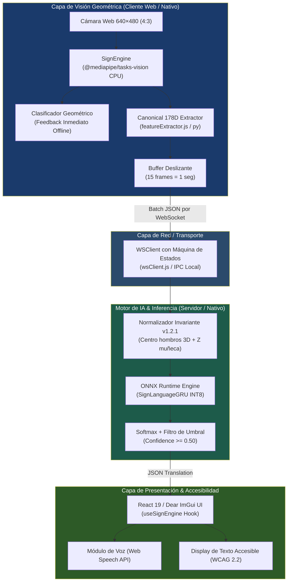

# ⚙️ Especificación Técnica y Arquitectura del Sistema — ExpresaT

> **Navegación:** [[00_INDICE_MAESTRO|🏠 Índice Maestro]] > **Especificaciones y Características**

Este documento define la especificación técnica integral de **ExpresaT**, abarcando la ingeniería canónica de características geométricas (conforme a [[Especificacion_Feature_Spec_v1_2_1|FEATURE_SPEC v1.2.1]]), la arquitectura de la red neuronal recurrente, las optimizaciones de cuantización y los componentes de servicio en frontend y backend.

---

## 🏗️ Visión General de la Arquitectura del Sistema

---

## 1. Ingeniería Canónica de Características (FEATURE_SPEC v1.2.1)

El modelo prescinde de píxeles brutos de video y opera sobre representaciones geométricas espaciales normalizadas de **178 dimensiones por fotograma** (para mayor detalle matemático, consultar [[Especificacion_Feature_Spec_v1_2_1]]):

| Región Anatómica | Puntos MediaPipe | Coordenadas / Atributos | Total Dimensiones |
|---|---|---|---|
| **Upper Pose** | Índices `0`, `11` a `22` (cabeza, hombros, codos, muñecas) | $x, y, z, \text{visibility}$ (4D) | $13 \times 4 =$ **52** |
| **Mano Izquierda** | Índices `0` a `20` (21 articulaciones completas) | $x, y, z$ (3D) | $21 \times 3 =$ **63** |
| **Mano Derecha** | Índices `0` a `20` (21 articulaciones completas) | $x, y, z$ (3D) | $21 \times 3 =$ **63** |
| **TOTAL** | | | **178 características / frame** |

### Normalización Espacial Invariante Canónica (v1.2.1)
Para garantizar invarianza matemática exacta ante traslación 3D ($\text{Extract}(P+\delta) == \text{Extract}(P)$) y escala:
1. **Centro de Hombros 3D:** $C_x = (P_{11,x} + P_{12,x})/2, \; C_y = (P_{11,y} + P_{12,y})/2, \; C_z = (P_{11,z} + P_{12,z})/2$.
2. **Escala Inter-humeral Euclidiana 3D:** $D = \sqrt{\Delta x^2 + \Delta y^2 + \Delta z^2}$. Requiere $D \ge 0.08$ y $\text{vis}(P_{11, 12}) \ge 0.40$ (si falla, emite `ERR_SHOULDERS_TOO_SMALL` o `ERR_SHOULDER_VISIBILITY`).
3. **Upper Pose (`[0..51]`):** $(x-C_x)/D, \; (y-C_y)/D, \; (z-C_z)/D, \; \text{clamp}(vis, 0, 1)$.
4. **Manos (`[52..114]` y `[115..177]`):**
   - Coordenadas $XY$: Relativas al centro de hombros: $(x-C_x)/D, \; (y-C_y)/D$.
   - Coordenada $Z$: **Relativa a la propia muñeca de la mano** escalada por $D$: $(z - z_{wrist})/D$.
5. **Asignación Conjunta Húngara:** Distancia euclidiana 2D mínima de las muñecas detectadas a $P_{15}$ y $P_{16}$ de pose, con desempate en situaciones ambiguas ($|d_1 - d_2| < 0.15 \cdot D$) mediante `categoryName` no espejada de MediaPipe.
6. **Mano Ausente:** Si una mano no está en pantalla, se llena con **estrictamente 63 ceros exactos (`0.0f`)** (`OK_HAND_MISSING`).
7. **Cuarentena de Datasets Antiguos:** `dataset/quarantine/letra_a_derecha_2.json` queda aislado por contener distorsiones sintéticas de escalado ($D \approx 0.0459$ sin división).

---

## 2. Arquitectura de la Red Neuronal (`SignLanguageGRU`)

- **Modelo:** `SignLanguageGRU` (definido en PyTorch y exportado a ONNX).
- **Forma de Entrada:** Tensor de dimensiones `(batch_size, 15, 178)` correspondiente a secuencias de 15 fotogramas temporales.
- **Capa Recurrente:** 1 capa **GRU (Gated Recurrent Unit)** unidireccional con 64 unidades ocultas (`hidden_size = 64`).
- **Cabezal Clasificador (MLP Head):**
  - `Linear(64 -> 32)`
  - `ReLU()`
  - `Dropout(0.3)`
  - `Linear(32 -> num_classes)`
- **Parámetros Totales:** ~12,000 parámetros (peso extremadamente ligero).
- **Justificación de Diseño:** La arquitectura GRU requiere un **25% menos de parámetros** y operaciones en comparación con LSTM, manteniendo idéntica precisión en secuencias cortas (1 segundo a 15 FPS).

### Pipeline de Optimización y Cuantización ONNX
1. Entrenamiento en PyTorch (`train_and_export.py`).
2. Exportación a ONNX estándar con `opset_version = 17`.
3. Cuantización dinámica a precisión **INT8** (`quantize_dynamic` de `onnxruntime.quantization`).
4. **Verificación de Contrato:** Comprobación estricta de `feature_spec_version = "1.2.1"` y `config_hash` en `model_metadata.json`.
5. **Resultado:** Reducción de tamaño de archivo a tan solo **4 KB de grafo + 193 KB de tabla de datos**, reduciendo el consumo de RAM en más de un 90% y acelerando la inferencia en CPU a tan solo **2.02 ms**.

---

## 3. Servidor Backend (FastAPI + WebSockets)

- **Punto de Entrada:** `expresat/backend/main.py`
- **Gestión de Sesión:** Patrón Singleton para `InferenceEngine` cargado en memoria una sola vez al inicio del ciclo de vida (`lifespan`).
- **Validación de Configuración y Origen:** Verificación de orígenes de desarrollo/producción y modo demostración (`config.py`).
- **Conexiones Concurrentes:** Administradas por la clase `ConnectionManager`.
- **Inferencia No Bloqueante:** La función `run_inference_async` ejecuta la llamada de ONNX Runtime en un hilo desacoplado mediante `asyncio.to_thread` para mantener el bucle de eventos reactivo.
- **Autenticación:** Integración con tokens JWT de Supabase en el handshake del WebSocket.

---

## 4. Frontend Web (React 19 + Vite + SignEngine)

- **Framework:** React 19.2.7 con empaquetador ultra-rápido Vite 8.1.0.
- **Enrutamiento:** React Router 7.
- **Motor de Visión (`src/engine/signEngine.js`):** MediaPipe Tasks Vision (`@mediapipe/tasks-vision` 1.0.1) ejecutado en CPU en el hilo principal con limpieza idempotente, cálculo de FPS reales y emisión de landmarks crudos sin filtros artificiales (`smoothLandmarks: false` disponible).
- **Extractor de Features Canónico (`src/engine/featureExtractor.js`):** Implementación en JavaScript del extractor 178D v1.2.1 con paridad idéntica ($|\Delta| \le 10^{-6}$) con Python.
- **Clasificador Geométrico Directo (`src/recognition/`):** Clasificador puro geométrico de manos para feedback offline instantáneo y validación cinemática.
- **Capa de Transporte (`src/transport/wsClient.js`):** Cliente WebSocket robusto con máquina de estados finitos (`CONNECTING`, `OPEN`, `CLOSING`, `CLOSED`), reconexión exponencial y fallback a demo mode.
- **Hook de Coordinación UI (`src/ui/useSignEngine.js`):** Manejo del ciclo de vida de cámara, canvas de landmarks (`drawLandmarks.js`) y estado de inferencia.
- **Páginas Principales:**
  - `Translator.jsx`: Vista central interactiva de traducción en tiempo real.
  - `Home.jsx`: Landing page explicativa.
  - `Auth.jsx`: Login y registro gestionado con Supabase Auth.
  - `Learn.jsx`: Módulo educativo y glosario visual de señas.

---

## 5. Métricas de Desempeño y Benchmark

| Métrica Operativa | Valor Medido | Criterio de Calidad |
|---|---|---|
| Tiempo de Inferencia ONNX (CPU) | **2.02 ms** | Excelente (< 10 ms requerido) |
| Latencia Extremo a Extremo (Web) | **~85 ms** | Percepción instantánea humana |
| Tamaño del Modelo Cuantizado (INT8) | **4 KB** | Distribución ultraligera |
| Consumo de RAM del Backend | **< 100 MB** | Apto para servidores micro / edge |
| Tasa de Cuadros de la Cámara | **15 FPS (Nativo 60 FPS)** | Verificado en vivo con HUD de FPS reales |
| Resolución de Entrada de Cámara | **640×480 (4:3)** | Obligatorio por FEATURE_SPEC v1.2.1 |
| Ventana Temporal de Análisis | **15 frames (1 segundo)** | Cobertura temporal de señas aisladas |

---

## 🤖 Asignación de Agentes y Skills Recomendadas

- **Para Modificaciones de la Red Neuronal:** Invocar **`ml-engineer`** (en `~/.gemini/config/skills/ml-engineer/`) y consultar [[Skills/MachineLearning_y_Vision]].
- **Para Optimización de Servidor y WebSockets:** Invocar **`fastapi-pro`** (en `~/.gemini/config/skills/fastapi-pro/`) y consultar [[Skills/Backend_APIs_y_Sistemas]].
- **Para Diseño de Componentes UI y Accesibilidad:** Invocar **`ui-ux-designer`** y **`wcag-audit-patterns`** y consultar [[Skills/UI_UX_y_Frontend]].
- **Para Auditorías de Seguridad y Rendimiento:** Invocar **`security-auditor`** y consultar [[Skills/Auditoria_Seguridad_y_Calidad]].
