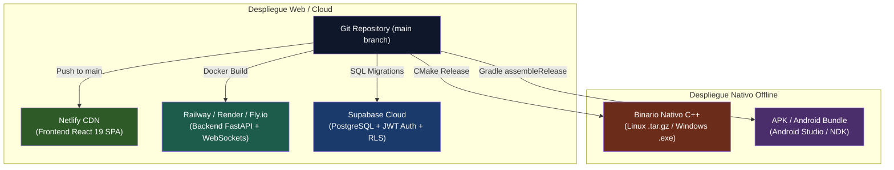

# 🚀 Guía de Despliegue Multiplataforma y Runbook de Operaciones — ExpresaT

> **Navegación:** [[00_INDICE_MAESTRO|🏠 Índice Maestro]] > **Guía de Despliegue (Deploys)**

Este documento contiene las especificaciones y procedimientos de puesta en producción para los distintos componentes del ecosistema **ExpresaT**.

---

## 🏗️ Matriz de Ambientes y Plataformas de Despliegue



---

## 1. Variables de Entorno de Producción (`ENV_VARIABLES_DEPLOY.txt`)

### Backend (FastAPI / Docker)
```env
# Entorno y Hosts
ENVIRONMENT=production
HOST=0.0.0.0
PORT=8000

# CORS y Seguridad de Red
CORS_ORIGINS=https://expresat.netlify.app,https://expresat.com
EXPRESAT_DEMO_MODE=false

# Supabase Auth e Integración
SUPABASE_URL=https://<tu-proyecto>.supabase.co
SUPABASE_KEY=<tu_supabase_service_role_key>
SUPABASE_ANON_KEY=<tu_supabase_anon_key>

# Configuración de Modelos e Inferencia
MODEL_DIR=./models/exported_model
CONFIDENCE_THRESHOLD=0.50
FEATURE_SPEC_VERSION=1.3.0
```

### Frontend (Netlify / Vite)
```env
VITE_API_URL=wss://api.expresat.com/ws/translate
VITE_SUPABASE_URL=https://<tu-proyecto>.supabase.co
VITE_SUPABASE_ANON_KEY=<tu_supabase_anon_key>
VITE_ENVIRONMENT=production
```

> [!CAUTION] Separación Estricta de Claves Supabase
> La clave `SUPABASE_SERVICE_ROLE_KEY` **nunca** debe inyectarse en el frontend ni exponerse en repositorios públicos. Sólo la `SUPABASE_ANON_KEY` está autorizada para distribuirse en la aplicación web.

---

## 2. Base de Datos y Autenticación (Supabase)

El backend delega la gestión de identidades y almacenamiento relacional a **Supabase** (PostgreSQL gestionado):

### Procedimiento:
1. Crear el proyecto en la consola de [Supabase](https://supabase.com).
2. Ejecutar las migraciones SQL ubicadas en `expresat/supabase/`:
   ```sql
   -- Ejemplo de política RLS para perfiles de usuario
   ALTER TABLE profiles ENABLE ROW LEVEL SECURITY;

   CREATE POLICY "Los usuarios solo leen su propio perfil"
   ON profiles FOR SELECT
   USING (auth.uid() = id);

   CREATE POLICY "Los usuarios solo actualizan su propio perfil"
   ON profiles FOR UPDATE
   USING (auth.uid() = id);
   ```
3. Habilitar los proveedores de autenticación (Email/Contraseña y proveedores sociales OAuth si aplican).
4. Configurar las políticas RLS en todas las tablas de historial y preferencias de accesibilidad.

---

## 3. Servidor Backend (FastAPI + WebSockets en Docker)

Dado que la inferencia gestual opera mediante conexiones persistentes por WebSocket, **no debe desplegarse en entornos serverless efímeros** (como AWS Lambda o Vercel Serverless Functions) que terminan las conexiones tras pocos segundos.

### Dockerfile Optimizado Multi-Stage:
```dockerfile
FROM python:3.11-slim AS builder
WORKDIR /app
RUN apt-get update && apt-get install -y --no-install-recommends build-essential && rm -rf /var/lib/apt/lists/*
COPY expresat/backend/requirements.txt .
RUN pip install --no-cache-dir --user -r requirements.txt

FROM python:3.11-slim
WORKDIR /app
COPY --from=builder /root/.local /root/.local
ENV PATH=/root/.local/bin:$PATH
COPY expresat/backend/ ./backend/
COPY expresat/models/ ./models/
COPY catalog/ ./catalog/
EXPOSE 8000
CMD ["uvicorn", "backend.main:app", "--host", "0.0.0.0", "--port", "8000", "--workers", "1"]
```

### Ejecución con Docker:
```bash
# Construir imagen
docker build -t expresat-backend:latest -f expresat/backend/Dockerfile .

# Levantar contenedor
docker run -d --name expresat-prod \
  -p 8000:8000 \
  --env-file .env \
  --memory=512m \
  --cpus=2 \
  --restart unless-stopped \
  expresat-backend:latest
```

### Configuración de Proxy Inverso Nginx (Reverse Proxy):
```nginx
location /ws/ {
    proxy_pass http://localhost:8000;
    proxy_http_version 1.1;
    proxy_set_header Upgrade $http_upgrade;
    proxy_set_header Connection "upgrade";
    proxy_set_header Host $host;
    proxy_read_timeout 3600s;
    proxy_send_timeout 3600s;
}

location /health {
    proxy_pass http://localhost:8000/health;
    proxy_connect_timeout 5s;
    proxy_read_timeout 5s;
}
```

---

## 4. Frontend Web (React 19 + Vite en Netlify)

El frontend está configurado para despliegue estático con CDN global mediante **Netlify**.

### Especificación de Compilación (`netlify.toml`):
```toml
[build]
  base = "expresat/frontend"
  publish = "dist"
  command = "npm run build"

[[redirects]]
  from = "/*"
  to = "/index.html"
  status = 200

[[headers]]
  for = "/*"
  [headers.values]
    X-Frame-Options = "DENY"
    X-Content-Type-Options = "nosniff"
    Referrer-Policy = "strict-origin-when-cross-origin"
    Permissions-Policy = "camera=(self)"
```

> [!TIP] Requisito Estricto de HTTPS
> Los navegadores modernos bloquean el acceso al hardware de la cámara (`navigator.mediaDevices.getUserMedia`) si la web no se sirve bajo **HTTPS**. Asimismo, en HTTPS el socket debe ser necesariamente seguro (`wss://`).

---

## 5. Distribución Nativa (C++ para Escritorio y Android)

### Escritorio (Linux / Windows):
```bash
cd expresat-native
cmake -B build -DCMAKE_BUILD_TYPE=Release
cmake --build build -j$(nproc)
```

### Móvil (Android NDK):
- Compilación a través de Gradle y Android Studio con Android NDK r25+.
- El modelo `expresat_gru_int8.onnx` se aloja en `app/src/main/assets/` y el puente JNI (`android_main.cpp`) lo carga directamente en memoria nativa en el dispositivo.

---

## 🤖 Asignación de Agentes y Skills Recomendadas

- **Para Tareas de CI/CD y Automatización:** Invocar **`deployment-pipeline-design`** y **`github-actions-templates`** (ver [[Skills/DevOps_CI_CD_y_Despliegue]]).
- **Para Compilación y Diagnóstico en Android:** Invocar **`android-cli`**.
- **Para Validación de Configuraciones y Secretos:** Invocar **`deployment-validation-config-validate`** y **`secrets-management`** (ver [[Skills/Auditoria_Seguridad_y_Calidad]]).
- **Para Resolución de Incidentes y Logs:** Invocar **`devops-troubleshooter`**.
