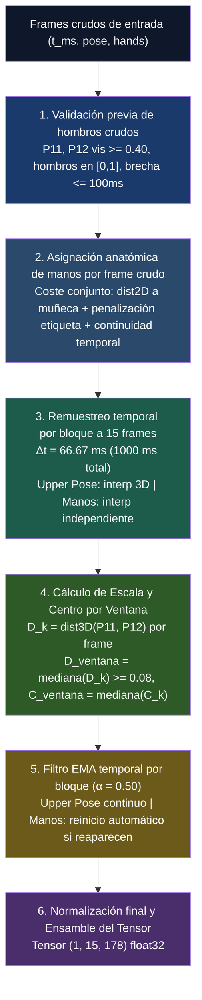

# 📐 Especificación Canónica del Vector de 178 Características (FEATURE_SPEC v1.3.0) — ExpresaT

> **Navegación:** [[00_INDICE_MAESTRO|🏠 Índice Maestro]] > [[Caracteristicas|⚙️ Características]] > **FEATURE_SPEC v1.3.0**

- **Versión de la especificación (`feature_spec_version`):** `1.3.0`
- **Estado:** Contrato técnico obligatorio e inmutable para modelos entrenados, generador de datasets v2 y motores de inferencia.
- **Ámbito:** Unificación matemática de extracción, filtrado, normalización y asignación anatómica en **Python** (`expresat/models/feature_extractor.py`), **JavaScript** (`expresat/frontend/src/engine/featureExtractor.js`) y utilidades de validación (`expresat-dataset-generator/scripts/inspect_recording.py`).
- **Estado de C++ (`expresat-native/`):** **NO CONFORME CON FEATURE_SPEC v1.3.0**. El pipeline nativo C++ no implementa `ExtractWindow`. Por política de seguridad y fidelidad, `InferenceThread` y `normalize_to_shoulders` **rechazan activamente** cualquier intento de procesamiento retornando códigos de error explícitos (`ERR_CPP_NOT_CONFORMANT` y `ERR_SHOULDERS_TOO_SMALL`), en lugar de caer en silent zero-filling o truncamientos silenciosos.
- **Invariante del Modelo:** Tensor tridimensional continuo de entrada `(1, 15, 178)` en `float32`.

---

## 1. Evidencia Histórica de `letra_a_derecha_2.json` y Aislamiento en Cuarentena

### 1.1 Causa Raíz del Archivo Legacy
La inspección de git (`commit 3bae2f14365509f9daa1db11b49751e1fb7cdac8`, "Demo", 5 de nov 2026) y la auditoría geométrica confirmaron que `expresat-dataset-generator/dataset/letra_a_derecha_2.json` contenía anomalías críticas:
- **Origen Sintético:** Generado mediante `MediapipeExtractor::process()` en modo STUB senoidal artificial (`EXPRESAT_STUB_EXTRACTOR=1`), produciendo curvas $0.5 + 0.15 \cos(t + 0.3i)$ sin anatomía real.
- **Distorsión en Aumentación:** El método `DataAugmenter::applyScale` multiplicó uniformemente todos los canales por factores $[0.90, 1.10]$, provocando que el canal de visibilidad desbordara hasta $1.0201$ (la visibilidad debe estar estrictamente acotada a $[0.0, 1.0]$).
- **Falta de Escalado por Hombros:** Los hombros se situaron en $(\pm 0.0177, 0, 0)$ con distancia inter-humeral $D \approx 0.0459$ porque se omitió la división por la distancia $D$. En un espacio correctamente normalizado, los hombros frontales deben situarse exactamente en $(\pm 0.5000, 0, 0)$ con distancia $D = 1.0$.

### 1.2 Medidas Correctivas Obligatorias
1. **Aislamiento en Cuarentena:** El archivo fue trasladado a `dataset/quarantine/letra_a_derecha_2.json` y queda **estrictamente prohibido su uso para el entrenamiento de nuevos modelos**.
2. **Validación de Versión y Hash de Configuración:** `InferenceEngine` (`inference_engine.py`) y el pipeline de entrenamiento (`train_and_export.py`) comprueban compatibilidad por `major.minor` (`1.3`) y validan el hash criptográfico SHA-256 (`config_hash`), el cual incorpora el hash de `tests/fixtures/feature_spec_cases.json`. Cualquier discrepancia aborta con `IncompatibleFeatureSpecError`.

---

## 2. Resolución Fija (640×480, 4:3), Rotación Centrada y Validación Cruda

1. **Resolución y Relación de Aspecto Fijas:**
   - La captura web opera estrictamente a **$640 \times 480$** (relación de aspecto nominal $A = 640/480 = 4/3 \approx 1.333333$).
   - En tiempo de ejecución se comprueba que `videoWidth` y `videoHeight` cumplan $|(W/H) - (4/3)| \le 0.05$. De lo contrario, se rechaza la captura con `ERR_INVALID_ASPECT_RATIO`.
   - Las dimensiones reales de cámara se registran en los metadatos de la toma cruda.
2. **Centro de Rotación Rígida 2D para Data Augmentation:**
   - Toda rotación sintética de augmentation se realiza alrededor del **centroide de los hombros** $C = (C_x, C_y)$ del sujeto en el frame original, preservando al firmante en el centro del cuadro y previniendo derivas espaciales excéntricas.
   - **Fórmula con corrección de relación de aspecto ($A = 4/3$):**
     $$x_{\text{rel}} = (x - C_x) \times A, \quad y_{\text{rel}} = y - C_y$$
     $$x_{\text{rot}} = x_{\text{rel}} \cos\theta - y_{\text{rel}} \sin\theta, \quad y_{\text{rot}} = x_{\text{rel}} \sin\theta + y_{\text{rel}} \cos\theta$$
     $$x' = C_x + \frac{x_{\text{rot}}}{A}, \quad y' = C_y + y_{\text{rot}}$$
3. **Validación de Calidad Exclusiva en Frames Originales:**
   - **Regla inmutable:** Las compuertas de calidad (visibilidad de hombros $\ge 0.40$, hombros dentro del cuadro $[0, 1]$, brechas temporales $\le 100\text{ ms}$) se evalúan **exclusivamente sobre los frames originales crudos**, nunca sobre los frames aumentados. El augmentation es una transformación derivada y no puede ser usado para enmascarar ni descartar tomas crudas.
4. **Conmutatividad de Espejo (Mirror Commutativity):**
   - En landmarks crudos: inversión horizontal $x \to 1.0 - x$, intercambio de landmarks bilaterales de pose, e inversión de `categoryName` (`'Left'` $\leftrightarrow$ `'Right'`).
   - En features normalizadas: $x' \to -x'$ e intercambio de los bloques izquierdo y derecho.
   - **Teorema de Paridad:** $\text{Extract}(\text{Mirror}(\text{raw})) == \text{MirrorFeatures}(\text{Extract}(\text{raw}))$ con error $L_\infty \le 10^{-6}$.

---

## 3. Manifiesto del Detector de Visión (Tasks Vision CPU)

Los detectores MediaPipe Tasks Vision (en CPU) deben inicializarse con los siguientes artefactos y umbrales unificados:

### Modelos y Checksums Criptográficos (SHA-256)
- **Detector de Manos:** `public/models/hand_landmarker.task`
  - **SHA-256:** `fbc2a30080c3c557093b5ddfc334698132eb341044ccee322ccf8bcf3607cde1` (7,858,683 bytes)
- **Detector de Pose:** `public/models/pose_landmarker_lite.task`
  - **SHA-256:** `59929e1d1ee95287735ddd833b19cf4ac46d29bc7afddbbf6753c459690d574a` (5,833,260 bytes)

### Parámetros de Inferencia Unificados
- `minHandDetectionConfidence`: `0.50`
- `minHandPresenceConfidence`: `0.50`
- `minTrackingConfidence`: `0.50`
- `minPoseDetectionConfidence`: `0.50`
- `minPosePresenceConfidence`: `0.50`
- `numHands`: `2`, `numPoses`: `1`, `delegate`: `'CPU'`, `runningMode`: `'VIDEO'`.

---

## 4. Composición Topológica del Vector 178D

Cada fotograma genera un vector plano de **178 valores `float32`**:

| Segmento | Índices | Descripción | Dimensiones | Formato |
|---|---|---|---|---|
| **Upper Pose** | `[0 .. 51]` | 13 landmarks del torso superior (0: nariz, 11-22: hombros, codos, muñecas, torso) | **52D** | $13 \times (x, y, z, \text{visibility})$ |
| **Mano Izquierda** | `[52 .. 114]` | 21 articulaciones de la mano izquierda física del firmante | **63D** | $21 \times (x, y, z)$ |
| **Mano Derecha** | `[115 .. 177]` | 21 articulaciones de la mano derecha física del firmante | **63D** | $21 \times (x, y, z)$ |
| **TOTAL** | `[0 .. 177]` | Vector unificado por frame | **178D** | `float32` |

> [!IMPORTANT]
> **Ausencia de Manos:** Si una mano no está visible en el fotograma pero los hombros son válidos, dicho segmento se rellena con **estrictamente 63 ceros exactos (`0.0f`)** (`OK_HAND_MISSING`). Prohibido emitir `NaN`, `null` o aproximaciones.

---

## 5. Algoritmo de Normalización Matemática Canónica

Para garantizar invarianza ante la estatura del usuario, su distancia a la cámara y traslaciones 3D en el espacio:

### 5.1 Centro y Escala de Referencia (Hombros)
A partir de los hombros izquierdo ($P_{11}$) y derecho ($P_{12}$):
1. **Centroide de Hombros ($C$):**
   $$C_x = \frac{P_{11,x} + P_{12,x}}{2}, \quad C_y = \frac{P_{11,y} + P_{12,y}}{2}, \quad C_z = \frac{P_{11,z} + P_{12,z}}{2}$$
2. **Escala Inter-humeral 3D ($D$):**
   $$D = \sqrt{(P_{11,x} - P_{12,x})^2 + (P_{11,y} - P_{12,y})^2 + (P_{11,z} - P_{12,z})^2}$$
3. **Comprobación de Escala:** Si $D < 0.08$, se rechaza con `ERR_SHOULDERS_TOO_SMALL`. Prohibido recortar con `std::max(D, 1e-6)`.
4. **Comprobación de Visibilidad:** Si $\text{vis}(P_{11}) < 0.40 \lor \text{vis}(P_{12}) < 0.40$, se rechaza con `ERR_SHOULDER_VISIBILITY`.

### 5.2 Normalización de Upper Pose (`[0 .. 51]`)
Para cada uno de los 13 landmarks del torso superior:
$$x' = \frac{x - C_x}{D}, \quad y' = \frac{y - C_y}{D}, \quad z' = \frac{z - C_z}{D}, \quad \text{vis}' = \text{clamp}(\text{vis}, 0.0, 1.0)$$

### 5.3 Normalización Desacoplada de Manos (`[52 .. 114]` y `[115 .. 177]`)
Para asegurar la propiedad fundamental de **invarianza a traslación 3D** ($\text{Extract}(P + \delta) == \text{Extract}(P)$):
- **Plano $XY$ (Espacio Torácico):** Las manos se ubican respecto al centro de los hombros:
  $$x' = \frac{x_{\text{hand}, i} - C_x}{D}, \quad y' = \frac{y_{\text{hand}, i} - C_y}{D}$$
- **Eje $Z$ (Desacoplamiento Relativo a la Muñeca):** Se resta la propia coordenada $Z$ de la muñeca (Landmark 0 de esa mano) y se escala por $D$:
  $$z' = \frac{z_{\text{hand}, i} - z_{\text{hand}, \text{wrist}}}{D}$$

---

## 6. Algoritmo Canónico `ExtractWindow`: Secuencia por Bloques Inmutable

Para evitar distorsiones o cruces fantasmas cuando el detector cambia el orden de las manos entre frames, el orden de operaciones es **estricto, por bloques anatómicos e inmutable**:



### Detalle de Asignación de Manos y Función de Coste
Para 2 manos detectadas $H_0, H_1$:
$$\text{coste}_A = d_{\text{left}}(H_0) + d_{\text{right}}(H_1) + \text{PenalizaciónEtiqueta}(0.25 \cdot D) + 0.5 \cdot \text{dist2D}(H, H_{\text{prev}})$$
$$\text{coste}_B = d_{\text{left}}(H_1) + d_{\text{right}}(H_0) + \text{PenalizaciónEtiqueta}(0.25 \cdot D) + 0.5 \cdot \text{dist2D}(H, H_{\text{prev}})$$

- **Registro de Ambigüedad:** Si $|\text{coste}_A - \text{coste}_B| < 0.15 \cdot D$, se incrementa el contador `ambiguous_handedness_count` en el manifiesto de la toma cruda.
- **Mano Desconectada:** Si $\min(d_{\text{left}}, d_{\text{right}}) > 1.75 \cdot D \land \text{vis}(P_{\text{wrist}}) \ge 0.50$, la mano se descarta como artefacto espurio (`ERR_HAND_DISCONNECTED`).

---

## 7. Brechas Temporales y Tolerancia

- $\text{Brecha} = t_{\text{siguiente\_válido}} - t_{\text{último\_válido}} - \Delta t_{\text{nominal}}$.
- **Umbral máximo permitido:** **$\le 100\text{ ms}$**.
  - A 15 FPS ($\Delta t = 66.7\text{ ms}$): 1 frame perdido permitido (se interpola). $\ge 2$ frames perdidos ($133.3\text{ ms}$) $\implies$ `ERR_INVALID_FRAME_GAP_TOO_LARGE`.
  - A 30 FPS ($\Delta t = 33.3\text{ ms}$): hasta 3 frames perdidos ($100\text{ ms}$) permitidos. $\ge 4$ frames perdidos $\implies$ Rechazado.

---

## 8. Modos Declarativos por Clase y Duraciones Unificadas

Todas las tomas de entrenamiento tienen duraciones estandarizadas conforme a `catalog/signs_catalog.json`:
- **Duración máxima de toma:** **$2.5\text{ s}$ ($2500\text{ ms}$)**.
- **Margen de captura cruda:** $1.5\text{ s}$ a $2.5\text{ s}$.

| Modo | Definición | Requisito de Segmentación | Criterio de Aceptación |
|---|---|---|---|
| `"estatica"` | Seña en pose fija sin trayectoria (ej. A, B, C... 1, 2, 3...) | El usuario debe **mantener la pose estable durante $\ge 1200\text{ ms}$**. | Varianza posicional articular $< 0.35 \text{ palmScale}/\text{s}$ durante la ventana central de 1000 ms. |
| `"dinamica"` | Seña con trayectoria cinemática (ej. J, Z, "hola", "gracias") | Movimiento con curva de aceleración y desaceleración. | Desplazamiento articular acumulado $\ge 0.15 \times D$ dentro de los 2500 ms. |

---

## 9. Catálogo Canónico de Códigos de Error

| Código de Error | Condición Disparadora | Comportamiento del Pipeline |
|---|---|---|
| `ERR_POSE_MISSING` | `pose == null` o `len(pose) < 23` | Rechazar frame (`valid: false`). |
| `ERR_SHOULDER_VISIBILITY` | $\text{vis}(P_{11}) < 0.40 \lor \text{vis}(P_{12}) < 0.40$ | Rechazar frame (`valid: false`). |
| `ERR_SHOULDERS_TOO_SMALL` | $D_{\text{ventana}} < 0.08$ | Rechazar frame o ventana. Prohibido recortar con `std::max`. |
| `ERR_OUT_OF_BOUNDS` | Hombros fuera del cuadro ($x, y \notin [0.0, 1.0]$) | Rechazar frame (`valid: false`). |
| `ERR_HAND_DISCONNECTED` | $\min(d_{\text{left}}, d_{\text{right}}) > 1.75 \cdot D \land \text{vis}(P_{\text{wrist}}) \ge 0.50$ | Descartar mano espuria. |
| `ERR_INVALID_FRAME_GAP_TOO_LARGE` | Brecha sin tracking continuo $> 100 \text{ ms}$ | Rechazar toma de entrenamiento completa. |
| `ERR_INVALID_ASPECT_RATIO` | $|(W/H) - (4/3)| > 0.05$ | Rechazar captura de cámara. |
| `ERR_CPP_NOT_CONFORMANT` | Invocación de inferencia nativa C++ en v1.3.0 | Rechazar ejecución con return de error explícito. |
| `OK_HAND_MISSING` | Hombros válidos pero mano ausente | Válido. Emitir estrictamente 63 ceros exactos (`0.0f`). |

---

## 10. Fixture Único Compartido, Tolerancia $L_\infty \le 10^{-6}$ y `config_hash`

Las pruebas de conformidad en Python (`pytest tests/test_feature_spec.py`) y JavaScript (`vitest run featureExtractor.test.js`) consumen **obligatoriamente el archivo canónico único**:
`tests/fixtures/feature_spec_cases.json`

### 10.1 Regla de Aceptación Numérica ($L_\infty$):
Para todo vector o tensor generado, la comparación con la salida esperada se evalúa **elemento a elemento** bajo la norma del supremo:
$$\|v_{\text{obtenido}} - v_{\text{esperado}}\|_\infty = \max_{i} |v_{\text{obtenido}, i} - v_{\text{esperado}, i}| \le 10^{-6}$$

### 10.2 Cálculo Canónico de `config_hash`:
El hash de configuración criptográfica es el digest SHA-256 del JSON ordenado que contiene:
1. `feature_spec_version`: `"1.3.0"`
2. `delegate`: `"CPU"` o `"GPU"`
3. Parámetros dimensionales y temporales (`total_features: 178`, `sequence_length: 15`, `target_fps: 15`, `duration_ms: 1000.0`, `shoulders_d_min: 0.08`).
4. Pesos de asignación (`weight_label_penalty: 0.25`, `weight_temporal_continuity: 0.50`).
5. **`fixtures_sha256`:** El hash SHA-256 íntegro de `tests/fixtures/feature_spec_cases.json`.

---

## 11. Esquema Canónico de Tomas Crudas (`.raw.json`) y Auditoría por Segmentos

Las tomas grabadas por el capturador web se persisten con el esquema `.raw.json`:
- **Versión del esquema:** `"1.3.1"`
- **Métricas de intervalo:** `p50_ms`, `p95_ms`, `max_ms`, `gaps_over_100ms_count`.
- **Auditoría con `inspect_recording.py`:**
  ```bash
  python expresat-dataset-generator/scripts/inspect_recording.py \
    --input raw_captures/session_01/hola_001.raw.json \
    --segments reposo,solo_derecha,solo_izquierda,ambas,cruce
  ```

---

## 🤖 Directivas de Oro para Agentes de IA

1. **Nunca editar las constantes dimensionales (178, 15 frames)** sin verificar `tests/test_feature_spec.py`.
2. **Nunca sustituir la división por $D$** con constantes ni con `std::max(D, 1e-6)` si $D < 0.08$. Si $D < 0.08$, emitir `ERR_SHOULDERS_TOO_SMALL`.
3. **Nunca consumir `dataset/quarantine/letra_a_derecha_2.json`** en ningún script de entrenamiento.
4. **Al verificar paridad entre JS y Python**, la norma del supremo elemento a elemento debe ser $\|v_1 - v_2\|_\infty \le 10^{-6}$.
