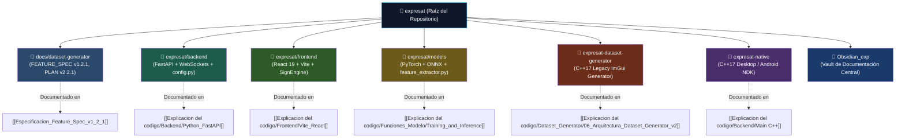

# 📂 Estructura del Repositorio y Arquitectura de Módulos — ExpresaT

> **Navegación:** [[00_INDICE_MAESTRO|🏠 Índice Maestro]] > **Estructura del Proyecto**

El repositorio de **ExpresaT** está organizado como un ecosistema modular desacoplado que contiene el servidor central FastAPI, el cliente web moderno React 19 con Tasks Vision, el pipeline canónico de características 178D, los generadores de datasets (C++ v1 y Web+Python v2), y el entorno nativo offline C++17 para escritorio y dispositivos móviles.

---

## 🗺️ Mapa de Relación entre Módulos y Documentación



---

## 🗂️ Árbol Exhaustivo de Directorios

```text
expresat/
├── docs/                             # Especificaciones de ingeniería y planes
│   └── dataset-generator/            # Documentación del generador y especificación técnica
│       ├── FEATURE_SPEC.md           # Especificación Canónica 178D v1.2.1
│       ├── PLAN.md                   # Plan de Rediseño Dataset Generator v2.2.1
│       └── AUDITORIA.md              # Auditoría geométrica de datasets y causas de cuarentena
│
├── dataset/                          # Almacén de datasets de entrenamiento
│   └── quarantine/                   # Datasets aislados con fallos de escalado
│       └── letra_a_derecha_2.json    # Archivo sintético defectuoso (cuarentena obligatoria)
│
├── tests/                            # Suites de pruebas automáticas del sistema
│   └── test_feature_spec.py          # Pruebas TC-01 a TC-05 de conformidad de FEATURE_SPEC v1.2.1
│
├── expresat/
│   ├── backend/                      # Servidor central asíncrono (FastAPI + WebSocket)
│   │   ├── main.py                   # Punto de entrada ASGI, ConnectionManager y lifespan
│   │   ├── config.py                 # Validación de orígenes, variables de entorno y demo mode
│   │   ├── websockets_handler.py     # Gestor de streaming de landmarks y reconexiones
│   │   ├── test_api_integration.py  # Tests de integración de WebSocket y endpoints REST
│   │   ├── requirements.txt          # Dependencias: fastapi, uvicorn, onnxruntime, numpy, pydantic
│   │   └── requirements-train.txt    # Dependencias: torch, torchvision, scikit-learn
│   │
│   ├── frontend/                     # Cliente web moderno de producción (React 19 + Vite)
│   │   ├── src/
│   │   │   ├── main.jsx              # Inicialización de React en el DOM
│   │   │   ├── App.jsx               # Enrutador principal (React Router 7) y ThemeContext
│   │   │   ├── config.js             # Configuración centralizada de endpoints y fallbacks
│   │   │   ├── engine/               # Motor de visión e ingeniería de características
│   │   │   │   ├── signEngine.js     # MediaPipe Tasks Vision CPU en main-thread (FPS reales)
│   │   │   │   ├── featureExtractor.js # Extractor canónico 178D v1.2.1 en JavaScript
│   │   │   │   └── __tests__/        # Tests Vitest para signEngine y featureExtractor
│   │   │   ├── recognition/          # Clasificación geométrica offline de manos
│   │   │   │   ├── geometry.js       # Cálculo de distancias articulares y ángulos
│   │   │   │   ├── classifier.js     # Clasificador geométrico y voting temporal
│   │   │   │   └── syntheticHand.js  # Utilería de fixtures para pruebas
│   │   │   ├── transport/            # Capa de transporte y red WebSocket
│   │   │   │   ├── wsClient.js       # Máquina de estados (CONNECTING, OPEN, CLOSING, CLOSED)
│   │   │   │   └── __tests__/        # Tests Vitest para WSClient
│   │   │   ├── ui/                   # Hooks y utilidades visuales
│   │   │   │   ├── useSignEngine.js  # Hook de coordinación (cámara + canvas + inferencia)
│   │   │   │   └── drawLandmarks.js  # Renderizado acelerado 2D de esqueleto sobre canvas
│   │   │   ├── pages/                # Vistas: Translator.jsx, Home.jsx, Auth.jsx, Learn.jsx, About.jsx
│   │   │   ├── components/           # Componentes UI (Navbar, Footer, ThemeToggle, EnvironmentSelector)
│   │   │   └── services/             # Integración Supabase Auth (authService.js)
│   │   ├── e2e/                      # Pruebas End-to-End con Playwright
│   │   │   └── translator.spec.js    # Suite E2E para flujo completo del Traductor
│   │   ├── playwright.config.js      # Configuración de Playwright
│   │   ├── vite.config.js            # Configuración de compilación optimizada y proxy WASM
│   │   └── package.json              # Dependencias de React 19, @mediapipe/tasks-vision, Vitest
│   │
│   ├── frontend-legacy/              # Cliente web de referencia en JavaScript puro (Vanilla)
│   │   ├── index.html                # Maqueta minimalista sin herramientas de compilación
│   │   └── js/                       # Módulos ES6 puros de referencia histórica
│   │
│   ├── models/                       # Pipeline de inteligencia artificial y red recurrente
│   │   ├── feature_extractor.py      # Extractor canónico 178D v1.2.1 en Python (con paridad 10^-6)
│   │   ├── inference_engine.py       # Wrapper ONNX Runtime, validación de hash y spec 1.2.1
│   │   ├── train_and_export.py       # Pipeline continuo: PyTorch GRU → ONNX float32 → INT8 cuantizado
│   │   ├── inference.py              # Script CLI para benchmarks y validación en local
│   │   └── exported_model/           # Artefactos compilados listos para producción
│   │       ├── expresat_gru_int8.onnx      # Modelo cuantizado para producción (~4 KB grafo)
│   │       ├── expresat_gru_float32.onnx   # Modelo flotante original sin cuantizar
│   │       └── model_metadata.json         # Metadatos del modelo: etiquetas, dimensiones, config_hash
│   │
│   ├── expresat-dataset-generator/    # Herramienta de escritorio nativa C++17 (v1 Legacy)
│   │   ├── CMakeLists.txt            # Configuración CMake 3.20+ (OpenCV 4/5, GLFW3, Dear ImGui)
│   │   ├── src/                      # Código fuente en C++ (extracción, normalización 178D, GUI ImGui)
│   │   ├── scripts/                  # Scripts de automatización (build.sh, setup_third_party.sh)
│   │   └── dataset/                  # Datasets generados en formato JSON estructurado
│   │
│   ├── expresat-native/               # Entorno nativo offline para escritorio y Android
│   │   ├── core/                     # Motor C++ con buffers lock-free y sesiones ONNX Runtime
│   │   │   ├── src/inference_thread.cpp # Normalización hombros alineada a FEATURE_SPEC v1.2.1
│   │   │   └── include/frame_queue.h # Cola circular SPSC lock-free
│   │   ├── desktop/                  # Aplicación de escritorio multiplataforma (Windows/Linux)
│   │   └── android/                  # Proyecto Gradle con puente JNI para dispositivos móviles
│   │
│   └── Obsidian_exp/                 # Base de conocimiento y documentación técnica completa
│       ├── 00_INDICE_MAESTRO.md      # Centro de navegación unificado
│       ├── Caracteristicas.md        # Especificación técnica del modelo e IA
│       ├── Especificacion_Feature_Spec_v1_2_1.md # Especificación matemática canónica
│       ├── Flujo de datos.md         # Pipeline de datos y cálculo de latencias
│       ├── Websocket.md              # Contratos de red y esquemas JSON
│       ├── Deploys.md                # Guía de despliegue en producción
│       ├── Plan de negocio...md      # Estrategia de producto y pricing
│       ├── Skills/                   # Guías de habilidades agrupadas por especialidad
│       └── Explicacion del codigo/   # Desglose exhaustivo por componente
```

---

## 🚀 Comandos Rápidos de Compilación y Ejecución

### 1. Iniciar Servidor Backend (Python)
```bash
cd expresat/backend
pip install -r requirements.txt
uvicorn main:app --host 0.0.0.0 --port 8000 --reload
```

### 2. Iniciar Frontend Web (React + Vite)
```bash
cd expresat/frontend
npm install
npm run dev
```

### 3. Ejecutar Pruebas de Paridad de Features (Python y Vitest)
```bash
# Pruebas en Python:
pytest tests/test_feature_spec.py -v

# Pruebas en Frontend:
cd expresat/frontend
npx vitest run
```

### 4. Compilar Motor Nativo (C++ Desktop)
```bash
cd expresat-native
cmake -B build -DCMAKE_BUILD_TYPE=Release
cmake --build build -j$(nproc)
```

---

## 🤖 Asignación de Agentes y Skills Recomendadas

- **Para Tareas Arquitectónicas y Reorganización:** Invocar **`c4-architecture-c4-architecture`** y **`monorepo-architect`** (ver [[Skills/00_Matriz_General_Skills]]).
- **Para Auditoría de Scripts y Dependencias:** Invocar **`dx-optimizer`** y **`bash-pro`**.
- **Para Validación de Datasets y Features:** Consultar [[Especificacion_Feature_Spec_v1_2_1]].
