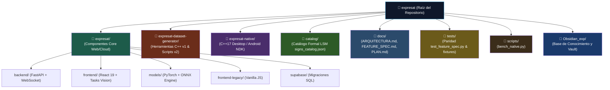

# 📂 Estructura del Repositorio y Arquitectura de Módulos — ExpresaT

> **Navegación:** [[00_INDICE_MAESTRO|🏠 Índice Maestro]] > **Estructura del Proyecto**

El ecosistema de **ExpresaT** está organizado como un monorepositorio desacoplado que contiene el servidor central asíncrono en FastAPI, el cliente web moderno en React 19 con Tasks Vision, el motor nativo en C++17 para escritorio y Android, las herramientas de generación y análisis de datasets, el catálogo formal de señas de LSM y la base de conocimiento central.

---

## 🗺️ Mapa de Relación entre Módulos y Documentación



---

## 🗂️ Árbol Exhaustivo de Directorios Físicos

```text
/home/adrian/Proyectos/expresat/
├── catalog/                               # Catálogo canónico de señas de LSM
│   └── signs_catalog.json                 # Vocabulario oficial v1.3.0 ("reposo", "hola", "gracias", etc.)
│
├── docs/                                  # Especificaciones de arquitectura y reportes
│   ├── ARQUITECTURA.md                    # Rediseño demo en navegador y prevención de 8 fallas históricas
│   ├── REPORTE.md                         # Reporte técnico general de avance
│   └── dataset-generator/                 # Documentación del generador v2
│       ├── FEATURE_SPEC.md                # Especificación Canónica 178D v1.3.0
│       ├── PLAN.md                        # Plan de Rediseño Dataset Generator v2.3.0
│       └── AUDITORIA.md                   # Auditoría geométrica y causas de cuarentena
│
├── tests/                                 # Suites de pruebas automáticas del sistema
│   ├── test_feature_spec.py               # Pruebas de paridad numérica en Python (L_inf <= 1e-6)
│   └── fixtures/
│       └── feature_spec_cases.json        # Fixture único canónico compartido (SHA-256 verificado)
│
├── scripts/                               # Scripts globales de diagnóstico y benchmark
│   └── bench_native.py                    # Benchmark de rendimiento nativo en CPU
│
├── exported_model/                        # Modelos compilados y exportados
│   ├── expresat_gru_float32.onnx          # Modelo en precisión completa (opset 17)
│   ├── expresat_gru_float32.onnx.data     # Pesos desacoplados del grafo
│   ├── expresat_gru.pt                    # Checkpoint PyTorch original
│   └── model_metadata.json                # Metadatos del modelo (config_hash, labels, spec_version)
│
├── expresat/                              # Núcleo de la plataforma web y API
│   ├── backend/                           # Servidor central asíncrono (FastAPI + WebSocket)
│   │   ├── main.py                        # Punto de entrada ASGI, ConnectionManager y lifespan
│   │   ├── config.py                      # Validación de orígenes, variables de entorno y demo mode
│   │   ├── websockets_handler.py          # [DEPRECADO / HISTÓRICO] Antiguo handler 225D
│   │   ├── test_api_integration.py       # Tests de integración de WebSocket y endpoints REST
│   │   ├── test_demo_rules.py             # Tests unitarios para reglas de demostración
│   │   ├── requirements.txt               # Dependencias de producción (fastapi, onnxruntime, pydantic)
│   │   └── requirements-train.txt         # Dependencias de entrenamiento (torch, torchvision)
│   │
│   ├── frontend/                          # Cliente web moderno de producción (React 19 + Vite)
│   │   ├── src/
│   │   │   ├── main.jsx                   # Inicialización de React en el DOM
│   │   │   ├── App.jsx                    # Enrutador principal (React Router 7) y Contextos
│   │   │   ├── config.js                  # Configuración centralizada de endpoints y fallbacks
│   │   │   ├── engine/                    # Motor de visión e ingeniería de características
│   │   │   │   ├── signEngine.js          # MediaPipe Tasks Vision CPU en main-thread (FPS reales)
│   │   │   │   ├── featureExtractor.js    # Extractor canónico 178D v1.3.0 en JavaScript
│   │   │   │   ├── index.js               # Exportador del paquete de visión
│   │   │   │   └── __tests__/             # Tests Vitest para paridad matemática y regresión
│   │   │   ├── recognition/               # Clasificación geométrica offline en cliente
│   │   │   │   ├── geometry.js            # Cálculo de distancias articulares, ángulos y palmScale
│   │   │   │   ├── classifier.js          # Clasificador geométrico y voting temporal
│   │   │   │   └── syntheticHand.js       # Fixtures de manos sintéticas para pruebas
│   │   │   ├── transport/                 # Capa de transporte y red WebSocket
│   │   │   │   ├── wsClient.js            # Máquina de estados finitos y reconexión exponencial
│   │   │   │   └── __tests__/             # Tests Vitest para WSClient
│   │   │   ├── ui/                        # Hooks y utilidades visuales
│   │   │   │   ├── useSignEngine.js       # Hook de coordinación (cámara + canvas + inferencia)
│   │   │   │   └── drawLandmarks.js       # Renderizado acelerado 2D de esqueleto sobre canvas
│   │   │   ├── pages/                     # Vistas: Translator.jsx, Home.jsx, Auth.jsx, Learn.jsx
│   │   │   ├── components/                # Componentes UI (Navbar, Footer, ThemeToggle)
│   │   │   └── services/                  # Integración Supabase Auth (authService.js)
│   │   ├── e2e/                           # Pruebas End-to-End con Playwright
│   │   │   └── translator.spec.js         # Suite E2E para flujo completo del Traductor
│   │   ├── package.json                   # Dependencias: react 19, @mediapipe/tasks-vision, vitest
│   │   └── vite.config.js                 # Configuración de compilación optimizada y proxy WASM
│   │
│   ├── frontend-legacy/                   # Cliente web de referencia en JavaScript puro (Vanilla)
│   │   ├── index.html                     # Maqueta sin empaquetadores
│   │   └── js/                            # Módulos ES6 puros (mediapipe_engine.js, app.js)
│   │
│   ├── models/                            # Pipeline de inteligencia artificial y red recurrente
│   │   ├── feature_extractor.py           # Extractor canónico 178D v1.3.0 en Python (paridad 10^-6)
│   │   ├── inference_engine.py            # Wrapper ONNX Runtime, validación de hash y spec 1.3.0
│   │   ├── train_and_export.py            # Pipeline continuo: PyTorch GRU → ONNX Float32 → INT8
│   │   ├── inference.py                   # [OBSOLETO] Reemplazado por inference_engine.py
│   │   └── exported_model/                # Modelos exportados para FastAPI
│   │
│   └── supabase/                          # Migraciones SQL y políticas de seguridad RLS
│
├── expresat-dataset-generator/            # Herramienta C++17 (v1) y utilidades CLI (v2)
│   ├── CMakeLists.txt                     # Configuración CMake 3.20+ (OpenCV, GLFW, Dear ImGui)
│   ├── src/                               # Código fuente C++ (extracción, GUI ImGui, data augmenter)
│   ├── scripts/                           # Scripts de análisis y validación de datos
│   │   ├── inspect_recording.py           # Validador de grabaciones crudas .raw.json con --segments
│   │   ├── inspect_dataset.py             # Inspección no invasiva de datasets sin saturar memoria
│   │   ├── validate_dataset.py            # Validador de esquemas de datos vectoriales
│   │   ├── dataset_stats.py               # Generador de métricas estadísticas de datasets
│   │   ├── build.sh                       # Script de compilación parametrizado (debug/release)
│   │   └── setup_third_party.sh           # Descarga y clonación de ImGui y nlohmann/json
│   └── dataset/                           # Datasets generados
│       └── quarantine/                    # Datasets aislados por defectos de escala
│           └── letra_a_derecha_2.json     # Archivo sintético defectuoso (cuarentena obligatoria)
│
├── expresat-native/                       # Entorno nativo offline para escritorio y Android
│   ├── core/                              # Motor C++ con buffers lock-free y sesiones ONNX Runtime
│   │   ├── src/inference_thread.cpp       # Motor C++ (emite ERR_CPP_NOT_CONFORMANT en v1.3.0)
│   │   ├── include/frame_queue.h          # Cola circular SPSC lock-free
│   │   ├── include/result_bus.h           # Bus atómico para resultados de inferencia
│   │   └── include/landmark_types.h       # Estructuras de datos para puntos MediaPipe
│   ├── desktop/                           # Aplicación de escritorio C++ (main.cpp, ImGui loop)
│   ├── android/                           # Proyecto Gradle con puente JNI (android_main.cpp)
│   └── CMakeLists.txt                     # Construcción CMake del motor y targets nativos
│
├── AUDIT_OPENCODE_REPORT.md               # Informe de auditoría de seguridad integral (Opencode)
├── ENV_VARIABLES_DEPLOY.txt               # Catálogo de variables de entorno para despliegue
├── netlify.toml                           # Configuración de despliegue en CDN para Netlify
└── Obsidian_exp/                          # Base de conocimiento y documentación técnica completa
```

---

## 🚀 Comandos Rápidos de Compilación, Ejecución y Pruebas

### 1. Iniciar Servidor Backend (Python FastAPI)
```bash
cd expresat/backend
python -m venv ../../venv
source ../../venv/bin/activate
pip install -r requirements.txt
uvicorn main:app --host 0.0.0.0 --port 8000 --reload
```

### 2. Iniciar Frontend Web (React 19 + Vite)
```bash
cd expresat/frontend
npm install
npm run dev
```

### 3. Ejecutar Pruebas de Paridad Matemática de Features (Python y Vitest)
```bash
# Pruebas en Python contra fixture canónico:
pytest tests/test_feature_spec.py -v

# Pruebas en Frontend con Vitest:
cd expresat/frontend
npx vitest run
```

### 4. Inspeccionar Tomas Crudas con Segmentación de Manos
```bash
python expresat-dataset-generator/scripts/inspect_recording.py \
  --input raw_captures/session_01/toma_01.raw.json \
  --segments reposo,solo_derecha,solo_izquierda,ambas,cruce
```

### 5. Compilar Motor Nativo (C++ Desktop)
```bash
cd expresat-native
cmake -B build -DCMAKE_BUILD_TYPE=Release
cmake --build build -j$(nproc)
```

---

## 🤖 Asignación de Agentes y Skills Recomendadas

- **Para Tareas Arquitectónicas y Reorganización:** Invocar **`c4-architecture-c4-architecture`** y **`monorepo-architect`** (ver [[Skills/00_Matriz_General_Skills]]).
- **Para Auditoría de Scripts y Dependencias:** Invocar **`dx-optimizer`** y **`bash-pro`**.
- **Para Validación de Datasets y Features:** Consultar [[Especificacion_Feature_Spec_v1_3_0]].
