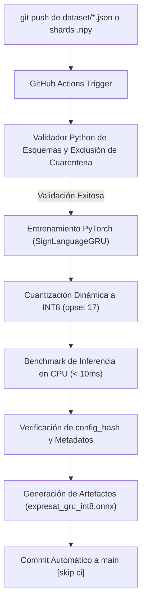

# Fase 5: Serialización JSON, Sharding e Integración CI/CD

> **Navegación:** [[../../00_INDICE_MAESTRO|🏠 Índice Maestro]] > [[Cpp_Generator|🛠️ Dataset Generator]] > **Fase 5: Serialización y CI/CD**

---

## 1. Formato y Esquema de Salida (`./dataset/<label>.json`)

Los datos generados por la herramienta legacy se guardan en archivos JSON estructurados con **`nlohmann/json`**:

```json
{
  "label": "hola",
  "num_samples": 500,
  "sequence_length": 15,
  "feature_dim": 178,
  "feature_spec_version": "1.3.0",
  "data": [
    [
      [0.0124, -0.0451, 0.0032, 0.99, "... 178 floats"], // Frame 1
      [0.0118, -0.0442, 0.0029, 0.98, "... 178 floats"]  // Frame 2
      // ... 15 fotogramas
    ]
    // ... repetido num_samples veces
  ]
}
```

### Campos del Esquema

| Campo | Tipo | Descripción |
|---|---|---|
| `label` | `string` | Identificador de la seña (ej. `"hola"`, `"gracias"`). |
| `num_samples` | `integer` | Número total de secuencias contenidas en el archivo. |
| `sequence_length` | `integer` | Cantidad de fotogramas continuos por secuencia (exactamente 15). |
| `feature_dim` | `integer` | Dimensionalidad de cada fotograma (178 para Pose Superior + Dos Manos). |
| `feature_spec_version` | `string` | Versión canónica del contrato técnico (`"1.3.0"`). |
| `data` | `float[][][]` | Tensor 3D con forma $(\text{muestras}, \text{frames}, \text{features})$. |

---

## 2. El Escritor de Datasets (`DatasetWriter`)

La clase `DatasetWriter` (`src/dataset_writer.h` y `src/dataset_writer.cpp`) gestiona dos modos de persistencia en disco:
1. **Escritura Individual por Etiqueta (`write`)**: Crea o sobreescribe `./dataset/<label>.json`.
2. **Fusión Agregada (`writeCombined`)**: Lee automáticamente todos los archivos JSON del directorio `./dataset/` (excluyendo estrictamente `dataset/quarantine/`) y genera un archivo unificado `./dataset/dataset.json`.

---

## 3. Pipeline de Integración Continua (GitHub Actions)

El archivo `.github/workflows/train_model.yml` implementa el flujo de **MLOps automatizado**:



### Fases del Flujo de Trabajo en GitHub Actions
1. **Disparador Condicional:** Se activa ante cambios en datasets de señas o bajo demanda manual (`workflow_dispatch`).
2. **Validación de Integridad y Filtro de Cuarentena:**
   - Comprueba la dimensión `feature_dim == 178` y `sequence_length == 15`.
   - **Regla Inmutable:** El script descarta activamente cualquier archivo dentro de `dataset/quarantine/` (ej. `letra_a_derecha_2.json`).
3. **Entrenamiento y Cuantización:**
   ```bash
   python expresat/models/train_and_export.py \
     --epochs 50 \
     --output ./exported_model \
     --labels $LABELS
   ```
4. **Verificación ONNX Runtime (Sanity Check):** Evalúa un tensor de prueba comprobando que la latencia en CPU sea menor a 10 ms.
5. **Publicación y Despliegue:** Se publican los artefactos finales (`expresat_gru_int8.onnx` y `model_metadata.json`) con 30 días de retención en GitHub Actions.
