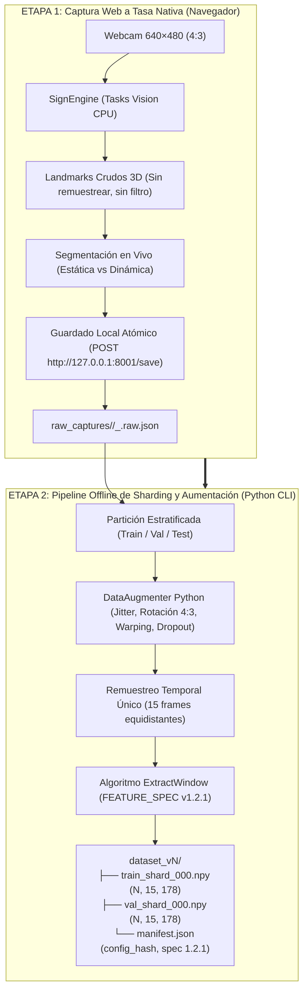

# 🚀 Dataset Generator v2: Arquitectura Desacoplada en Dos Etapas

> **Navegación:** [[../../00_INDICE_MAESTRO|🏠 Índice Maestro]] > [[Cpp_Generator|🛠️ Dataset Generator]] > **Dataset Generator v2**

---

## 1. Motivación y Rediseño Arquitectónico

La herramienta legacy en C++ (`expresat-dataset-generator` v1) presentaba limitaciones operativas:
1. El compilado con stub extractor generó datos distorsionados (caso de estudio: `dataset/quarantine/letra_a_derecha_2.json`).
2. La sincronización de modelos MediaPipe en C++ con dependencias de terceros requería compilaciones complejas en cada máquina.
3. El formato de persistencia en múltiples archivos JSON individuales ralentizaba la lectura en el entrenamiento y no escalaba eficientemente.

El **Plan v2.2.1** desacopla completamente el sistema en dos fases independientes y especializadas:

---

## 2. Etapa 1: Captura Web en Tiempo Real

- **Entorno:** Navegador web moderno (Firefox / Chromium).
- **Motor de Visión:** Importa directamente `SignEngine` desde `expresat/frontend/src/engine/signEngine.js` (`@mediapipe/tasks-vision` 1.0.1 en CPU, modo `VIDEO`).
- **Flags de Detección:**
  - `smoothLandmarks: false`: Emisión de landmarks crudos sin interpolaciones ni retrasos artificiales.
  - Resolución fija de cámara: **$640 \times 480$** (Aspect Ratio 4:3 verificado en vivo).
- **Modos Declarativos de Captura:**
  - **Modo `"estatica"` (Letras, números):** Segmentación centrada en la meseta de estabilidad cinemática ($\ge 600 \text{ ms}$, varianza articular $< 0.35 \text{ palmScale}/\text{s}$).
  - **Modo `"dinamica"` (Señas con trayectoria, frases):** Segmentación centrada en el pico de energía cinética (desplazamiento articular $\ge 0.15 \cdot D$).
- **Persistencia Segura:** Envío local a `http://127.0.0.1:8001/save` que valida el token de sesión, cabecera `Origin` y realiza una escritura atómica (`.tmp` $\to$ `.raw.json`).

---

## 3. Etapa 2: Pipeline Offline en Python (Streaming con NumPy)

Operado mediante una CLI headless en Python:
1. **Aumentación Estocástica sobre Landmarks Crudos a Tasa Nativa:**
   - Jitter gaussiano adaptativo a la escala de la palma (`palmScale`).
   - Rotación rígida 2D en plano $XY$ con compensación de relación de aspecto 4:3 ($x_{iso} = x \cdot A, y_{iso} = y$).
   - Variación de velocidad temporal (remuestreo estocástico entre $0.85\times$ y $1.15\times$).
   - Desplazamientos temporales de inicio ($\pm 100 \text{ ms}$).
   - `HAND_DROPOUT_FRAME`: Pérdida simulada de 1 mano en 1 frame aislado.
   - `FULL_FRAME_DROPOUT`: Brecha temporal acotada $\le 100 \text{ ms}$.
   - Espejo bilateral horizontal con intercambio estricto de `categoryName` ('Left' $\leftrightarrow$ 'Right').
2. **Un Único Remuestreo Temporal:** Conversión a 15 frames exactos ($\Delta t = 66.67 \text{ ms}$).
3. **Normalización Canónica v1.2.1:**
   - Cálculo de $C_{\text{ventana}}$ y $D_{\text{ventana}}$ (medianas de los 15 frames).
   - Rechazo si $D_{\text{ventana}} < 0.08$.
   - Filtro EMA ($\alpha = 0.50$).
   - Asignación conjunta de manos por coste mínimo a $P_{15}/P_{16}$.
   - Normalización 3D: Pose relativa al centro de hombros, manos con $Z$ relativo a muñeca.
4. **Serialización en Shards Binarios Contiguos:**
   - Guardado en archivos binarios `train_shard_*.npy` y `val_shard_*.npy` con tensores `(N, 15, 178)` en `float32`.
   - Generación de `manifest.json` con `feature_spec_version = "1.2.1"`, semilla estocástica, `config_hash` y metadatos de estratificación.

---

## 4. Cuarentena de Datasets Previos

| Dataset | Estado | Causa | Acción |
|---|---|---|---|
| `letra_a_derecha_2.json` | **Cuarentena** | Generación sintética senoidal sin normalización inter-humeral ($D \approx 0.0459$) y visibilidad desbordada a 1.0201. | Aislado en `dataset/quarantine/`. No usar en entrenamiento. |
| Nuevas tomas generadas con v2 | **Válido (Spec 1.2.1)** | Generación con captura real 4:3, paridad determinista $10^{-6}$ y `manifest.json` verificado. | Aceptado por `InferenceEngine` y `train_and_export.py`. |

---

## 🤖 Asignación de Agentes y Skills

- **Para Modificaciones del Pipeline Offline:** Activar **`data-engineering-data-pipeline`** y **`mlops-engineer`** (ver [[../../Skills/MachineLearning_y_Vision]]).
- **Para la Interfaz Web de Captura:** Activar **`react-modernization`** (ver [[../../Skills/UI_UX_y_Frontend]]).
- **Para la Especificación Matemática:** Consultar [[../../Especificacion_Feature_Spec_v1_2_1]].
