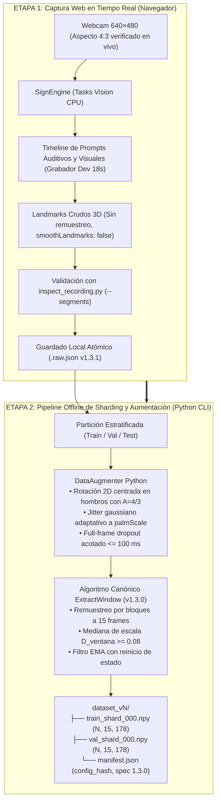

# 🚀 Dataset Generator v2: Arquitectura Desacoplada en Dos Etapas (PLAN v2.3.0)

> **Navegación:** [[../../00_INDICE_MAESTRO|🏠 Índice Maestro]] > [[Cpp_Generator|🛠️ Dataset Generator]] > **Dataset Generator v2**

---

## 1. Motivación y Rediseño Arquitectónico

La herramienta legacy en C++ (`expresat-dataset-generator` v1) presentaba limitaciones operativas:
1. El compilado con stub extractor generó datos senoidales distorsionados (`dataset/quarantine/letra_a_derecha_2.json`).
2. La sincronización de modelos MediaPipe en C++ con dependencias de terceros requería complejas compilaciones específicas por máquina.
3. El formato de persistencia en múltiples archivos JSON individuales ralentizaba la lectura en el entrenamiento masivo.

El **PLAN v2.3.0** desacopla completamente el sistema en dos fases independientes y especializadas:



---

## 2. Etapa 1: Captura Web a Tasa Nativa y Grabador de Desarrollo (18s)

- **Entorno:** Navegador web moderno (Firefox / Chromium).
- **Motor de Visión:** `SignEngine` (`@mediapipe/tasks-vision` 1.0.1 en CPU, `runningMode: 'VIDEO'`, `delegate: 'CPU'`).
- **Flags de Detección:**
  - `smoothLandmarks: false`: Emisión de landmarks crudos sin interpolaciones ni retrasos artificiales.
  - Resolución fija: **$640 \times 480$** (Aspect Ratio 4:3 verificado en vivo; desvío $> 5\% \implies$ `ERR_INVALID_ASPECT_RATIO`).
- **Grabador de Desarrollo (18 segundos):**  
  Implementa una secuencia guiada con timeline auditivo (`AudioContext` beeps) y visual para calibración de señas:
  - Segundos 0–3: `reposo` (postura base neutra sin señas).
  - Segundos 3–6: `solo_derecha` (seña con mano derecha física activa).
  - Segundos 6–9: `solo_izquierda` (seña con mano izquierda física activa).
  - Segundos 9–13: `ambas` (seña bimanual simétrica).
  - Segundos 13–18: `cruce` (seña bimanual con cruce sobre el pecho).
- **Métricas de Intervalo en Manifiesto:**
  Cada toma genera métricas de jitter temporal: `p50_ms`, `p95_ms`, `max_ms`, `gaps_over_100ms_count`. Si se detecta un gap $> 100\text{ ms}$, la toma se descarta con `ERR_INVALID_FRAME_GAP_TOO_LARGE`.

---

## 3. Etapa 2: Pipeline Offline en Python (Streaming con NumPy)

Operado mediante una CLI headless en Python:

### A. Aumentación Estocástica sobre Landmarks Crudos a Tasa Nativa
1. **Rotación Rígida 2D con Aspect Ratio Corregido ($A = 4/3$):**  
   Rotación alrededor del **centroide de los hombros** $C = (C_x, C_y)$:
   $$x_{\text{rel}} = (x - C_x) \times A, \quad y_{\text{rel}} = y - C_y$$
   $$x_{\text{rot}} = x_{\text{rel}} \cos\theta - y_{\text{rel}} \sin\theta, \quad y_{\text{rot}} = x_{\text{rel}} \sin\theta + y_{\text{rel}} \cos\theta$$
   $$x' = C_x + \frac{x_{\text{rot}}}{A}, \quad y' = C_y + y_{\text{rot}}$$
2. **Jitter Gaussiano Adaptativo:** Escalado por el factor `palmScale` de la mano para que el temblor sintético sea anatómicamente proporcional.
3. **Dropout Controlado:** Simulación de oclusiones temporales breves ($\le 100\text{ ms}$) o pérdida de un fotograma en una mano (`HAND_DROPOUT_FRAME`).
4. **Espejo Bilateral Horizontal:** $x \to 1.0 - x$, inversión de landmarks bilaterales de pose e intercambio de `categoryName` (`'Left'` $\leftrightarrow$ `'Right'`).

### B. Secuencia por Bloques Canónica `ExtractWindow` (v1.3.0)
1. **Validación Previa:** $P_{11}, P_{12}$ presentes con visibilidad $\ge 0.40$ y dentro de $[0, 1]$.
2. **Asignación Anatómica de Manos:** Matriz de costes con término espacial, término de etiqueta ($0.25 \cdot D$) y continuidad temporal ($0.50 \cdot dist$).
3. **Remuestreo Temporal por Bloque:** Interpolación lineal independiente para pose y manos hasta 15 frames exactos ($\Delta t = 66.67\text{ ms}$).
4. **Escala y Centro por Mediana:** $D_{\text{ventana}} = \text{mediana}(D_0 \dots D_{14}) \ge 0.08$.
5. **Filtro EMA Temporal ($\alpha = 0.50$):** Suavizado con reinicio de estado al reaparecer una mano.
6. **Ensamble:** Generación del tensor `(1, 15, 178)` en `float32`.

### C. Serialización en Shards Binarios Contiguos
- Guardado en archivos binarios `train_shard_*.npy` y `val_shard_*.npy`.
- Generación de `manifest.json` con `feature_spec_version = "1.3.0"`, `config_hash`, semilla aleatoria y metadatos de particionado.

---

## 4. Cuarentena de Datasets Previos

| Dataset | Estado | Causa Raíz | Acción Inmutable |
|---|---|---|---|
| `letra_a_derecha_2.json` | **Cuarentena** | Generación sintética senoidal sin división inter-humeral ($D \approx 0.0459$) y visibilidad desbordada a 1.0201. | Aislado en `dataset/quarantine/`. Prohibido en entrenamiento. |
| Nuevas tomas generadas con v2 | **Válido (Spec 1.3.0)** | Captura web real 4:3, paridad determinista $L_\infty \le 10^{-6}$ y `manifest.json` verificado. | Aceptado por `InferenceEngine` y `train_and_export.py`. |

---

## 🤖 Guía de Operación para Agentes de Datos y MLOps

1. **Auditar grabaciones crudas:**
   ```bash
   python expresat-dataset-generator/scripts/inspect_recording.py \
     --input raw_captures/session_01/hola_001.raw.json \
     --segments reposo,solo_derecha,solo_izquierda,ambas,cruce
   ```
2. **Validar estadísticas generales:**
   ```bash
   python expresat-dataset-generator/scripts/dataset_stats.py
   ```
3. **Validar que ningún pipeline lea archivos en `dataset/quarantine/`.**
