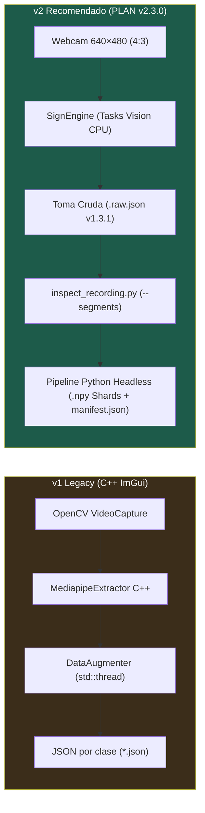

# 🛠️ Generador de Datasets (`expresat-dataset-generator`)

> **Navegación:** [[../../00_INDICE_MAESTRO|🏠 Índice Maestro]] > **Explicación del Código** > **Generador de Datasets**

---

## 1. Visión General y Evolución de Arquitectura

El ecosistema de generación y curaduría de datos para **ExpresaT** ha evolucionado a través de dos etapas arquitectónicas:

1. **Generador Nativo C++17 (v1 Legacy):** Aplicación de escritorio desarrollada con **Dear ImGui**, **OpenGL 3.3 / GLFW** y **OpenCV**, con motor multihilo de aumentación estocástica (`DataAugmenter`).
2. **Dataset Generator v2 (PLAN v2.3.0 Vigente):** Arquitectura desacoplada en dos etapas:
   - **Etapa 1 (Captura Web):** Grabador de desarrollo en navegador a 640×480 (4:3) con `SignEngine` (Tasks Vision CPU, `smoothLandmarks: false`), timeline de prompts sonoros/visuales y persistencia atómica en archivos `.raw.json`.
   - **Etapa 2 (Pipeline Offline en Python):** CLI headless que realiza aumentación sobre puntos crudos (rotación centrada en hombros con $A=4/3$, jitter adaptativo), remuestreo temporal a 15 frames con el algoritmo `ExtractWindow` v1.3.0 y serialización en shards binarios contiguos `.npy` acompañados de `manifest.json`.



> [!CAUTION] Alerta de Cuarentena Obligatoria
> El archivo `dataset/quarantine/letra_a_derecha_2.json` fue aislado tras confirmarse que fue producido con el generador v1 en modo STUB senoidal con un bug de escala que omitió la división por la distancia inter-humeral ($D \approx 0.0459$). Todos los nuevos modelos deben entrenarse con datasets conformes a [[../../Especificacion_Feature_Spec_v1_3_0|FEATURE_SPEC v1.3.0]].

---

## 2. Herramientas CLI Disponibles (`expresat-dataset-generator/scripts/`)

| Script | Propósito Técnico | Comando de Ejemplo |
|---|---|---|
| **`inspect_recording.py`** | Validador exhaustivo de tomas `.raw.json`, verificación de gaps $\le 100\text{ ms}$, métricas de FPS y análisis por segmentos anatómicos (`reposo`, `solo_derecha`, `solo_izquierda`, `ambas`, `cruce`). | `python expresat-dataset-generator/scripts/inspect_recording.py --input raw.json --segments reposo,solo_derecha,solo_izquierda,ambas,cruce` |
| **`inspect_dataset.py`** | Inspección no invasiva de datasets `.json` sin cargar millones de tokens en memoria (solo cabeceras, número de muestras y dimensiones). | `python expresat-dataset-generator/scripts/inspect_dataset.py --file dataset/hola.json` |
| **`validate_dataset.py`** | Validador estricto de esquemas de datos vectoriales 178D y detección de valores fuera de rango o NaN. | `python expresat-dataset-generator/scripts/validate_dataset.py --strict` |
| **`dataset_stats.py`** | Generador de reportes estadísticos de balanceo de clases y distribución de muestras. | `python expresat-dataset-generator/scripts/dataset_stats.py` |

---

## 3. Módulos Técnicos Detallados

1. **[[06_Arquitectura_Dataset_Generator_v2]]**: Nueva arquitectura desacoplada en dos etapas (PLAN v2.3.0).
2. **[[01_Arquitectura_y_Compilacion]]**: Sistema CMake 3.20+, C++17, dependencias vendored/FetchContent y scripts de build.
3. **[[02_Extraccion_y_Normalizacion]]**: Layout del vector plano 178D, evolución matemática y cuarentena.
4. **[[03_Motor_Aumentacion_Sintetica]]**: Motor estocástico en `std::thread`, transformaciones espaciales y temporales.
5. **[[04_Interfaz_Grafica_ImGui]]**: Dear ImGui + GLFW3 + OpenGL 3.3, subprocesos desacoplados (`CameraStream` y worker).
6. **[[05_Serializacion_JSON_y_CICD]]**: Esquema JSON por etiqueta y pipeline de GitHub Actions.

---

## 🤖 Guía de Operación para Agentes

- **Para Validar Tomas Crudas Nuevas:**
  ```bash
  python expresat-dataset-generator/scripts/inspect_recording.py --input <archivo.raw.json> --segments reposo,solo_derecha,solo_izquierda,ambas,cruce
  ```
- **Prohibido realizar `read_file` sobre archivos `dataset/*.json` de tensores completos.** Usar siempre `inspect_dataset.py`.
