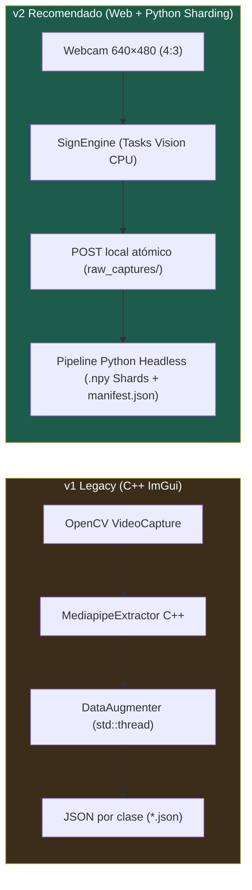

# 🛠️ Generador de Datasets (`expresat-dataset-generator`)

> **Navegación:** [[../../00_INDICE_MAESTRO|🏠 Índice Maestro]] > **Explicación del Código** > **Generador de Datasets**

---

## 1. Visión General y Evolución

El ecosistema de generación y síntesis de secuencias para **ExpresaT** ha evolucionado en dos etapas clave:

1. **Generador Nativo C++17 (v1 Legacy):** Aplicación de escritorio desarrollada con **Dear ImGui**, **OpenGL 3.3 / GLFW** y **OpenCV 4/5**, con motor multihilo de aumentación estocástica (`std::thread`).
2. **Dataset Generator v2 (Plan v2.2.1):** Arquitectura desacoplada en dos etapas: captura web a tasa nativa con `SignEngine` (Tasks Vision CPU, 640×480 4:3, `smoothLandmarks: false`) y pipeline offline headless en Python con particionado estratificado, aumentación sobre puntos crudos y guardado en shards binarios `.npy` contiguos con `manifest.json`.

> [!CAUTION] Alerta de Cuarentena
> El archivo `dataset/quarantine/letra_a_derecha_2.json` fue aislado tras detectarse que fue producido con el generador v1 en modo STUB senoidal con un bug de escala que omitió la división por hombros ($D$). Todos los nuevos modelos deben entrenarse con datasets conformes a [[../../Especificacion_Feature_Spec_v1_2_1|FEATURE_SPEC v1.2.1]].

---

## 2. Módulos Técnicos Detallados

La documentación técnica detallada está dividida en las siguientes guías modulares:

1. **[[06_Arquitectura_Dataset_Generator_v2]]**: Nueva arquitectura desacoplada en dos etapas (Captura Web Tasks Vision + Pipeline Offline Python NPY sharding).
2. **[[01_Arquitectura_y_Compilacion]]**: Sistema de compilación CMake 3.20+, C++17, dependencias vendored/FetchContent, scripts de automatización (`build.sh`, `setup_third_party.sh`).
3. **[[02_Extraccion_y_Normalizacion]]**: Layout del vector plano de 178D, evolución matemática de normalización y comparativa histórica.
4. **[[03_Motor_Aumentacion_Sintetica]]**: Motor estocástico en `std::thread`, transformaciones espaciales (Jitter, Escalado, Rotación) y temporales (Warping).
5. **[[04_Interfaz_Grafica_ImGui]]**: Arquitectura de Dear ImGui + GLFW3 + OpenGL 3.3, subprocesos desacoplados (`CameraStream` y worker de generación).
6. **[[05_Serializacion_JSON_y_CICD]]**: Estructura JSON por etiqueta (`./dataset/<label>.json`), archivo compilado `dataset.json`, y pipeline de integración continua en GitHub Actions.

---

## 🤖 Asignación de Agentes y Skills Recomendadas

- **Para el Pipeline Moderno v2:** Consultar [[06_Arquitectura_Dataset_Generator_v2]] e invocar **`data-engineering-data-pipeline`** y **`mlops-engineer`**.
- **Para Compilación y Mantenimiento C++ v1:** Invocar **`cpp-pro`** (ver [[../../Skills/Backend_APIs_y_Sistemas]]).
- **Para la Especificación Matemática:** Consultar [[../../Especificacion_Feature_Spec_v1_2_1]].
