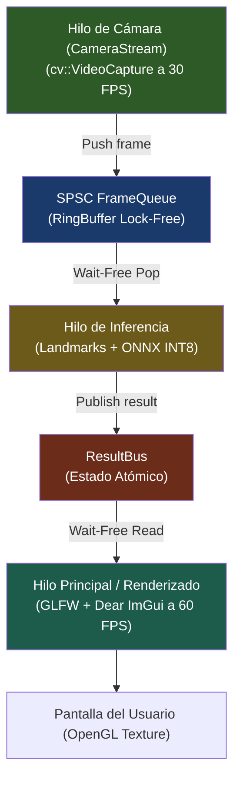

# 🖥️ Explicación del Código: Frontend Nativo Multiplataforma (C++ / ImGui / Android)

> **Navegación:** [[../00_INDICE_MAESTRO|🏠 Índice Maestro]] > **Explicación del Código** > **Frontend Nativo**

---

## 1. Propósito General y Arquitectura

El frontend de **ExpresaT** cuenta con una vertiente de ultra-bajo retraso implementada como una **aplicación nativa en C++17**. Esta solución prescinde del intermediario del navegador web y de la conexión de red WebSocket, ejecutando la captura de video y la inferencia ONNX en el mismo proceso para alcanzar latencias de inferencia de tan solo ~2 ms con cero retardo de transporte.

### Pila Tecnológica:
- **Escritorio (Linux / Windows):** C++17, [Dear ImGui](https://github.com/ocornut/imgui) (v1.90), GLFW 3.4, OpenGL 3.3 Core Profile.
- **Móvil (Android):** C++ NDK, JNI (Java Native Interface), Android CameraX / SurfaceView.
- **Captura de Video:** OpenCV (`cv::VideoCapture`).

---

## 2. Organización de Archivos en el Repositorio

El código fuente de esta variante reside en `expresat-native/`:

```text
expresat-native/
├── desktop/                      # Target de escritorio (Windows / Linux)
│   ├── main.cpp                  # Punto de entrada, ventana GLFW y loop ImGui a 60 FPS
│   └── CMakeLists.txt            # Reglas de construcción para la app de escritorio
├── android/                      # Target móvil para Android
│   ├── app/build.gradle          # Configuración de compilación con Gradle y NDK
│   └── app/src/main/
│       ├── cpp/android_main.cpp  # Puente JNI con el motor nativo de inferencia
│       └── java/.../MainActivity.java # Interfaz y ciclo de vida en Android
└── core/                         # Motor común compartido (InferenceThread, FrameQueue, ResultBus)
```

---

## 3. Concurrencia entre Hilos y Renderizado



### Subida a Textura OpenGL y Bucle Principal
1. **Hilo de Cámara (`CameraStream`):** Extrae continuamente frames de la webcam en formato BGR mediante `cv::VideoCapture`, los convierte a RGB y los coloca de forma lock-free en `uploadFrame_`.
2. **Subida a GPU:** En el hilo principal de renderizado, si hay un nuevo frame (`frameSeq_ != lastUploadSeq_`), se actualiza la memoria de la GPU mediante `glTexImage2D`:
   ```cpp
   glBindTexture(GL_TEXTURE_2D, camTexId_);
   glTexImage2D(GL_TEXTURE_2D, 0, GL_RGB,
                rgb.cols, rgb.rows, 0,
                GL_RGB, GL_UNSIGNED_BYTE, rgb.data);
   glBindTexture(GL_TEXTURE_2D, 0);
   ```
3. **Renderizado ImGui:** Se dibuja la imagen centrada preservando el aspect ratio 4:3 con `ImGui::Image`.

---

## 4. Integración Móvil en Android (JNI)

En Android, la capa visual aprovecha las vistas nativas del sistema operativo, mientras que el procesamiento de visión e inferencia ONNX se delega a las bibliotecas compartidas C++ (`.so`) compiladas mediante el **Android NDK** a través de `android_main.cpp`.

---

## 🤖 Guía de Operación para Agentes C++

- **Para Compilar y Probar en Escritorio:**
  ```bash
  cd expresat-native
  cmake -B build -DCMAKE_BUILD_TYPE=Release
  cmake --build build -j$(nproc)
  ./build/desktop/expresat-desktop
  ```
- **Verificar Ausencia de Raw Pointers:** Aplicar siempre patrones de la skill `memory-safety-patterns`.
