# ⚛️ Explicación del Código: Frontend Web Moderno (React 19 + Vite)

> **Navegación:** [[../../00_INDICE_MAESTRO|🏠 Índice Maestro]] > **Explicación del Código** > **Frontend** > **Vite + React**

El frontend de producción de **ExpresaT** (`expresat/frontend`) está construido con **React 19.2** y empaquetado con **Vite 8.1**, ofreciendo una interfaz ultra-rápida, completamente accesible (conforme a WCAG 2.2 nivel AA/AAA) y potenciada por un motor de visión local en JavaScript en el hilo principal.

---

## 1. Decisiones Arquitectónicas Clave y Prevención de Fallas Históricas

La arquitectura actual fue rediseñada para erradicar las **8 fallas históricas** documentadas en `docs/ARQUITECTURA.md`:

```mermaid
flowchart TD
    subgraph Antiguo_Problema ["Falla Histórica en Web Worker"]
        W1["mediapipe-worker.js (type: 'module')"] --> W2["vision_bundle.mjs invoca importScripts()"]
        W2 --> W3["TypeError: importScripts no permitido en ESM"]
        W3 --> W4["Fallback import() limpia self.ModuleFactory = void 0"]
        W4 --> W5["Crash: Error: ModuleFactory not set"]
    end

    subgraph Solucion_Actual ["Solución Actual: SignEngine en Main-Thread"]
        S1["SignEngine en Main Thread\n(@mediapipe/tasks-vision 1.0.1 CPU)"]
        S2["Binarios WASM locales servidos desde /wasm"]
        S3["HandLandmarker + PoseLandmarker Lite concurrentes"]
        S4["Limpieza idempotente: cleanup() y close() sin memory leaks"]
        S1 --> S2 --> S3 --> S4
    end

    style Antiguo_Problema fill:#6b1a2d,color:#fff
    style Solucion_Actual fill:#1d5b4a,color:#fff
```



### Características de `SignEngine` (`src/engine/signEngine.js`):
1. **Ejecución en CPU Directa:** Utiliza el delegado `'CPU'` con WebAssembly optimizado con SIMD/XNNPACK, evitando los cuellos de botella de transferencia de buffers de Web Workers.
2. **Cálculo de FPS Reales:** Mide la tasa efectiva de cuadros procesados por el motor de visión (`getFps()`), diferenciándola de la tasa de refresco del monitor (60 Hz).
3. **Emisión de Datos Crudos (`smoothLandmarks: false`):** Permite emitir coordenadas puras sin filtros artificiales para captura fiel de datasets.
4. **Limpieza Idempotente:** Los métodos `cleanup()` y `close()` liberan los grafos WASM y detienen los bucles de captura huérfanos.

---

## 2. Organización del Código Fuente (`expresat/frontend/src`)

```text
expresat/frontend/src/
├── engine/                           # Motor de visión e ingeniería de características
│   ├── signEngine.js                 # MediaPipe Tasks Vision CPU, ciclo de vida y FPS reales
│   ├── featureExtractor.js           # Extractor canónico 178D conforme a FEATURE_SPEC v1.3.0
│   ├── index.js                      # Punto de entrada unificado del módulo de visión
│   └── __tests__/                    # Tests unitarios en Vitest (paridad L_inf <= 10^-6)
│
├── recognition/                      # Clasificación geométrica offline en cliente
│   ├── geometry.js                   # Cálculo de distancias articulares, ángulos y palmScale
│   ├── classifier.js                 # Lógica de clasificación estática y ventana de votación
│   └── syntheticHand.js              # Fixtures de manos sintéticas para pruebas unitarias
│
├── transport/                        # Capa de red y sincronización WebSocket
│   ├── wsClient.js                   # Máquina de estados finitos y reconexión exponencial
│   └── __tests__/                    # Tests de resiliencia y reconexión de socket
│
├── ui/                               # Componentes de presentación y renderizado
│   ├── useSignEngine.js              # Custom Hook que enlaza cámara, canvas e inferencia
│   └── drawLandmarks.js              # Dibujado acelerado en Canvas 2D de manos y torso
│
├── pages/                            # Vistas principales de la aplicación
│   ├── Translator.jsx                # Interfaz principal de traducción interactiva
│   ├── Home.jsx                      # Landing page con propuesta de valor y accesibilidad
│   ├── Auth.jsx                      # Formulario de inicio de sesión Supabase Auth
│   ├── Learn.jsx                     # Módulo interactivo de aprendizaje de lengua de señas
│   └── About.jsx                     # Misión del proyecto, equipo y tecnología
│
├── components/                       # Componentes reutilizables (Navbar, Footer, ThemeToggle)
└── services/                         # Servicios auxiliares (authService.js)
```

---

## 3. Fragmentos Clave de Implementación

### A. Hook Coordinador `useSignEngine` (`src/ui/useSignEngine.js`)
Enlaza el elemento `<video>` del DOM, el `<canvas>` superpuesto para los landmarks y el despachador de inferencia:

```jsx
import { useEffect, useRef, useState } from 'react';
import { SignEngine } from '../engine/signEngine';
import { drawLandmarks } from './drawLandmarks';

export function useSignEngine({ onFrame, onPrediction }) {
    const videoRef = useRef(null);
    const canvasRef = useRef(null);
    const engineRef = useRef(null);
    const [fps, setFps] = useState(0);

    useEffect(() => {
        let isMounted = true;
        const engine = new SignEngine({
            delegate: 'CPU',
            onResults: (results, framePayload) => {
                if (!isMounted) return;
                setFps(engine.getFps());
                if (canvasRef.current) {
                    drawLandmarks(canvasRef.current, results);
                }
                if (onFrame) onFrame(framePayload);
            }
        });
        engineRef.current = engine;
        engine.init().then(() => {
            if (isMounted && videoRef.current) {
                engine.start(videoRef.current);
            }
        });

        return () => {
            isMounted = false;
            engine.cleanup();
        };
    }, []);

    return { videoRef, canvasRef, fps };
}
```

### B. Extractor Canónico 178D (`src/engine/featureExtractor.js`)
Garantiza invarianza estricta de traslación 3D conforme a [[../../Especificacion_Feature_Spec_v1_3_0|FEATURE_SPEC v1.3.0]]:

```javascript
export function extract178D(pose, leftHand, rightHand) {
    if (!pose || pose.length < 23) {
        return { valid: false, error: 'ERR_POSE_MISSING' };
    }
    const ls = pose[11], rs = pose[12];
    if (ls.visibility < 0.40 || rs.visibility < 0.40) {
        return { valid: false, error: 'ERR_SHOULDER_VISIBILITY' };
    }

    const cx = (ls.x + rs.x) * 0.5;
    const cy = (ls.y + rs.y) * 0.5;
    const cz = (ls.z + rs.z) * 0.5;
    const D = Math.hypot(ls.x - rs.x, ls.y - rs.y, ls.z - rs.z);

    if (D < 0.08) {
        return { valid: false, error: 'ERR_SHOULDERS_TOO_SMALL' };
    }

    const features = new Float32Array(178);
    // [0..51] Upper Pose normalizado relativo a C y escalado por D
    // [52..114] Mano Izquierda: (x-cx)/D, (y-cy)/D, (z-z_wrist)/D
    // [115..177] Mano Derecha: (x-cx)/D, (y-cy)/D, (z-z_wrist)/D
    // Si una mano es nula, permanece con ceros exactos (0.0f)
    return { valid: true, features };
}
```

---

## 4. Pruebas Automatizadas y Calidad de Código

El repositorio cuenta con compuertas automatizadas de verificación:

1. **Pruebas Unitarias de Paridad Matemática (Vitest):**
   ```bash
   cd expresat/frontend
   npx vitest run src/engine/__tests__/featureExtractor.test.js
   ```
   Valida que los vectores calculados en JavaScript coincidan elemento a elemento con los generados en Python bajo la norma $\|v_{\text{JS}} - v_{\text{Py}}\|_\infty \le 10^{-6}$.
2. **Pruebas de Red y WSClient:**
   ```bash
   npx vitest run src/transport/__tests__/wsClient.test.js
   ```
   Verifica transiciones de estado, reconexión exponencial y conmutación a modo demo.
3. **Pruebas End-to-End con Playwright:**
   ```bash
   npx playwright test e2e/translator.spec.js
   ```
   Simula cámara web en navegador headless con streams simulados de 640×480 a 4:3.

---

## 🤖 Guía de Operación para Agentes Frontend

- **Prohibido reintroducir Web Workers** para `@mediapipe/tasks-vision`.
- **Asegurar accesibilidad en cada cambio visual:** Verificar atributos `aria-live="polite"` en el contenedor de traducción y contraste cromático $\ge 4.5:1$.
- **Al modificar `featureExtractor.js`**, ejecutar inmediatamente `npx vitest run` y `pytest tests/test_feature_spec.py`.
