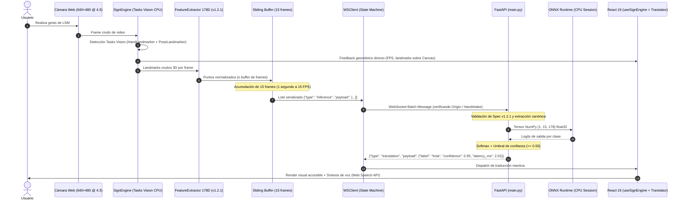

# 🔄 Flujo de Datos y Pipeline de Procesamiento — ExpresaT

> **Navegación:** [[00_INDICE_MAESTRO|🏠 Índice Maestro]] > **Flujo de Datos**

Este documento detalla el ciclo de vida completo de la información desde que el sensor óptico (cámara web) captura la escena hasta que la predicción textual y audible de la lengua de señas es desplegada en pantalla, siguiendo el contrato matemático de [[Especificacion_Feature_Spec_v1_2_1|FEATURE_SPEC v1.2.1]].

---

## 🛰️ Diagrama de Secuencia de Flujo de Datos (Arquitectura Web Moderna)

---

## ⚡ Pipeline Nativo Local (C++ / Edge In-Device)

En la variante **`expresat-native`**, el flujo de datos no atraviesa la red, garantizando latencias inferiores a **3 ms** y funcionamiento *offline-first*:

```mermaid
flowchart LR
    A["Cámara\n(cv::VideoCapture)"] -->|"cv::Mat crudo"| B["SPSC FrameQueue\n(Lock-Free RingBuffer)"]
    B -->|"Wait-Free Pop"| C["Inference Thread\n(MediaPipe Tasks C++)"]
    C -->|"178D Landmarks"| D["normalize_to_shoulders\n(FEATURE_SPEC v1.2.1)"]
    D -->|"Tensor [1, 15, 178]"| E["ONNX Runtime C++\n(expresat_gru_int8.onnx)"]
    E -->|"Softmax & Top-5"| F["ResultBus\n(Atomic State)"]
    F -->|"Lectura asíncrona"| G["Dear ImGui / OpenGL\n(Render Loop 60 FPS)"]

    style A fill:#2d5a27,color:#fff
    style B fill:#1a3a6b,color:#fff
    style C fill:#6b5a1a,color:#fff
    style D fill:#6b2d1a,color:#fff
    style E fill:#4a2d6b,color:#fff
    style F fill:#2b4a6b,color:#fff
    style G fill:#1d5b4a,color:#fff
```

---

## 📐 Topología Matemática del Vector de Características (178D)

Cada fotograma individual dentro de la secuencia temporal de 15 frames es procesado y normalizado para transformarse en un vector unidimensional de **178 componentes flotantes (`float32`)**:

| Región Anatómica | Puntos MediaPipe | Coordenadas por Punto | Total Características |
|---|---|---|---|
| **Upper Pose** | Índices `0` (nariz) y `11` a `22` (hombros, codos, muñecas, torso) | $x, y, z, \text{visibility}$ (4D) | $13 \times 4 =$ **52** |
| **Mano Izquierda** | Índices `0` a `20` (21 articulaciones completas) | $x, y, z$ (3D) | $21 \times 3 =$ **63** |
| **Mano Derecha** | Índices `0` a `20` (21 articulaciones completas) | $x, y, z$ (3D) | $21 \times 3 =$ **63** |
| **TOTAL POR FOTOGRAMA** | | | **178 dimensiones** |
| **SECUENCIA COMPLETA** | 15 fotogramas temporales concatenados | | $15 \times 178 =$ **2,670 flotantes** |

### Algoritmo Canónico de Normalización (FEATURE_SPEC v1.2.1)
Para garantizar invarianza ante distancia, traslación y ángulo:

1. **Centro de Hombros 3D ($C_{shoulder}$):**
   $$C_x = \frac{x_{11} + x_{12}}{2}, \quad C_y = \frac{y_{11} + y_{12}}{2}, \quad C_z = \frac{z_{11} + z_{12}}{2}$$

2. **Escala Inter-humeral 3D ($D$):**
   $$D = \sqrt{(x_{11} - x_{12})^2 + (y_{11} - y_{12})^2 + (z_{11} - z_{12})^2}$$
   - Condición de validez: $D \ge 0.08$ y $\text{vis}(P_{11,12}) \ge 0.40$. Si no se cumple, el fotograma se descarta.

3. **Upper Pose (`[0..51]`):**
   $$x' = \frac{x - C_x}{D}, \quad y' = \frac{y - C_y}{D}, \quad z' = \frac{z - C_z}{D}, \quad \text{vis}' = \text{clamp}(\text{vis}, 0.0, 1.0)$$

4. **Manos (`[52..114]` y `[115..177]`):**
   - En el plano $XY$, relativas al centro de hombros: $x' = (x_{\text{hand}} - C_x)/D, \; y' = (y_{\text{hand}} - C_y)/D$.
   - En el eje $Z$, **relativas a la propia muñeca de la mano** (Landmark 0):
     $$z'_i = \frac{z_{\text{hand}, i} - z_{\text{hand}, \text{wrist}}}{D}$$
   - Si una mano está ausente: **63 ceros exactos (`0.0f`)**.

---

## ⏱️ Presupuesto de Latencias (Latency Budget)

| Etapa | Plataforma Web (FastAPI + React 19) | Plataforma Nativa C++ (Desktop / Android) |
|---|---|---|
| Captura de Video | ~16 ms (Cámara nativa 60 FPS / 4:3) | ~16 ms (hilo independiente OpenCV) |
| Extracción MediaPipe | ~12–18 ms (`SignEngine` Tasks Vision CPU) | ~8–12 ms (MediaPipe C++ Tasks) |
| Normalización 178D | < 0.1 ms (`featureExtractor.js` / py) | < 0.05 ms (`normalize_to_shoulders`) |
| Transporte de Red (WebSocket) | ~30–60 ms (WSClient batch con backoff) | **0 ms** (Memoria compartida / SPSC) |
| Inferencia ONNX (INT8 CPU) | **2.02 ms** | **1.85 ms** |
| Post-procesado (Softmax/Filtro) | < 0.1 ms | < 0.05 ms |
| **Latencia Total de Respuesta** | **~60–95 ms** (Percepción instantánea humana) | **~10–18 ms** (Tiempo real estricto) |

---

## 🤖 Asignación de Agentes y Skills Recomendadas

- **Para Inferencia y Normalización:** Activar la skill **`ml-engineer`** y consultar [[Especificacion_Feature_Spec_v1_2_1]].
- **Para Concurrencia y Sockets:** Activar la skill **`fastapi-pro`** y **`async-python-patterns`** para verificar que el bucle asíncrono no se bloquee.
- **Para Lock-Free y C++:** Activar la skill **`cpp-pro`** y **`memory-safety-patterns`** para inspeccionar la integridad de `inference_thread.cpp` y `frame_queue.h`.
- **Para Coordinación de UI:** Consultar [[Explicacion del codigo/Frontend/Vite_React]].
