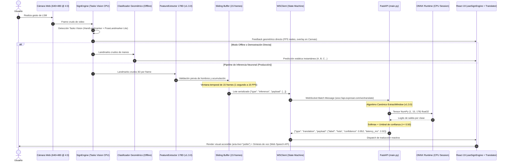
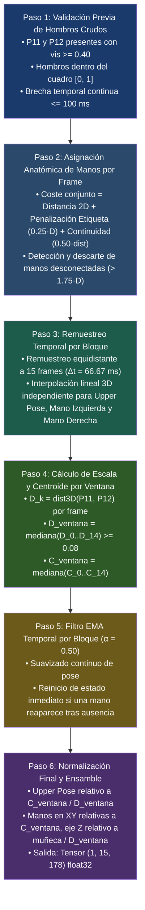

# 🔄 Flujo de Datos y Pipeline de Procesamiento Extremo a Extremo — ExpresaT

> **Navegación:** [[00_INDICE_MAESTRO|🏠 Índice Maestro]] > **Flujo de Datos**

Este documento detalla el ciclo de vida completo de la información desde que el sensor óptico (cámara web) captura la escena hasta que la predicción textual y audible de la lengua de señas es desplegada en pantalla, siguiendo el contrato canónico de [[Especificacion_Feature_Spec_v1_3_0|FEATURE_SPEC v1.3.0]].

---

## 🛰️ Diagrama de Secuencia Extremo a Extremo (Web Moderna)

---

## 📐 Algoritmo Canónico `ExtractWindow` (FEATURE_SPEC v1.3.0)

El procesamiento de secuencias temporales en el backend (`models/feature_extractor.py`) y en el pipeline offline v2 se ejecuta en **6 pasos inmutables por bloques anatómicos**:

---

## ⚡ Pipeline Nativo Local (C++ / Edge In-Device)

En la variante **`expresat-native`**, el diseño busca latencias inferiores a **3 ms** y funcionamiento *offline-first* mediante buffers circulares:

> [!WARNING] Estado de Conformidad C++ con FEATURE_SPEC v1.3.0
> El pipeline nativo C++ (`expresat-native/core/src/inference_thread.cpp`) actualmente **no implementa `ExtractWindow` con remuestreo por bloques y medianas de ventana**.
> Por diseño de seguridad, si `InferenceThread` detecta parámetros incompletos, rechaza activamente el frame emitiendo `ERR_CPP_NOT_CONFORMANT` o `ERR_SHOULDERS_TOO_SMALL`, evitando corromper la inferencia con ceros silenciosos.

---

## ⏱️ Presupuesto de Latencias (Latency Budget)

| Etapa del Pipeline | Plataforma Web (FastAPI + React 19) | Plataforma Nativa C++ (Desktop / Android) |
|---|---|---|
| Captura de Video | ~16 ms (Cámara nativa 60 FPS / 4:3) | ~16 ms (Hilo independiente OpenCV) |
| Extracción MediaPipe | ~12–18 ms (`SignEngine` Tasks Vision CPU) | ~8–12 ms (MediaPipe C++ Tasks) |
| Normalización Canónica 178D | < 0.15 ms (`featureExtractor.js` / py) | < 0.05 ms (`normalize_to_shoulders`) |
| Transporte de Red (WebSocket) | ~30–50 ms (WSClient batch wss://) | **0 ms** (Memoria compartida SPSC) |
| Inferencia ONNX (INT8 CPU) | **2.02 ms** | **1.85 ms** |
| Post-procesado (Softmax/Filtro) | < 0.1 ms | < 0.05 ms |
| **Latencia Total de Respuesta** | **~60–85 ms** (Percepción instantánea) | **~10–18 ms** (Tiempo real estricto) |

---

## 🤖 Asignación de Agentes y Skills Recomendadas

- **Para Inferencia y Normalización Canónica:** Activar la skill **`ml-engineer`** y consultar [[Especificacion_Feature_Spec_v1_3_0]].
- **Para Concurrencia y Sockets:** Activar la skill **`fastapi-pro`** y **`async-python-patterns`** para verificar que el bucle asíncrono no se bloquee.
- **Para Lock-Free y C++:** Activar la skill **`cpp-pro`** y **`memory-safety-patterns`** para inspeccionar la integridad de `inference_thread.cpp` y `frame_queue.h`.
- **Para Coordinación de UI:** Consultar [[Explicacion del codigo/Frontend/Vite_React]].
