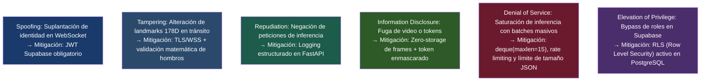

# 🛡️ Skills Especializadas: Auditoría, Seguridad y Calidad de Código

> **Navegación:** [[../00_INDICE_MAESTRO|🏠 Índice Maestro]] > [[00_Matriz_General_Skills|🧭 Matriz de Skills]] > **Auditoría, Seguridad y Calidad**

La naturaleza interactiva de **ExpresaT** (streaming de video por cámara, autenticación mediante JWT con Supabase, conexión bidireccional por WebSockets e inferencia en C++ y Python) exige rigurosos controles de seguridad, validación de entradas y revisiones de código sistemáticas.

---

## 🚨 Hallazgos Críticos de Seguridad (Informe Opencode) y Remediaciones

> [!CAUTION] Los 5 Hallazgos Críticos de AUDIT_OPENCODE_REPORT.md
> Todo agente que modifique el backend o la capa de transporte debe aplicar las siguientes soluciones obligatorias:

| # | Archivo y Línea | Problema / Riesgo | Remediación Obligatoria Implementada |
|---|---|---|---|
| **C1** | `backend/config.py` (L19) | `DEMO_MODE` por defecto en `true` enmascaraba el modelo de IA. | Tipado estricto `bool(os.getenv("EXPRESAT_DEMO_MODE", "false").lower() in ("true", "1", "yes"))`. En producción nunca arranca en demo por omisión. |
| **C2** | `backend/main.py` (L49, 269) | `verify_supabase_token` admitía tokens mock en entornos de producción. | En `ENVIRONMENT=production`, se rechazan tokens mock y se valida la firma criptográfica contra `supabase.auth.get_user(token)`. Si falla, cierra con código 1008. |
| **C3** | `backend/main.py` (L144) | CORS configurado con comodín universal `allow_origins=["*"]`. | Lista blanca estricta (`CORS_ORIGINS_DEFAULT`) parametrizable vía variable de entorno `CORS_ORIGINS`. |
| **C4** | `frontend/apiService.js` (L59) | Transmisión de token JWT en la URL de consulta (`?token=...`). | Pasar token prioritariamente en encabezados o cookies seguras. El backend enmascara la URL en los logs para evitar fugas en proxies. |
| **C5** | `backend/main.py` (L249) | `_mock_inference` usaba `random.choice` sin seed y sin alertar. | Se añadieron advertencias explícitas en logs (`[WARN] Model not loaded`) y retorno estructurado de errores con código `503 Service Unavailable`. |

---

## 🛠️ Catálogo de Skills Instaladas en este Dominio

### 1. `code-reviewer` & `code-review-excellence`
- **Ubicación:** 
  - `~/.gemini/config/skills/code-reviewer/SKILL.md`
  - `~/.gemini/config/skills/code-review-excellence/SKILL.md`
- **Objetivo:** Análisis profundo de Pull Requests y diffs. Evaluación de legibilidad, mantenibilidad, principios SOLID, cobertura de pruebas y detección de code smells.
- **Cuándo invocar:** Antes de fusionar cualquier cambio a ramas principales o tras refactorizar `InferenceEngine` o `ConnectionManager`.

### 2. `security-auditor` & `backend-security-coder`
- **Ubicación:**
  - `~/.gemini/config/skills/security-auditor/SKILL.md`
  - `~/.gemini/config/skills/backend-security-coder/SKILL.md`
- **Objetivo:** Identificación de vulnerabilidades en endpoints FastAPI, inyección en payloads JSON/WebSocket, validación de orígenes y mitigación de denegación de servicio (DoS).

### 3. `frontend-security-coder` & `frontend-mobile-security-xss-scan`
- **Ubicación:**
  - `~/.gemini/config/skills/frontend-security-coder/SKILL.md`
  - `~/.gemini/config/skills/frontend-mobile-security-xss-scan/SKILL.md`
- **Objetivo:** Protección contra XSS, manipulación indebida del DOM, saneamiento de etiquetas traducidas y aislamiento de claves privadas de Supabase (`service_role` vs `anon_key`).

### 4. `sast-configuration` & `secrets-management`
- **Ubicación:**
  - `~/.gemini/config/skills/sast-configuration/SKILL.md`
  - `~/.gemini/config/skills/secrets-management/SKILL.md`
- **Objetivo:** Configuración de herramientas estáticas de análisis (Bandit, ESLint, Oxlint, Cppcheck) y prevención de fugas de credenciales en `.env`.

---

## 🛡️ Matriz de Amenazas STRIDE para ExpresaT



---

## 📋 Lista de Verificación (Checklist) para Agentes de Auditoría

Al revisar o auditar cualquier componente de ExpresaT, verificar:
1. **Validación de Tamaño de Payloads:** Ningún mensaje de WebSocket entrante puede exceder los límites predefinidos (batch de 15 frames con 178 puntos flotantes).
2. **Desinfección de Salidas:** El campo `label` devuelto por el modelo debe sanearse antes de inyectarse en el DOM.
3. **Manejo Seguro de Memoria en C++:** Validar que `frame_queue.h` y `inference_thread.cpp` no presenten fugas de memoria, condiciones de carrera ni referencias colgantes.
4. **Comandos SAST de Verificación:**
   ```bash
   # Linter de frontend (React + Hooks):
   cd expresat/frontend && npm run lint

   # Linter y análisis estático en Python:
   flake8 expresat/backend/ tests/
   bandit -r expresat/backend/ -ll
   ```
