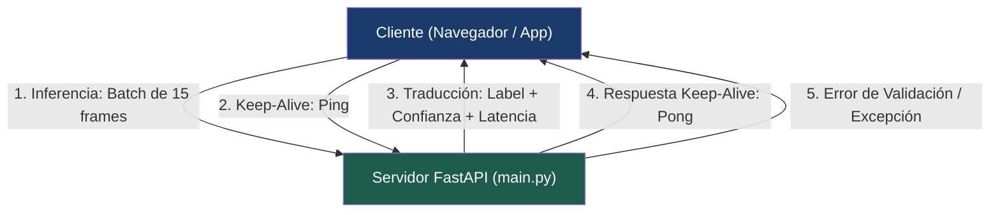
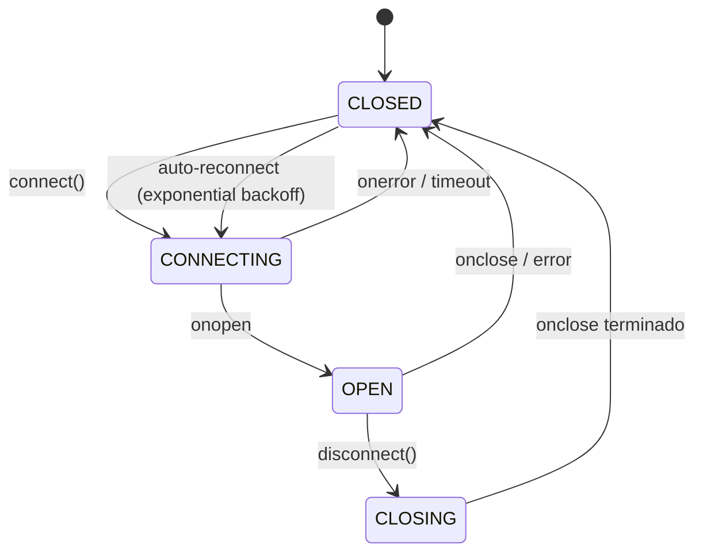

# 📡 Protocolo WebSocket y Streaming en Tiempo Real — ExpresaT

> **Navegación:** [[00_INDICE_MAESTRO|🏠 Índice Maestro]] > **Protocolo WebSocket**

La comunicación en tiempo real entre el cliente de captura (navegador web con React 19 o cliente nativo ligero) y el servidor de inferencia se realiza mediante el protocolo **WebSocket (RFC 6455)**, diseñado para minimizar la latencia de transporte y posibilitar un intercambio continuo de coordenadas corporales bajo estrictas salvaguardas de seguridad.

---

## 1. Puntos de Conexión (Endpoints)

| Endpoint | Estado | Protocolo | Descripción |
|---|---|---|---|
| `/ws/translate` | **Activo (Producción)** | `wss://` | Endpoint principal para inferencia en tiempo real. Admite modo por lotes (*Batch Mode* de 15 frames) y modo streaming clásico. |
| `/ws` | *Legacy (Compatibilidad)* | `wss://` | Redirecciona internamente hacia `/ws/translate` para soportar clientes anteriores. |

---

## 2. Autenticación y Mitigaciones de Seguridad (Auditoría Opencode)

> [!CAUTION] Mitigaciones Críticas de Seguridad
> En la auditoría de seguridad del repositorio (`AUDIT_OPENCODE_REPORT.md`), se identificaron vulnerabilidades críticas que deben respetarse en toda modificación del backend y frontend:

1. **Tokens en Query URL (Hallazgo C4):**  
   - *Riesgo:* Pasar el JWT como `?token=...` en la URL de conexión expone el token en logs de servidores proxy, balanceadores e historiales de navegador.  
   - *Mitigación:* Se implementa lectura del token prioritariamente desde cabeceras (`Authorization: Bearer <token>`) o cookies seguras (`HttpOnly`, `SameSite=Strict`, `Secure`). Si se recibe vía query-string por compatibilidad, el servidor enmascara la URL en los logs (`/ws/translate?token=***`).
2. **Validación Criptográfica Supabase JWT (Hallazgo C2):**  
   - En producción (`ENVIRONMENT=production`), la función `verify_supabase_token` valida la firma criptográfica del JWT contra el secreto de Supabase antes de autorizar el socket.  
   - Si el token es inválido o expiró, el servidor cierra la conexión con el código de error WebSocket **`1008 (Policy Violation)`** y un log de diagnóstico explícito.
3. **Control Estricto de Orígenes CORS (Hallazgo C3):**  
   - Prohibido `allow_origins=["*"]` en producción. Los orígenes deben definirse explícitamente mediante la variable de entorno `CORS_ORIGINS` (ej. `https://expresat.netlify.app,https://expresat.com`).
4. **Bandera de Modo Demostración Explícita (Hallazgo C1):**  
   - La variable `EXPRESAT_DEMO_MODE` debe evaluarse de forma booleana estricta: `os.getenv("EXPRESAT_DEMO_MODE", "false").lower() in ("true", "1", "yes")`. En producción, el servidor nunca arranca en modo demo por omisión.

---

## 3. Contratos de Mensajería y Esquemas JSON



### A. Mensajes del Cliente hacia el Servidor

#### 1. Modo por Lotes (Batch Mode — Canónico y Recomendado)
Envía un bloque temporal consolidado de 15 fotogramas contiguos (equivalente a 1 segundo de movimiento a 15 FPS):
```json
{
  "type": "inference",
  "payload": [
    {
      "pose": [
        {"x": 0.501, "y": 0.201, "z": -0.041, "visibility": 0.99},
        // ... 13 landmarks del torso superior (0, 11-22)
      ],
      "leftHand": [
        {"x": 0.450, "y": 0.600, "z": -0.020},
        // ... 21 articulaciones de la mano izquierda
      ],
      "rightHand": [
        {"x": 0.550, "y": 0.600, "z": -0.020}
        // ... 21 articulaciones de la mano derecha
      ]
    }
    // ... exactamente 15 fotogramas
  ]
}
```

#### 2. Modo Flujo Continuo (Stream Mode — Compatibilidad hacia atrás)
Envía un único fotograma por mensaje; el backend mantiene una cola circular por cliente:
```json
{
  "type": "inference",
  "payload": {
    "pose": [...],
    "leftHand": [...],
    "rightHand": [...]
  }
}
```

#### 3. Control Keep-Alive (Heartbeat Ping)
Para mantener la conexión viva ante proxies inversos:
```json
{
  "type": "ping"
}
```

---

### B. Mensajes del Servidor hacia el Cliente

#### 1. Resultado de Traducción (`translation`)
Emitido tras la inferencia si la confianza supera el umbral configurado (`confidence >= CONFIDENCE_THRESHOLD`, por defecto 0.50):
```json
{
  "type": "translation",
  "payload": {
    "label": "hola",
    "confidence": 0.952,
    "latency_ms": 2.02,
    "all_probabilities": {
      "hola": 0.952,
      "gracias": 0.031,
      "adios": 0.012,
      "por_favor": 0.003,
      "reposo": 0.002
    }
  }
}
```

#### 2. Respuesta de Control (`pong`)
```json
{
  "type": "pong"
}
```

#### 3. Mensaje de Error (`error`)
Emitido ante datos mal formados, distorsiones geométricas o violaciones de contrato:
```json
{
  "type": "error",
  "payload": {
    "code": "ERR_SHOULDERS_TOO_SMALL",
    "message": "Distancia inter-humeral inferior a 0.08. Ajuste su posición frente a la cámara."
  }
}
```

---

## 4. Implementación del Administrador de Conexiones (`ConnectionManager`)

En `expresat/backend/main.py`, la concurrencia está encapsulada en una clase con control de estado y offload no bloqueante:

```python
class ConnectionManager:
    def __init__(self):
        self.active_connections: list[WebSocket] = []

    async def connect(self, websocket: WebSocket):
        await websocket.accept()
        self.active_connections.append(websocket)

    def disconnect(self, websocket: WebSocket):
        if websocket in self.active_connections:
            self.active_connections.remove(websocket)

    async def send_personal_message(self, message: dict, websocket: WebSocket):
        await websocket.send_json(message)

    async def broadcast(self, message: dict):
        for connection in self.active_connections:
            await connection.send_json(message)
```

### Inferencia No Bloqueante en Hilo Desacoplado
Para evitar congelar el bucle de eventos (`asyncio event loop`) al procesar tensores NumPy y sesiones de ONNX Runtime:

```python
async def run_inference_async(engine, raw_frames):
    # Offload de tarea CPU-bound a un thread pool desacoplado
    return await asyncio.to_thread(engine.predict, raw_frames)
```

---

## 5. Arquitectura del Cliente Web (`wsClient.js`)

El cliente implementa una **máquina de estados finitos explícita**:



- **Reconexión Exponencial:** Espera base de $1.0\text{ s}$, multiplicador $1.5\times$, jitter estocástico $\pm 20\%$, hasta un máximo de $30\text{ s}$.
- **Fallback a Modo Demostración:** Si el backend no responde tras 3 intentos, el cliente conmuta transparentemente al clasificador geométrico local (`classifier.js`).

---

## 🤖 Asignación de Agentes y Skills Recomendadas

- **Para Desarrollo y Rutas Asíncronas:** Invocar **`fastapi-pro`** y **`async-python-patterns`** (ver [[Skills/Backend_APIs_y_Sistemas]]).
- **Para Auditoría de Vulnerabilidades y DoS:** Invocar **`backend-security-coder`** y **`security-auditor`** (ver [[Skills/Auditoria_Seguridad_y_Calidad]]).
- **Para Pruebas de Carga y Simulación:** Invocar **`api-testing-observability-api-mock`**.
