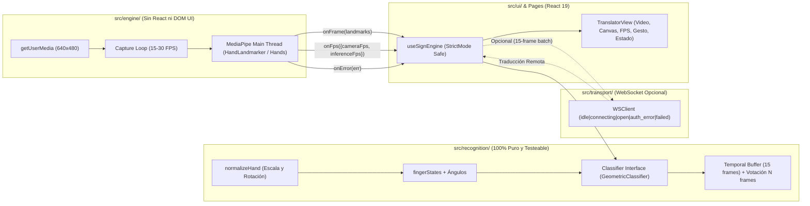

# Arquitectura de ExpresaT — Pipeline Web Desacoplado en Navegador

- **Fecha de diseño inicial:** 2026-11-09 (`rearquitectura-demo`)
- **Estado:** **Vigente (Implementado en código actual)**
- **Orquestación:** Arquitectura Frontend de 4 capas + configuración centralizada e instrumentación `DEV`
- **Índice y contratos relacionados:** [Índice de Documentación](./README.md) | [Especificación 178D (`FEATURE_SPEC v1.3.0`)](./dataset-generator/FEATURE_SPEC.md)

> [!NOTE]
> Este documento se redactó originalmente para planificar la rama `rearquitectura-demo` y fue actualizado al estado vigente del código (`signEngine.js`, `config.js`, `wsClient.js`, `recognition/`, `featureExtractor.js` e instrumentación de desarrollo). La bitácora puntual de commits de aquel hito se conserva en [REPORTE.md](./REPORTE.md).

---

## 1. Resumen Ejecutivo

Esta arquitectura desacopla el pipeline web de **ExpresaT** para lograr una **demo funcional, robusta y 100% operativa en el navegador** (sin requerir backend ni inicio de sesión para el tracking de manos y la clasificación geométrica de señas), con una interfaz limpia (`Classifier`) para integrar un modelo neuronal ONNX/GRU, soporte del extractor canónico 178D (`featureExtractor.js`) y un cliente WebSocket opcional (`transport/`) con manejo de errores determinista.

---

## 2. Inventario Arquitectónico del Repositorio

### 2.1 Componentes Conservados como Referencia o Independientes
- **`expresat/frontend-legacy/`**: Prototipo HTML/JS original basado en `window.Holistic` + `window.Camera` en hilo principal. Conservado como referencia histórica.
- **`expresat/models/` y `expresat-dataset-generator/`**: Respetan la invariante de tensor `(1, 15, 178)`. En el generador C++, la captura real MediaPipe permanece en modo stub; la extracción canónica unificada (`FEATURE_SPEC v1.3.0`) reside en `expresat/models/feature_extractor.py` y `expresat/frontend/src/engine/featureExtractor.js`.
- **`expresat-native/`**: Pipeline nativo C++/ONNX marcado formalmente como **`NO_CONFORME_FEATURE_SPEC_1_3_0`** (rechaza ejecución explícitamente hasta alinear `ExtractWindow`). Ver [FEATURE_SPEC.md](./dataset-generator/FEATURE_SPEC.md).

### 2.2 Componentes Reutilizados y Adaptados
- **Frontend (`expresat/frontend/`)**:
  - Páginas de navegación y autenticación (`Home.jsx`, `Learn.jsx`, `About.jsx`, `Auth.jsx`, `Navbar.jsx`, `Footer.jsx`, `ErrorBoundary.jsx`, `ThemeContext.jsx`, `ThemeToggle.jsx`, `EnvironmentSelector.jsx`, `BackgroundParticles.jsx`).
  - `LandmarkEMAFilter` (`src/services/landmarkFilter.js`) y `LandmarkTracker` (`src/services/landmarkTracker.js`) integrados con `SignEngine` y `useSignEngine`.
- **Backend (`expresat/backend/`)**:
  - `config.py`, `demo_rules.py`, `main.py`, `test_demo_rules.py` y `test_api_integration.py`, con validación configurable de `Origin` y token JWT más logs diagnósticos ante cualquier rechazo (`1008`).

### 2.3 Componentes Descartados o Reemplazados
- **`expresat/frontend/src/workers/mediapipe-worker.js`** (**ELIMINADO**): Causante de `Error: ModuleFactory not set.` al instanciar múltiples tareas en un Worker ESM (`type: 'module'`) donde Emscripten limpia `self.ModuleFactory = void 0` tras la primera carga y donde `importScripts` falla con `TypeError` en módulos ES.
- **`expresat/frontend/src/hooks/useMediaPipe.js`** (**ELIMINADO / REEMPLAZADO** por `src/engine/` + `src/ui/useSignEngine.js`): Acoplaba cámara, Worker, canvas y envío WebSocket en un único hook.
- **`expresat/frontend/src/services/mediapipeEngine.js`** (**ELIMINADO / REEMPLAZADO** por `src/engine/signEngine.js`): Implementación previa dependiente del DOM (`document.getElementById`).
- **`expresat/backend/websockets_handler.py`** (**DEPRECADO — no usado en runtime**): Emite `DeprecationWarning` al importarse; la lógica activa de `/ws/translate` vive en `expresat/backend/main.py`.

---

## 3. Prevención de las 8 Fallas Históricas Confirmadas

| # | Falla Histórica | Causa Raíz | Solución Arquitectónica Vigente |
|---|---|---|---|
| **1** | `ModuleFactory not set` al correr MediaPipe en Worker `type: 'module'` | En `@mediapipe/tasks-vision`, `vision_bundle.mjs` usa `importScripts()` (que falla en Worker ESM) y al caer a `import()` limpia `self.ModuleFactory = void 0` tras crear la primera tarea. | **MediaPipe corre en el hilo principal, sin Workers.** `signEngine.js` protege `window.ModuleFactory` y soporta tanto `@mediapipe/tasks-vision` (WASM local en `/wasm`, delegado preferido `'GPU'` con respaldo automático a `'CPU'` o `?delegate=CPU\|GPU`) como la API legacy (`window.Hands` / `window.Holistic`). |
| **2** | `ReferenceError` por identificadores sin definir (`isDemo`, `authWarning`) | Variables usadas en JSX sin declarar en `useState` y ausencia de regla `no-undef` en ESLint. | ESLint (`eslint.config.js`) configurado con `no-undef: "error"`, `react-hooks/rules-of-hooks: "error"`, `react-hooks/exhaustive-deps: "warn"` en `npm run lint`. |
| **3** | `setState` durante el render | Actualizaciones de estado disparadas síncronamente en render. | Estado gestionado exclusivamente en `useEffect` y callbacks de eventos en `useSignEngine.js`. |
| **4** | Contador de FPS basado en `requestAnimationFrame` y acoplado al DOM | `renderLoop()` incrementaba `frameCount` en cada `rAF` (~60 Hz) y mutaba `document.getElementById('fps-counter')`. | `SignEngine` mide **dos contadores independientes**: `cameraFps` e `inferenceFps`, emitidos vía callback `onFps({ cameraFps, inferenceFps })` sin tocar el DOM. |
| **5** | Reintentos infinitos del WebSocket ante 403/1008 | El cliente programaba `setTimeout(connect)` sin distinguir rechazo por política/auth ni pre-chequeo HTTP. | `transport/wsClient.js` implementa máquina de estados explícita (`idle \| connecting \| open \| auth_error \| failed`) y prohíbe reintentos ante códigos `1008`, `4001`, `4003`, `4401`, `4403`, HTTP `401`/`403` o ausencia de token cuando `demo_mode === false`. |
| **6** | Tracking atado al estado del backend | Un fallo de WebSocket o backend bloqueaba o detenía el reconocimiento en UI. | `recognition/` (`GeometricClassifier`) se ejecuta **100% en el navegador** por frame; `transport/` es opcional y desacoplado. |
| **7** | Doble montaje de StrictMode dejando streams abiertos y `AbortError` en `play()` | En React 19 `StrictMode`, el cleanup ocurre antes de resolver `getUserMedia` o `play()`. | `signEngine.js` usa un token incremental (`_runId`), libera tracks inmediatamente si `stop()` ocurrió en vuelo y maneja `AbortError` de `video.play()` de forma idempotente. |
| **8** | Variables `VITE_*` dispersas con fallbacks inválidos | Lecturas directas de `import.meta.env` en múltiples archivos. | Módulo único `src/config.js` que lee, normaliza y valida `import.meta.env.VITE_*` sin filtrar secretos. |

---

## 4. Decisión Técnica con Evidencia: MediaPipe en el Hilo Principal

### 4.1 Opciones Implementadas en `SignEngine`

1. **Modo Principal — `@mediapipe/tasks-vision` (`HandLandmarker` + `PoseLandmarker` opcional en Main Thread):**
   - **Versión y assets locales:** `@mediapipe/tasks-vision@^1.0.1` en `package.json`, con binarios WASM en `expresat/frontend/public/wasm/` y modelos `.task` en `expresat/frontend/public/models/`, servidos localmente en desarrollo mediante `servePublicWasmAndModelsPlugin()` en `vite.config.js`.
   - **Protección de `ModuleFactory`:** En el hilo principal `FilesetResolver` inyecta `<script src="/wasm/vision_wasm_internal.js">`; `protectMainThreadModuleFactory()` en `signEngine.js` intercepta escrituras sobre `window.ModuleFactory` para impedir que Emscripten lo anule tras inicializar el primer landmarker.
   - **Selección de delegado:** Diseñado inicialmente con `'CPU'` por defecto en `rearquitectura-demo`; en el código vigente (`signEngine.js`), `preferredDelegate` toma `'GPU'` por defecto (con fallback automático a `'CPU'`, configurable vía constructor `options.delegate` o query parameter `?delegate=CPU|GPU`).
   - **Modelos `.task`:** Carga local desde `/models/hand_landmarker.task` (y `/models/pose_landmarker_lite.task` cuando `enablePose` está activo), con respaldo automático a URLs oficiales de Google Storage si falla la ruta local.

2. **Respaldo Automático — API Legacy (`@mediapipe/hands@0.4.1675469240` / `@mediapipe/holistic@0.5.1675471629`):**
   - Cargada dinámicamente desde jsDelivr por etiqueta `<script>` en el hilo principal si `backend: 'legacy'` o si falla la inicialización completa de `@mediapipe/tasks-vision`.

### 4.2 Decisiones de Ejecución
1. **Hilo principal con respaldo escalonado:** Si `@mediapipe/tasks-vision` falla al cargar WASM o `.task`, `SignEngine` intenta `_initLegacyBackend()`; si ambos fallan, propaga el error tipado primario (`WASM_LOAD_FAILED` o `MODEL_LOAD_FAILED`) vía `onError` para que la UI informe con transparencia sin congelar la app.
2. **Pruebas deterministas sin hardware:** Las pruebas unitarias y E2E (`recognition.test.js`, `e2e/translator.spec.js`) usan el generador geométrico puro `src/recognition/syntheticHand.js` (`buildSyntheticHand`, `SYNTHETIC_PRESETS`) en lugar de hardware físico.
3. **Pose desactivada en producción por defecto:** `CONFIG.enablePose` es `false` para priorizar fluidez en hardware modesto (`10–30 FPS`); `Translator.jsx` activa `enablePose: Boolean(import.meta.env.DEV)` automáticamente en entorno de desarrollo para herramientas de inspección y captura `178D`.

---

## 5. Diseño de las 4 Capas Desacopladas

### 5.1 Capa 1: Configuración (`src/config.js`)
- Lee y normaliza todas las variables `import.meta.env.VITE_*` en un único módulo (`buildConfig` / `CONFIG`):
  - `VITE_API_URL_LOCAL` (default: `http://127.0.0.1:8000`) y `VITE_API_URL` (default prod: `https://expresat.onrender.com`)
  - `VITE_WS_URL_LOCAL` (default: `ws://127.0.0.1:8000/ws/translate`) y `VITE_WS_URL_PROD` (default: `wss://expresat.onrender.com/ws/translate`)
  - `VITE_SUPABASE_URL` y `VITE_SUPABASE_ANON_KEY` (opcionales en modo demo)
  - `VITE_DEMO_MODE` (default: `true`)
  - `VITE_TARGET_FPS` (default: `20`, rango validado `10–30`)
  - `VITE_MODEL_COMPLEXITY` (default: `0`, rango `0–1`)
  - `VITE_ENABLE_POSE` (default: `false`; `Translator.jsx` activa Pose en `import.meta.env.DEV`)
  - `VITE_MEDIAPIPE_BACKEND` (`tasks` | `legacy`, default: `tasks`)
  - `VITE_WASM_PATH` (default: `/wasm`) y `VITE_HAND_MODEL_PATH` (default: `/models/hand_landmarker.task`)
- Expone `validateConfig()` que devuelve `{ valid, warnings, missingOptional, summary }` sin filtrar secretos, y `getActiveEndpoints(selectedEnv)`.

### 5.2 Capa 2: Reconocimiento Geométrico Puro (`src/recognition/`)
- **Cero dependencias de navegador, cámara, DOM o React.**
- Archivos:
  - `src/recognition/geometry.js`:
    - `distance3D(p1, p2)`, `angleBetweenVectorsDeg(v1, v2)`, `jointAngleDeg(a, b, c)`
    - `palmScale(landmarks)`: distancia euclidiana 3D entre `WRIST (0)` y `MIDDLE_MCP (9)`. Rechaza manos degeneradas/ruido (`palmScale < 0.02` o coordenadas `NaN`/fuera de rango).
    - `normalizeHand(landmarks)`: traslada al origen en `WRIST (0)`, escala por `1 / palmScale`, y rota en el plano XY para alinear el eje `WRIST (0) -> MIDDLE_MCP (9)` con el eje vertical `(0, -1)`, logrando invariancia a traslación, escala y rotación en el plano.
    - `fingerStates(landmarks)`: calcula el estado extendido/doblado y curvatura angular de los 5 dedos (`thumb`, `index`, `middle`, `ring`, `pinky`), más métricas de pinza (`thumbIndexTipDist` normalizada), `indexMiddleSpread` e inclinación espacial.
  - `src/recognition/classifier.js`:
    - Define el contrato base `Classifier { predict(frames) -> { label, confidence, details } }`.
    - Implementa `GeometricClassifier`:
      - Gestos estáticos soportados:
        - `MANO_ABIERTA` (5 dedos extendidos, estática)
        - `PUNO` (5 dedos cerrados en puño)
        - `UNO` (solo índice extendido)
        - `DOS` (índice y medio extendidos en V)
        - `OK / Pinza` (`isPinching` con distancia normalizada `< 0.36 * palmScale` y `(!index || middle)`)
        - `BIEN` (pulgar extendido, otros 4 cerrados)
        - `TE_QUIERO` (pulgar, índice y meñique extendidos)
        - `LUNES` (pulgar e índice en L)
      - Gestos dinámicos soportados (ventana temporal de hasta 15 frames):
        - `HOLA` (mano abierta + oscilación lateral de muñeca con cambios de dirección $\ge 2$ y amplitud relativa a `palmScale`)
      - **Suavizado temporal por votación de $N$ frames (`SmoothingVoter`, default $N = 5$):** evita parpadeos exigiendo mayoría en la ventana reciente antes de cambiar la etiqueta emitida.
      - Rechazo de ruido: si los landmarks son inválidos, incompletos (`< 21` puntos) o degenerados, devuelve `{ label: null, confidence: 0, reason }`.
    - Incluye adaptador `ModelClassifier` para conectar el modelo neuronal en el futuro sin cambiar `useSignEngine`.
  - `src/recognition/syntheticHand.js`:
    - Generador determinista de manos sintéticas de 21 puntos (`buildSyntheticHand`, `SYNTHETIC_PRESETS`) usado por Vitest y Playwright.

### 5.3 Capa 3: Motor de Captura, Extracción 178D y Telemetría (`src/engine/`)
- Archivos:
  - `src/engine/signEngine.js`:
    - Clase `SignEngine` independiente de React.
    - Métodos públicos principales:
      - `start(videoElement)` (idempotente, protegido por `_runId` contra doble montaje de StrictMode)
      - `stop()` (idempotente, detiene loop y observador pasivo `rVFC`, cierra tracks de `MediaStream`, libera detectores MediaPipe)
      - `onFrame(callback)` -> emite `{ hands, handedness, leftHand, rightHand, pose, timestamp, latencyMs, raw }`
      - `onFps(callback)` -> emite `{ cameraFps, inferenceFps }` en ventanas de 1000 ms
      - `onError(callback)` -> emite códigos tipados en `ENGINE_ERROR_CODES` (`CAMERA_UNSUPPORTED`, `CAMERA_DENIED`, `CAMERA_NOT_FOUND`, `CAMERA_IN_USE`, `CAMERA_OVERCONSTRAINED`, `WASM_LOAD_FAILED`, `MODEL_LOAD_FAILED`, `ENGINE_RUNTIME_ERROR`).
  - `src/engine/featureExtractor.js`:
    - Implementación canónica en JS del contrato `FEATURE_SPEC v1.3.0` (`extractFrameFeatures`, `extractWindow`, `mirrorRawFrame`, `mirrorFeatures178`, `assignHandsToAnatomicalSlots`, paridad $L_\infty \le 10^{-6}$ frente a `expresat/models/feature_extractor.py`).
  - `src/engine/devTelemetry.js`:
    - Instrumentación exclusiva de desarrollo (`import.meta.env.DEV`) con marcas `performance.mark`/`measure` por etapa (`hand`, `pose`, `draw`, `ui`), observador de frames reales (`rVFC`) y reporte Markdown exportable sin alterar el flujo de producción.

### 5.4 Capa 4: Transporte WebSocket Opcional (`src/transport/`)
- Archivos:
  - `src/transport/wsClient.js`:
    - Estados explícitos (`WS_STATES`): `'idle' | 'connecting' | 'open' | 'auth_error' | 'failed'`.
    - Backoff exponencial (`baseDelayMs = 1000`, `maxRetries = 4` por defecto) y ping periódico (`pingIntervalMs = 5000`) para medición de latencia.
    - **Prohibición estricta de reintento** cuando:
      - El código de cierre WS es `1008`, `4001`, `4003`, `4401` o `4403`.
      - El pre-chequeo HTTP `/health` responde `401` o `403`.
      - El servidor reporta `demo_mode === false` y el cliente no posee token JWT (transiciona directo a `'auth_error'`).

### 5.5 Capa 5: Interfaz de Usuario React (`src/ui/`, `src/components/`, `src/pages/`)
- Archivos:
  - `src/ui/useSignEngine.js`: Hook que orquesta `SignEngine`, `GeometricClassifier`, `LandmarkTracker` y `WSClient` con cleanup idempotente bajo `<StrictMode>` y escucha del evento `'environment-changed'`.
  - `src/ui/drawLandmarks.js`: `renderCanvasFrame()` dibuja el video en espejo (`scale(-1, 1)`), esqueletos y badges diagnósticos legibles sin invertir texto.
  - `src/pages/Translator.jsx`: Muestra video/canvas en espejo, contadores separados (**FPS Cámara** y **FPS Inferencia**), gesto detectado + estado de dedos, estado explícito de backend/errores y, solo en `DEV`, `DevRecorder` y `DevInstrumentationPanel`.
  - `src/components/DevRecorder.jsx` y `devRecorderUtils.js` *(solo `DEV`)*: Captura tomas guiadas `.raw.json` `v1.3.1` (`18 s`, compuerta `>= 15.0 FPS` y brechas `interval_metrics`).
  - `src/components/DevInstrumentationPanel.jsx` *(solo `DEV`)*: Visualiza percentiles por etapa (`p50/p95/p99/max`) en `reposo` vs. `grabando` y exportación de reporte.

---

## 6. Inventario de Implementación Vigente

### 6.1 Módulos Activos en el Repositorio
- **Configuración y entorno:** [`expresat/frontend/src/config.js`](../expresat/frontend/src/config.js), [`expresat/frontend/.env.example`](../expresat/frontend/.env.example), [`expresat/.env.example`](../expresat/.env.example), [`expresat/frontend/eslint.config.js`](../expresat/frontend/eslint.config.js), [`expresat/frontend/vite.config.js`](../expresat/frontend/vite.config.js).
- **Motor, reconocimiento, transporte y UI:**
  - `expresat/frontend/src/engine/`: [`signEngine.js`](../expresat/frontend/src/engine/signEngine.js), [`featureExtractor.js`](../expresat/frontend/src/engine/featureExtractor.js), [`devTelemetry.js`](../expresat/frontend/src/engine/devTelemetry.js), [`index.js`](../expresat/frontend/src/engine/index.js).
  - `expresat/frontend/src/recognition/`: [`geometry.js`](../expresat/frontend/src/recognition/geometry.js), [`classifier.js`](../expresat/frontend/src/recognition/classifier.js), [`syntheticHand.js`](../expresat/frontend/src/recognition/syntheticHand.js), [`index.js`](../expresat/frontend/src/recognition/index.js).
  - `expresat/frontend/src/transport/`: [`wsClient.js`](../expresat/frontend/src/transport/wsClient.js), [`index.js`](../expresat/frontend/src/transport/index.js).
  - `expresat/frontend/src/ui/` y componentes dev: [`useSignEngine.js`](../expresat/frontend/src/ui/useSignEngine.js), [`drawLandmarks.js`](../expresat/frontend/src/ui/drawLandmarks.js), [`Translator.jsx`](../expresat/frontend/src/pages/Translator.jsx), [`DevRecorder.jsx`](../expresat/frontend/src/components/DevRecorder.jsx), [`DevInstrumentationPanel.jsx`](../expresat/frontend/src/components/DevInstrumentationPanel.jsx).
- **Pruebas y benchmarks:**
  - Vitest (`expresat/frontend/vitest.config.js`): `config.test.js`, `recognition.test.js`, `signEngine.test.js`, `wsClient.test.js`, `featureExtractor.test.js`, `devTelemetry.test.js`, `devRecorder.test.js`.
  - Playwright E2E y Benchmarks aislados: `expresat/frontend/playwright.config.js` (`e2e/translator.spec.js`, `e2e/dev_instrumentation.spec.js`) y `playwright.benchmark.config.js` (`benchmarks/determinism.spec.js`, `benchmarks/performance_benchmark.spec.js`).
- **Backend FastAPI:** [`expresat/backend/config.py`](../expresat/backend/config.py), [`expresat/backend/main.py`](../expresat/backend/main.py), [`expresat/backend/test_api_integration.py`](../expresat/backend/test_api_integration.py).

### 6.2 Archivos Eliminados Históricamente (Referencia)
- `expresat/frontend/src/workers/mediapipe-worker.js` *(eliminado; superado por ejecución en hilo principal)*.
- `expresat/frontend/src/hooks/useMediaPipe.js` *(eliminado; reemplazado por `SignEngine` + `useSignEngine`)*.
- `expresat/frontend/src/services/mediapipeEngine.js` *(eliminado; reemplazado por `SignEngine`)*.
