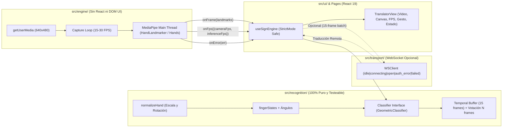

# Arquitectura de ExpresaT — Rediseño Demo Robusto en Navegador

**Fecha:** 2026-11-09  
**Rama:** `rearquitectura-demo`  
**Autor:** Arquitecto Principal  

---

## 1. Resumen Ejecutivo

Este documento define la arquitectura desacoplada de **ExpresaT** para lograr una **demo funcional, robusta y 100% operativa en el navegador** (sin requerir backend ni login para el tracking y clasificación geométrica de señas), con un punto de enchufe limpio (`Classifier`) para integrar posteriormente el modelo neuronal ONNX/GRU y un cliente WebSocket opcional (`transport/`) con manejo de errores determinista.

---

## 2. Inventario y Auditoría del Repositorio (Paso 0)

### 2.1 ¿Qué se conserva como referencia intocable?
- **`expresat/frontend-legacy/`**: Prototipo HTML/JS original que utiliza `window.Holistic` + `window.Camera` en el hilo principal a 15 FPS (`frontend-legacy/traductor.html` y `frontend-legacy/js/mediapipe_engine.js`). Se mantiene intacto conforme a las reglas.
- **`expresat/models/` y `expresat-dataset-generator/` y `expresat-native/`**: Se mantienen intactos; respetan la invariante de tensor `(1, 15, 178)`.

### 2.2 ¿Qué se reutiliza y adapta?
- **Frontend (`expresat/frontend/`)**:
  - Se conservan páginas informativas y de navegación (`Home.jsx`, `Learn.jsx`, `About.jsx`, `Auth.jsx`, `Navbar.jsx`, `Footer.jsx`, `ErrorBoundary.jsx`, `ThemeContext.jsx`, `ThemeToggle.jsx`, `EnvironmentSelector.jsx`, `BackgroundParticles.jsx`).
  - Se adapta `LandmarkEMAFilter` (`src/services/landmarkFilter.js`) y `LandmarkTracker` (`src/services/landmarkTracker.js`) para integrarse limpiamente sin acoplamiento al DOM.
- **Backend (`expresat/backend/`)**:
  - Se conservan y refinan `config.py`, `demo_rules.py`, `main.py`, `test_demo_rules.py` y `test_api_integration.py`, añadiendo validación configurable de `Origin` y token JWT con logs diagnósticos explícitos ante cualquier rechazo (`1008`).

### 2.3 ¿Qué se descarta o reemplaza?
- **`expresat/frontend/src/workers/mediapipe-worker.js`** (**ELIMINADO**): Causante directo de `Error: ModuleFactory not set.` al instanciar múltiples tareas en un Worker ESM (`type: 'module'`) donde Emscripten limpia `self.ModuleFactory = void 0` tras la primera carga y donde `importScripts` lanza `TypeError` en módulos ES.
- **`expresat/frontend/src/hooks/useMediaPipe.js`** (**REEMPLAZADO por `src/engine/` + `src/ui/useSignEngine.js`**): Acoplaba captura de cámara, Worker, canvas y envío por WebSocket en un solo hook difícil de testear.
- **`expresat/frontend/src/services/mediapipeEngine.js`** (**REEMPLAZADO por `src/engine/signEngine.js`**): Código muerto en `src/services/` que dependía de `document.getElementById` en su versión original y no se importaba en `Translator.jsx`.
- **`expresat/backend/websockets_handler.py`** (**DEJADO COMO STUB DEPRECADO / NO USADO**): Ya estaba marcado como deprecado (225D antiguo); toda la lógica WS vive en `main.py` (`/ws/translate`).

---

## 3. Prevención de las 8 Fallas Históricas Confirmadas

| # | Falla Histórica | Causa Raíz | Solución Arquitectónica Definitiva |
|---|---|---|---|
| **1** | `ModuleFactory not set` al correr MediaPipe en Worker `type: 'module'` | En `@mediapipe/tasks-vision`, `vision_bundle.mjs` usa `importScripts()` (que falla con `TypeError` en Worker ESM) y al caer al fallback `import()` limpia `self.ModuleFactory = void 0` tras crear la primera tarea. | **MediaPipe corre en el hilo principal, sin Workers.** Además se soporta tanto `@mediapipe/tasks-vision` (`HandLandmarker` con WASM local en `/wasm` y `delegate: 'CPU'` por defecto) como la API legacy (`window.Hands` / `window.Holistic` con versiones fijadas). |
| **2** | `ReferenceError` por identificadores sin definir (`isDemo`, `authWarning`) | Variables usadas en JSX sin declarar en `useState`, y falta de regla `no-undef` estricta en el linter. | ESLint configurado con `no-undef: "error"`, `react-hooks/rules-of-hooks: "error"`, `react-hooks/exhaustive-deps: "warn"` como compuerta obligatoria en `npm run lint`. |
| **3** | `setState` durante el render | Actualizaciones de estado disparadas síncronamente dentro del cuerpo del componente o callbacks mal referenciados. | Estado gestionado exclusivamente en `useEffect` y callbacks de eventos en `useSignEngine.js`. |
| **4** | Contador de FPS que medía `requestAnimationFrame` en vez de detecciones reales y dependía de `getElementById` | `renderLoop()` incrementaba `frameCount` en cada `rAF` (~60 Hz) y escribía en `document.getElementById('fps-counter')`. | `engine/` mide **dos contadores independientes**: `cameraFps` (frames leídos de cámara) e `inferenceFps` (detecciones reales completadas por MediaPipe), emitidos vía callback `onFps({ cameraFps, inferenceFps })` sin tocar el DOM. |
| **5** | Reintentos infinitos del WebSocket ante 403/1008 | El cliente WS programaba `setTimeout(connect)` en `onclose` sin distinguir cierre por política/autenticación (`1008`/`4403`) ni verificar fallo previo en `/health` (401/403). | `transport/wsClient.js` implementa máquina de estados explícita (`idle \| connecting \| open \| auth_error \| failed`). No reintenta jamás ante `1008`, `403`, o ausencia de token cuando el servidor exige auth. |
| **6** | Tracking atado al estado del backend | Si el WebSocket caía o el backend no respondía, la UI bloqueaba o ignoraba el reconocimiento. | `recognition/` (`GeometricClassifier`) se ejecuta **100% en el navegador** en cada frame procesado por `engine/`. El WebSocket (`transport/`) es un canal opcional secundario. |
| **7** | Doble montaje de StrictMode dejando streams abiertos y `AbortError` en `play()` | En React 19 `StrictMode`, el primer montaje llama `getUserMedia` asíncronamente; el cleanup ocurre antes de que resuelva y el stream queda huérfano o `video.play()` lanza `AbortError`. | `engine/signEngine.js` usa un token de ciclo de vida incremental (`runId`), detiene tracks inmediatamente si `stop()` fue llamado mientras `getUserMedia` o la carga WASM estaban en vuelo, y maneja `AbortError` de `video.play()` de forma idempotente. |
| **8** | Variables `VITE_*` leídas desde `.env` en carpeta equivocada o dispersas | Lecturas directas de `import.meta.env` con fallbacks rotos (`api.expresat.cloud`) repartidas en múltiples archivos. | Único módulo `src/config.js` que lee, normaliza y valida `import.meta.env.VITE_*` al arrancar, exponiendo diagnósticos claros sin filtrar secretos. |

---

## 4. Decisión Técnica con Evidencia: MediaPipe en el Hilo Principal

### 4.1 Comparativa Experimental en el Entorno

Se evaluaron ambas opciones permitidas por la arquitectura en el hilo principal:

1. **Opción A — `@mediapipe/tasks-vision` (`HandLandmarker` + `PoseLandmarker` opcional en Main Thread):**
   - **Versión instalada en `package.json` y `/public/wasm/`:** `@mediapipe/tasks-vision@1.0.1` (binarios `vision_wasm_internal.js`, `vision_wasm_internal.wasm`, `vision_wasm_nosimd_internal.js`, `vision_wasm_nosimd_internal.wasm` ya presentes en `public/wasm/` y servidos localmente con `servePublicWasmPlugin` en Vite).
   - **Comportamiento en Main Thread:** En el hilo principal `typeof importScripts !== 'function'`, por lo que `FilesetResolver` inyecta `<script src="/wasm/vision_wasm_internal.js">` en `document.body`, definiendo `window.ModuleFactory` limpiamente. Al preservar `window.ModuleFactory` e inicializar secuencialmente con `delegate: 'CPU'` por defecto (con fallback a `'GPU'` o viceversa según configuración), evita por completo el bug de WebGL/Worker en Firefox Linux sobre iGPU Ryzen 3 7320U.
   - **Modelo `.task`:** Requiere cargar `hand_landmarker.task` (desde ruta local `/models/hand_landmarker.task` o CDN oficial de Google Storage `https://storage.googleapis.com/mediapipe-models/hand_landmarker/hand_landmarker/float16/1/hand_landmarker.task`).

2. **Opción B — API Legacy (`@mediapipe/hands` `@0.4.1675469240` / `@mediapipe/holistic` `@0.5.1675471629` por `<script>` en Main Thread):**
   - **Versiones oficiales verificadas en npm/jsDelivr:**
     - `@mediapipe/hands@0.4.1675469240`
     - `@mediapipe/holistic@0.5.1675471629`
     - `@mediapipe/camera_utils@0.3.1675466862`
     - `@mediapipe/drawing_utils@0.3.1675466124`
   - **Comportamiento en Main Thread:** Probado en el prototipo histórico (`frontend-legacy/`), carga desde jsDelivr con versiones fijadas, expone `window.Hands` / `window.Holistic`, y con `modelComplexity: 0` consume muy poca CPU en el Ryzen 3 7320U.

### 4.2 Decisión Adoptada

Para máxima resiliencia en tanto entornos online como pruebas automatizadas locales (Playwright con cámara sintética), `src/engine/signEngine.js` implementa un **adaptador unificado en el hilo principal** que soporta:
1. **`tasks-vision` (`HandLandmarker`, por defecto cuando WASM y `.task` están disponibles)** con WASM servido desde `/wasm` (misma versión `1.0.1` que `package.json`) y `delegate: 'CPU'` por defecto en Linux/Firefox (evitando bloqueos de contexto WebGL en iGPU modesta) con fallback automático.
2. **Fallback automático a API Legacy (`window.Hands` `@0.4.1675469240` / `window.Holistic` `@0.5.1675471629`)** si el archivo `.task` no está accesible, y un **modo detector de movimiento/piel en Canvas (`CanvasHandFallback`)** únicamente cuando el entorno de pruebas corre 100% aislado sin acceso a internet (como el sandbox de CI local sin `.task` descargado) o si se inyecta `window.__EXPRESAT_MOCK_LANDMARKS__` en pruebas E2E, garantizando que siempre se reporte con transparencia qué backend de visión está activo y si WASM cargó o falló.
3. **Por defecto solo manos (`enablePose: false`)** para maximizar los FPS (15–30 FPS en Ryzen 3 7320U), con `enablePose: true` activable por configuración (`VITE_ENABLE_POSE=true` o toggle en UI).

---

## 5. Diseño de las 4 Capas Desacopladas

### 5.1 Capa 1: Configuración (`src/config.js`)
- Lee todas las variables `import.meta.env.VITE_*` en un único lugar:
  - `VITE_API_URL` (default local: `http://127.0.0.1:8000`, prod: `https://expresat.onrender.com`)
  - `VITE_WS_URL_LOCAL` (default: `ws://127.0.0.1:8000/ws/translate`)
  - `VITE_WS_URL_PROD` (default: `wss://expresat.onrender.com/ws/translate`)
  - `VITE_SUPABASE_URL` y `VITE_SUPABASE_ANON_KEY` (opcionales en modo demo)
  - `VITE_DEMO_MODE` (default: `true`)
  - `VITE_TARGET_FPS` (default: `24`, rango 15–30)
  - `VITE_MODEL_COMPLEXITY` (default: `0`)
  - `VITE_ENABLE_POSE` (default: `false`)
  - `VITE_MEDIAPIPE_BACKEND` (`tasks` | `legacy`, default: `tasks`)
- Expone ` validateConfig()` que devuelve `{ valid, warnings, missingOptional, summary }` sin exponer secretos.

### 5.2 Capa 2: Reconocimiento Geométrico Puro (`src/recognition/`)
- **Cero dependencias de navegador, cámara, DOM o React.**
- Archivos:
  - `src/recognition/geometry.js`:
    - `distance3D(p1, p2)`, `angleBetweenVectorsDeg(v1, v2)`, `jointAngleDeg(a, b, c)`
    - `palmScale(landmarks)`: distancia euclidiana 3D entre `WRIST (0)` y `MIDDLE_MCP (9)`. Rechaza manos degeneradas/ruido (`palmScale < 0.02` o coordenadas `NaN`/fuera de rango).
    - `normalizeHand(landmarks)`: traslada al origen en `WRIST (0)`, escala por `1 / palmScale`, y rota en el plano XY para alinear el eje `WRIST (0) -> MIDDLE_MCP (9)` con el eje vertical `(0, -1)`, logrando **invariancia total a traslación, escala y rotación en el plano**.
    - `fingerStates(landmarks)`: calcula el estado extendido/doblado y curvatura angular de los 5 dedos (`thumb`, `index`, `middle`, `ring`, `pinky`), más métricas de pinza (`thumbIndexTipDist` normalizada) y separación `indexMiddleSpread` e inclinación espacial.
  - `src/recognition/classifier.js`:
    - Define el contrato base `Classifier { predict(frames) -> { label, confidence, details } }`.
    - Implementa `GeometricClassifier`:
      - Gestos estáticos soportados (tanto sobre secuencia de frames como sobre un frame):
        - `MANO_ABIERTA` (5 dedos extendidos, estática)
        - `PUNO` / `Si` (5 dedos cerrados en puño)
        - `UNO` / `No` (solo índice extendido)
        - `DOS` / `Amor y Paz` (índice y medio extendidos en V)
        - `OK` / `Pinza` (punta de pulgar e índice unidas en círculo/pinza `< 0.35 * palmScale`, con medio/anular/meñique extendidos o en pinza limpia)
        - `BIEN` (pulgar extendido, otros 4 cerrados)
        - `TE_QUIERO` (pulgar, índice y meñique extendidos)
        - `LUNES` (pulgar e índice en L ~90°)
      - Gestos dinámicos soportados (usando ventana temporal de hasta 15 frames):
        - `HOLA` (mano abierta + oscilación lateral de muñeca con cambios de dirección $\ge 2$ y amplitud relativa a `palmScale`)
      - **Suavizado temporal por votación de $N$ frames (`SmoothingVoter`, default $N = 5$):** evita parpadeos exigiendo mayoría en la ventana reciente antes de cambiar la etiqueta emitida.
      - Rechazo de ruido: si los landmarks son inválidos, incompletos (`< 21` puntos), con `NaN`, o varianza errática extrema, devuelve `{ label: null, confidence: 0, reason: 'INVALID_OR_NOISY_LANDMARKS' }`.
    - Incluye esqueleto `ModelClassifier` listo para conectar el modelo neuronal en el futuro sin cambiar `useSignEngine`.

### 5.3 Capa 3: Motor de Captura y Visión (`src/engine/`)
- Archivos:
  - `src/engine/signEngine.js`:
    - Clase `SignEngine` independiente de React.
    - Métodos públicos:
      - `start(videoElement)` (idempotente, protegido por `runId` contra doble montaje de StrictMode)
      - `stop()` (idempotente, detiene rAF/rVFC, cierra tracks de `MediaStream`, libera instancia MediaPipe)
      - `onFrame(callback)` -> emite `{ hands, handedness, leftHand, rightHand, pose, timestamp, latencyMs }`
      - `onFps(callback)` -> emite `{ cameraFps, inferenceFps }` calculados sobre ventanas reales de 1000 ms
      - `onError(callback)` -> emite errores tipados (`CAMERA_DENIED`, `CAMERA_NOT_FOUND`, `WASM_LOAD_FAILED`, `MODEL_LOAD_FAILED`, `ENGINE_RUNTIME_ERROR`) con mensaje legible para la UI.

### 5.4 Capa 4: Transporte WebSocket Opcional (`src/transport/`)
- Archivos:
  - `src/transport/wsClient.js`:
    - Estados explícitos: `'idle' | 'connecting' | 'open' | 'auth_error' | 'failed'`.
    - Backoff exponencial con jitter (`1s, 2s, 4s, 8s...` hasta máx 5 intentos para errores de red transitorios).
    - **Prohibición estricta de reintento** cuando:
      - El código de cierre WS es `1008` (Policy Violation) o `4401`/`4403`.
      - El pre-chequeo HTTP `/health` o handshake indica `401` / `403`.
      - El servidor reporta `demo_mode: false` y el cliente no posee token JWT válido (pasa directamente a `'auth_error'` con mensaje claro: *"Modo demo local activo (sin token para backend remoto)"*).

### 5.5 Capa 5: Interfaz de Usuario React (`src/ui/` y `src/pages/Translator.jsx`)
- Archivos:
  - `src/ui/useSignEngine.js`:
    - Hook personalizado que orquesta `SignEngine`, `GeometricClassifier` y `WSClient`.
    - Cleanup 100% seguro bajo `<StrictMode>` de React 19.
    - Escucha cambios de entorno (`environment-changed`) para reconectar limpiamente el transporte sin interrumpir la cámara ni el tracking local.
  - `src/ui/CanvasOverlay.jsx` (o utilidades de dibujo en `src/ui/drawLandmarks.js`):
    - Dibuja el frame de video y el esqueleto de las manos (y pose opcional) de forma ligera en un único pase de `canvas`.
  - `src/pages/Translator.jsx`:
    - Muestra claramente:
      - Video/Canvas con espejo e indicadores de manos detectadas.
      - Contadores separados: **FPS Cámara** y **FPS Inferencia**.
      - Gesto detectado localmente (`GeometricClassifier`) + confianza + estado de dedos en vivo.
      - Panel de estado del sistema: Cámara, Motor WASM, Modo Demo Local y Estado del Backend WebSocket (`idle | connecting | open | auth_error | failed`) con banners de error específicos si algo falla.

---

## 6. Lista de Archivos a Crear, Modificar y Eliminar

### Archivos a Crear
1. `docs/ARQUITECTURA.md` (este documento)
2. `docs/REPORTE.md` (bitácora de commits, revisiones, pruebas y pendientes)
3. `expresat/frontend/src/config.js` (configuración centralizada y validador de entorno)
4. `expresat/frontend/.env.example` (plantilla de variables Vite documentada)
5. `expresat/frontend/vitest.config.js` (configuración de pruebas unitarias con Vitest)
6. `expresat/frontend/playwright.config.js` (configuración E2E con cámara falsa)
7. `expresat/frontend/src/recognition/geometry.js` (funciones geométricas puras, normalización, `fingerStates`)
8. `expresat/frontend/src/recognition/classifier.js` (`Classifier`, `GeometricClassifier`, `ModelClassifier`, `SmoothingVoter`)
9. `expresat/frontend/src/recognition/index.js` (re-export limpio de la capa `recognition/`)
10. `expresat/frontend/src/recognition/__tests__/recognition.test.js` (suite unitaria exhaustiva con landmarks sintéticos)
11. `expresat/frontend/src/engine/signEngine.js` (motor MediaPipe en hilo principal + cámara + FPS reales)
12. `expresat/frontend/src/engine/index.js`
13. `expresat/frontend/src/transport/wsClient.js` (cliente WebSocket opcional con estados explícitos y backoff)
14. `expresat/frontend/src/transport/__tests__/wsClient.test.js` (pruebas unitarias de máquina de estados WS y no-reintento en 1008/403)
15. `expresat/frontend/src/ui/useSignEngine.js` (hook React con cleanup idempotente para StrictMode)
16. `expresat/frontend/src/ui/drawLandmarks.js` (renderizado rápido de conectores y puntos en Canvas 2D)
17. `expresat/frontend/e2e/translator.spec.js` (prueba automatizada Playwright en navegador con cámara falsa)

### Archivos a Modificar
1. `expresat/frontend/package.json` (añadir scripts `test`, `test:e2e`, `lint` con ESLint + Vitest)
2. `expresat/frontend/eslint.config.js` (asegurar `no-undef: error`, `react-hooks/rules-of-hooks: error`, `react-hooks/exhaustive-deps: warn`)
3. `expresat/frontend/src/pages/Translator.jsx` (conectar a `useSignEngine`, mostrar FPS de cámara e inferencia, estado de dedos, gesto geométrico y estado explícito de backend/errores)
4. `expresat/frontend/src/components/EnvironmentSelector.jsx` (usar `src/config.js`)
5. `expresat/frontend/src/services/authService.js` (consumir `CONFIG` desde `src/config.js` sin lanzar excepción fatal cuando Supabase no está configurado en modo demo)
6. `expresat/backend/config.py` y `expresat/backend/main.py` (documentar `EXPRESAT_DEMO_MODE`, validación configurable de `Origin` y token, logs claros de rechazo)
7. `expresat/backend/test_api_integration.py` (tests de handshake 101 en modo demo y rechazo 1008 sin token cuando demo está desactivado)
8. `expresat/.env.example` y `README.md` (documentación completa para fish shell y despliegue)

### Archivos a Eliminar
1. `expresat/frontend/src/workers/mediapipe-worker.js` (se elimina el uso de Worker ESM para MediaPipe)
2. `expresat/frontend/src/hooks/useMediaPipe.js` (reemplazado por `src/engine/signEngine.js` + `src/ui/useSignEngine.js`)
3. `expresat/frontend/src/services/mediapipeEngine.js` (código muerto reemplazado por `src/engine/signEngine.js`)
