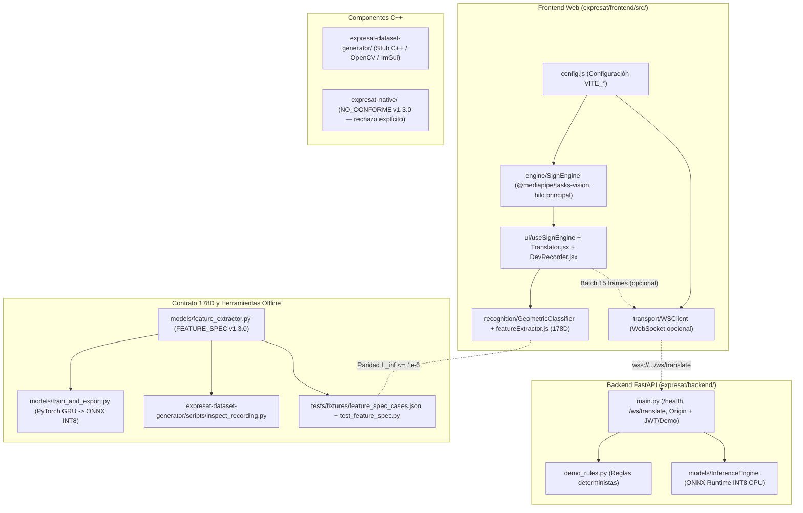

# Documentación Técnica — ExpresaT

Centro de navegación de la documentación técnica, contratos matemáticos, decisiones de arquitectura y registros históricos de **ExpresaT** (traductor de Lengua de Señas Mexicana en tiempo real).

> [!NOTE]
> Este índice separa la **documentación vigente** del sistema de las **auditorías y reportes históricos** conservados para trazabilidad. Para ejecutar el proyecto en local o revisar variables de despliegue, consulta también el [README principal del repositorio](../README.md).

---

## Mapa del Sistema

---

## 1. Documentación Técnica Vigente

| Documento | Estado | Descripción |
|---|---|---|
| [Arquitectura Frontend y Desacoplamiento (4 Capas)](./ARQUITECTURA.md) | **Vigente** | Diseño del frontend en hilo principal (`engine/`, `recognition/`, `transport/`, `ui/`), prevención de fallas históricas (`ModuleFactory`, `StrictMode`, FPS reales) e instrumentación de desarrollo. |
| [Especificación Canónica de Features 178D (`FEATURE_SPEC v1.3.0`)](./dataset-generator/FEATURE_SPEC.md) | **Vigente (Contrato v1.3.0 + Hoja de Ruta v1.4.0)** | Contrato matemático unificado entre JS y Python: composición `[0..51]` Pose + `[52..114]` Mano Izq + `[115..177]` Mano Der, normalización por hombros 3D, `ExtractWindow`, paridad $L_\infty \le 10^{-6}$, `config_hash` y esquema `.raw.json` `v1.3.1`. |
| [Registro de Decisiones y Libro de Evidencia (`DECISIONES.md`)](./dataset-generator/DECISIONES.md) | **Vigente (ADR / Gobernanza)** | Decisiones vigentes de captura y latencias, análisis del mínimo `-4.3126` en `pose.z`, estado de compuertas (Gates 1A/1B/1C) y clasificación rigurosa de cifras medidas vs. invalidadas. |
| [Plan de Mejora de Captura y Esquema 60 s (`PLAN_MEJORA.md`)](./dataset-generator/PLAN_MEJORA.md) | **Vigente (Plan Activo — Bloqueado antes de Fase 1)** | Compuertas numéricas por ventana (`unique_real_frames >= 12/15`, `max_interval <= 100 ms`), estado de higiene pre-Fase 1 y fases 1–5 hacia el formato binario `v2.0.0`. |

---

## 2. Auditorías Técnicas y Planes del Pipeline de Datos

| Documento | Estado | Descripción |
|---|---|---|
| [Auditoría de Captura, Inferencia y Grabación — Fase 0](./dataset-generator/AUDITORIA_CAPTURA.md) | **Snapshot Histórico (Pre-Higiene)** | Auditoría de código y entorno previa a la limpieza del repositorio (`.gitignore`, `sysmon.sh` y primera toma `.raw.json` incorporados después). Conservada con banner de reconciliación hacia `DECISIONES.md` y `PLAN_MEJORA.md`. |
| [Auditoría Técnica Base — Dataset Generator (Paso 0)](./dataset-generator/AUDITORIA.md) | **Histórico (Paso 0)** | Línea base original de `expresat-dataset-generator/` (modo stub, perfil de memoria RSS de `nlohmann::json`, fragmentación inicial de constructores y condiciones bloqueantes). |
| [Plan de Rediseño — Dataset Generator v2 (`PLAN.md`)](./dataset-generator/PLAN.md) | **Diseño Base (`v2.3.0`, Parcialmente Implementado)** | Arquitectura desacoplada en dos etapas: captura web de landmarks crudos y pipeline CLI offline en Python con shards `.npy` y streaming. |

---

## 3. Artefactos JSON de Benchmarks y Telemetría (`docs/dataset-generator/`)

Todos los archivos JSON en `docs/dataset-generator/` documentan corridas experimentales y quedan clasificados conforme a [DECISIONES.md §6.2](./dataset-generator/DECISIONES.md#62-catálogo-completo-de-cifras-actuales-e-históricas):

| Archivo JSON | Contenido | Validez Actual |
|---|---|---|
| [BENCHMARK_LATENCIAS_FIREFOX.json](./dataset-generator/BENCHMARK_LATENCIAS_FIREFOX.json) | Latencias por etapa (`hand`, `pose`, `canvas`, `total`) en Firefox headless para GPU (1:1, 1:2, 1:3) y CPU sobre 25 frames estáticos de `test_hand.png`. | **Invalidado por entorno** (corrida sin normalización AC/`EPP=power` ni `sysmon.sh`, sobre 1 imagen estática). |
| [BENCHMARK_NATIVE_PYTHON.json](./dataset-generator/BENCHMARK_NATIVE_PYTHON.json) | Benchmark nativo Python (`scripts/bench_native.py`) sobre 200 frames `640x480` de `test_hand.png` (`13.71 FPS` efectivos). | **Invalidado por entorno** (refuta la estimación previa de "30–45 FPS", pendiente de repetición en equipo normalizado). |
| [DELEGATE_DIVERGENCE.json](./dataset-generator/DELEGATE_DIVERGENCE.json) | Comparación CPU vs. GPU en Chromium headless (`crossOriginIsolated: false`, `linf_hand_landmarks: 0.002367`, `poses_detected_cpu: 0`). | **Invalidado** (1 solo frame estático sobre `test_hand.png` / recorte de mano; sonda SIMD defectuosa). |
| [GATE_1B_WASM_NOISE_REPORT.json](./dataset-generator/GATE_1B_WASM_NOISE_REPORT.json) | Prueba de determinismo WASM (30 frames sobre `test_hand.png`, `maxLandmarkNoise: 0.00097665`, más nodos agregados Firefox/Chromium). | **Parcial / Con sesgo de arnés** (imagen estática y compartición parcial de instancia WASM en subnodos posteriores). |
| [GATE_1B_WASM_NOISE_REPORT_CHROMIUM.json](./dataset-generator/GATE_1B_WASM_NOISE_REPORT_CHROMIUM.json) | Corrida Gate 1B en Chromium (`30/30` frames, `maxLandmarkNoise: 0`). | **Invalidado** (`test_person.png` corresponde a un recorte de mano `'I'` y el detector reutilizó instancia WASM). |
| [GATE_1B_WASM_NOISE_REPORT_FIREFOX.json](./dataset-generator/GATE_1B_WASM_NOISE_REPORT_FIREFOX.json) | Corrida Gate 1B en Firefox (`30/30` frames, `maxLandmarkNoise: 0`). | **Invalidado** (mismas causas que el reporte Chromium; pendiente de clip real en Fase 1/4). |

---

## 4. Documentación Histórica / Reemplazada

Estos documentos reflejan estados anteriores del repositorio que fueron resueltos o superados por la arquitectura sin Workers:

| Documento | Estado | Alcance Original | Reemplazado / Actualizado por |
|---|---|---|---|
| [Reporte Branch `rearquitectura-demo`](./REPORTE.md) | **Histórico (Hito Cerrado)** | Bitácora de commits, auditorías y pruebas verdes al cerrar la migración a 4 capas en navegador. | [ARQUITECTURA.md](./ARQUITECTURA.md) |
| [Diagnóstico WebSocket 403 / Cloudflare](./depuracion-web/DIAGNOSTICO.md) | **Histórico (Diagnóstico Puntual)** | Análisis de rechazo HTTP 403 de proxy Cloudflare ante `Upgrade: websocket` hacia Render y discrepancia CORS `ecpresatt` vs `expresat`. | Configuración activa en [expresat/.env.example](../expresat/.env.example) y [expresat/backend/main.py](../expresat/backend/main.py) |
| [Plan Inicial MediaPipe Fix](./mediapipe-fix/PLAN.md) | **Histórico / Reemplazado** | Cola de 18 correcciones cuando MediaPipe corría dentro de `mediapipe-worker.js` y `useMediaPipe.js`. | [ARQUITECTURA.md](./ARQUITECTURA.md) |
| [Reporte Final `fix-mediapipe`](./mediapipe-fix/REPORTE.md) | **Histórico / Reemplazado** | Resumen de commits de la rama `fix-mediapipe` previa a la eliminación de Workers. | [REPORTE.md](./REPORTE.md) y [ARQUITECTURA.md](./ARQUITECTURA.md) |
| [Auditoría MediaPipe — Web](./mediapipe-fix/AUDITORIA-web.md) | **Histórico / Reemplazado** | Auditoría inicial de `useMediaPipe.js`, `mediapipeEngine.js`, `apiService.js` y `mediapipe-worker.js`. | [ARQUITECTURA.md](./ARQUITECTURA.md) |
| [Auditoría MediaPipe — Backend](./mediapipe-fix/AUDITORIA-backend.md) | **Histórico / Superado** | Auditoría inicial de `verify_supabase_token()`, `CORS_ORIGINS_DEFAULT` y `DEMO_MODE` en `expresat/backend/`. | [expresat/backend/main.py](../expresat/backend/main.py) y [expresat/backend/config.py](../expresat/backend/config.py) |
| [Auditoría MediaPipe — Nativo / Desktop](./mediapipe-fix/AUDITORIA-native.md) | **Histórico** | Auditoría inicial de `expresat-native/` (`extract_landmarks()` como stub; normalización y conformidad bloqueada). | [FEATURE_SPEC.md](./dataset-generator/FEATURE_SPEC.md) y [inference_thread.cpp](../expresat-native/core/src/inference_thread.cpp) |
| [Auditoría MediaPipe — Dataset Generator](./mediapipe-fix/AUDITORIA-dataset-generator.md) | **Histórico** | Auditoría inicial de `expresat-dataset-generator/` en modo stub C++. | [AUDITORIA.md](./dataset-generator/AUDITORIA.md) y [PLAN.md](./dataset-generator/PLAN.md) |

---

## 5. Suites de Verificación del Repositorio

Los comandos ejecutables verificados en el repositorio actual son:

| Suite / Herramienta | Ubicación | Propósito |
|---|---|---|
| **Linter y Tests Frontend** | [`expresat/frontend/package.json`](../expresat/frontend/package.json) | `npm --prefix expresat/frontend run lint` (ESLint) y `npm --prefix expresat/frontend test` (Vitest: `config`, `recognition`, `signEngine`, `wsClient`, `featureExtractor`, `devTelemetry`, `devRecorder`). |
| **Pruebas E2E Frontend** | [`expresat/frontend/e2e/`](../expresat/frontend/e2e/) | `npm --prefix expresat/frontend run test:e2e` (Playwright con flujo simulado de cámara). Los benchmarks aislados usan `playwright.benchmark.config.js` en [`expresat/frontend/benchmarks/`](../expresat/frontend/benchmarks/). |
| **Conformidad Numérica 178D (Python)** | [`tests/test_feature_spec.py`](../tests/test_feature_spec.py) | Verifica elemento a elemento ($L_\infty \le 10^{-6}$) contra [`tests/fixtures/feature_spec_cases.json`](../tests/fixtures/feature_spec_cases.json) y esquema [`.raw.json`](../tests/schemas/recording_raw.schema.json). |
| **Integración Backend FastAPI** | [`expresat/backend/test_api_integration.py`](../expresat/backend/test_api_integration.py) | Verifica `/health`, handshake WebSocket en `EXPRESAT_DEMO_MODE=true`, rechazo `1008` sin token/Origin y `test_demo_rules.py`. |
