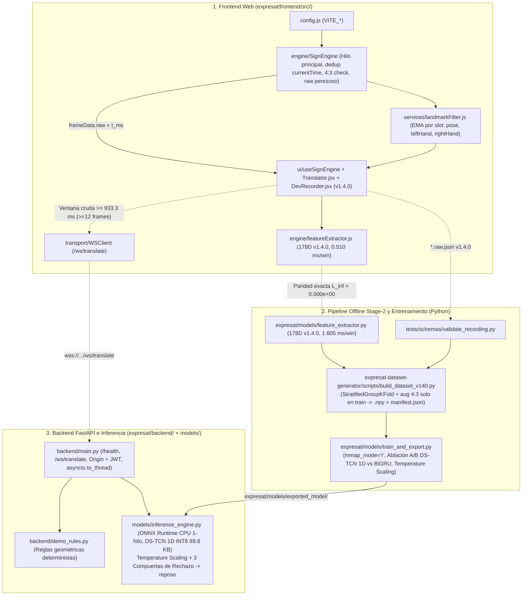

# Documentación Técnica — ExpresaT (`FEATURE_SPEC v1.4.0`)

Centro de navegación de la documentación técnica, contratos matemáticos, decisiones de arquitectura y registros históricos de **ExpresaT** (traductor de Lengua de Señas Mexicana en tiempo real).

> [!TIP] 🤖 Motor de Contexto en Obsidian para Agentes de IA
> La bóveda completa con revelación progresiva, cheat sheet de `< 1.5k` tokens, playbooks TDD y grafo criptográfico `config_hash` se encuentra en **[`Obsidian_exp/00_INDICE_MAESTRO.md`](../Obsidian_exp/00_INDICE_MAESTRO.md)** y **[`Obsidian_exp/Agentes/01_MAPA_CONTEXTO_RAPIDO.md`](../Obsidian_exp/Agentes/01_MAPA_CONTEXTO_RAPIDO.md)**.

---

## Mapa del Sistema (`dataset-v2` — `FEATURE_SPEC v1.4.0`)

---

## 1. Documentación Técnica Vigente (`v1.4.0`)

| Documento | Estado | Descripción |
|---|---|---|
| [Especificación Canónica 178D (`FEATURE_SPEC v1.4.0`)](./dataset-generator/FEATURE_SPEC.md) | **Vigente (`v1.4.0`)** | Contrato matemático unificado JS ↔ Python: $D_{\text{2D\_iso}}$ 4:3, `P15..P22 z'=0.0`, lateralidad directa `'Left'->leftHand` / `'Right'->rightHand`, TTL `200 ms`, brecha estricta $\le 100\text{ ms}$, paridad $L_\infty \le 10^{-6}$ y `config_hash` desacoplado. |
| [Política de Consolidación de Ramas y Bloqueo Nativo](./NATIVE_ISOLATION_POLICY.md) | **Vigente (`v1.4.0`)** | Consolida `dataset-v2` como única fuente de verdad JS ↔ Python, documenta el retiro del generador C++ legacy y establece el bloqueo explícito `ERR_CPP_NOT_CONFORMANT` sobre `expresat-native/`. |
| [Registro de Decisiones y Libro de Evidencia (`DECISIONES.md`)](./dataset-generator/DECISIONES.md) | **Vigente (ADR §§1–7)** | Decisiones de arquitectura, diagnóstico forense de `pose.z'`, consolidación `v1.4.0` (Fases A–D) y libro de evidencia reproducible. |
| [Arquitectura Frontend en 4 Capas (`ARQUITECTURA.md`)](./ARQUITECTURA.md) | **Vigente** | Diseño del frontend en hilo principal (`engine/`, `recognition/`, `transport/`, `ui/`), prevención de fallas históricas (`ModuleFactory`, `StrictMode`) y telemetría dev. |
| [Plan de Mejora de Captura y Compuertas (`PLAN_MEJORA.md`)](./dataset-generator/PLAN_MEJORA.md) | **Vigente** | Compuertas numéricas de densidad por ventana (`unique_real_frames >= 12/15`, `max_interval <= 100 ms`, `bridges <= 3/14`, cero extrapolación de cola). |

---

## 2. Suites de Verificación Ejecutables (`[MEDIDO]`)

| Suite | Comando Exacto | Resultado Verificado |
|---|---|---|
| **Contratos Python, Stage-2, Entrenamiento A/B, Calibración, Inferencia y CI** | `./expresat/venv/bin/python -m unittest discover -s tests -p "test_*.py" -v` | **`54/54 OK`** |
| **Integración Backend FastAPI y Reglas Demo** | `PYTHONPATH=expresat:expresat/backend ./expresat/venv/bin/python -m unittest expresat/backend/test_api_integration.py expresat/backend/test_demo_rules.py -v` | **`22/22 OK`** |
| **Tests Unitarios Frontend (Vitest)** | `npm --prefix expresat/frontend test -- --run` | **`9 archivos / 78/78 OK`** |
| **Linters Frontend (ESLint + oxlint)** | `npm --prefix expresat/frontend run lint && npx --prefix expresat/frontend oxlint expresat/frontend/src` | **`0 errores`** |
| **Build de Producción Frontend (Vite 8)** | `npm --prefix expresat/frontend run build` | **`OK (~1.3s)`** |
