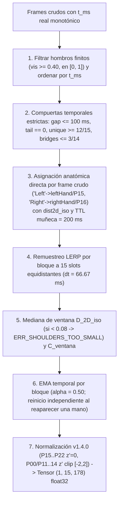

# Especificación Canónica del Vector de 178 Características — ExpresaT

- **Versión de la especificación (`feature_spec_version`):** `1.4.0` *(esquema `.raw.json` `1.4.0` en [`tests/schemas/recording_raw.schema.json`](../../tests/schemas/recording_raw.schema.json))*
- **Estado:** Contrato técnico vigente y verificado elemento a elemento ($L_\infty = 0.000 \le 10^{-6}$) entre Python ([`expresat/models/feature_extractor.py`](../../expresat/models/feature_extractor.py)) y JavaScript ([`expresat/frontend/src/engine/featureExtractor.js`](../../expresat/frontend/src/engine/featureExtractor.js)).
- **Estado de C++ (`expresat-native/`):** **NO CONFORME CON FEATURE_SPEC v1.4.0 — AISLADO FUERA DEL PIPELINE** (`CPP_FEATURE_SPEC_CONFORMANCE = "NO_CONFORME_FEATURE_SPEC_1_3_0"`). El generador C++ legacy fue retirado de `dataset-v2` y `expresat-native/` permanece explícitamente bloqueado hasta portar `ExtractWindow` v1.4.0.
- **Invariante del modelo:** Tensor tridimensional de entrada `(1, 15, 178)` en `float32`.

---

## 1. Evidencia Histórica de `letra_a_derecha_2.json`, Cuarentena y Guardia de Contrato

### 1.1 Evidencia del Origen del Archivo Legacy
La inspección del historial confirmó que `expresat-dataset-generator/dataset/letra_a_derecha_2.json` era un stub sintético:
- **Generador legacy:** `EXPRESAT_STUB_EXTRACTOR` (ondas senoidales $0.5 + 0.15\cos(t + 0.3i)$).
- **Augmentation corrupto legacy:** escalaba todos los canales por $[0.90, 1.10]$ desbordando visibilidad hasta $1.0201$ y dejando $D_{\text{norm}} \approx 0.0459$ en lugar de $1.0$.
- **Mitigación activa en `v1.4.0`:** [`expresat-dataset-generator/scripts/validate_dataset.py`](../../expresat-dataset-generator/scripts/validate_dataset.py) rechaza automáticamente stubs sintéticos ($D_{\text{norm}} \notin [0.80, 1.20]$, `visibility > 1.0`, frames todo-ceros, ventanas congeladas con varianza temporal nula y violaciones de `P15..P22 z' = 0.0`).

### 1.2 Verificación de Versión y `config_hash` en Tiempo de Ejecución (`v1.4.0`)
1. **Desacople total de `tests/fixtures/`:** `compute_config_hash()` (Python) y `computeConfigHash()` (JS) sellan exclusivamente los 27 parámetros canónicos de `FEATURE_SPEC v1.4.0`, `delegate`, `pose_cadence` y los hashes SHA-256 de los artefactos `.task` de MediaPipe (digest bit-a-bit idéntico en Python y JS: `7992397c3e4387e937c46b195fcb1e078109368f249bdc41171815212cae2ce5` para `GPU`, `pose_cadence=1`).
2. **Guardia obligatoria en `InferenceEngine`:** [`expresat/models/inference_engine.py`](../../expresat/models/inference_engine.py) ejecuta `validate_metadata_feature_spec()` antes de crear la sesión ONNX Runtime y aborta explícitamente con `IncompatibleFeatureSpecError` si `model_metadata.json` omite `feature_spec_version`/`config_hash`, difiere en `major.minor` (`1.4`), difiere en `delegate`/`pose_cadence` esperados o no coincide el SHA-256 canónico. Los métodos legacy `_normalize_to_shoulders`, `_extract_pose_upper` y `_extract_hand` fueron eliminados.

---

## 2. Resolución, Relación de Aspecto 4:3, Rotación y Augmentation

1. **Resolución y Relación de Aspecto Canónica (4:3 ± 0.05):**
   - Captura web canónica a **$640 \times 480$** ($A = 4/3 \approx 1.333333$).
   - **Enforcement activo en `SignEngine` y `DevRecorder`:** `validateVideoAspectRatio(videoWidth, videoHeight)` exige $|(W/H) - (4/3)| \le 0.05$; cualquier desvío (p. ej. `16:9`) emite `ERR_INVALID_ASPECT_RATIO`.
   - `SignEngine` invoca `detectForVideo(video, timestampMs, { rotationDegrees: 0 })` en ambos detectores (`HandLandmarker` y `PoseLandmarker`), deduplica frames repetidos por `video.currentTime` y mantiene `poseCadence = 1`.
2. **Rotación Rígida 2D Isotrópica 4:3 para Data Augmentation (solo en split `train` crudo):**
   - Toda rotación sintética opera sobre landmarks crudos `[0, 1]` alrededor del centro de hombros $C = (C_x, C_y)$ con corrección de aspecto $A = 4/3$:
     $$x_{\text{rel}} = (x - C_x) \cdot A, \quad y_{\text{rel}} = y - C_y$$
     $$x_{\text{rot}} = x_{\text{rel}} \cos\theta - y_{\text{rel}} \sin\theta, \quad y_{\text{rot}} = x_{\text{rel}} \sin\theta + y_{\text{rel}} \cos\theta$$
     $$x' = C_x + (x_{\text{rot}} / A), \quad y' = C_y + y_{\text{rot}}$$
   - El augmentation **nunca** modifica la visibilidad ni se aplica sobre `val`/`test`.
3. **Validación en Frames Originales:**
   - Las compuertas de calidad (`vis >= 0.40`, hombros en `[0, 1]`, brecha $\Delta t \le 100.0\text{ ms}$, densidad $\ge 12/15$, puentes $\le 3/14$, extrapolación de cola $= 0$) se evalúan siempre sobre frames originales crudos.
4. **Espejo en Crudo vs. en Features (`L_inf <= 1e-6`):**
   - En crudo (`mirror_raw_frame` / `mirrorRawFrame`): $x \to 1.0 - x$, intercambio de pares bilaterales de pose (`11↔12`, `13↔14`, `15↔16`, `17↔18`, `19↔20`, `21↔22`), inversión de etiqueta (`'Left' ↔ 'Right'`) tanto en listas como en objetos `{landmarks, categoryName, score}`, e intercambio explícito de claves `leftHand ↔ rightHand`.
   - En features (`mirror_features_178` / `mirrorFeatures178`): $x' \to -x'$, intercambio de pares bilaterales de Upper Pose e intercambio de bloques `[52..114] ↔ [115..177]`.
   - Conmutatividad garantizada: $\|\text{Extract}(\text{Mirror}(\text{raw})) - \text{MirrorFeatures}(\text{Extract}(\text{raw}))\|_\infty \le 10^{-6}$.

---

## 3. Manifiesto del Detector de Visión

Los detectores `@mediapipe/tasks-vision` operan con los siguientes artefactos sellados en `config_hash`:
- **Detector de Manos:** [`expresat/frontend/public/models/hand_landmarker.task`](../../expresat/frontend/public/models/hand_landmarker.task)
  - **SHA256:** `fbc2a30080c3c557093b5ddfc334698132eb341044ccee322ccf8bcf3607cde1`
- **Detector de Pose:** [`expresat/frontend/public/models/pose_landmarker_lite.task`](../../expresat/frontend/public/models/pose_landmarker_lite.task)
  - **SHA256:** `59929e1d1ee95287735ddd833b19cf4ac46d29bc7afddbbf6753c459690d574a`

### Parámetros Alineados en `signEngine.js` (`v1.4.0`)
- `HandLandmarker`: `runningMode: 'VIDEO'`, `numHands: 2`, `minHandDetectionConfidence: 0.50`, `minHandPresenceConfidence: 0.50`, `minTrackingConfidence: 0.50`.
- `PoseLandmarker`: `runningMode: 'VIDEO'`, `numPoses: 1`, `minPoseDetectionConfidence: 0.50`, `minPosePresenceConfidence: 0.50`, `minTrackingConfidence: 0.50`, `poseCadence: 1`.
- `enablePose: true` obligatorio siempre que exista transporte remoto / inferencia neural activa (`useSignEngine.js`, `Translator.jsx`).

---

## 4. Composición del Vector 178D y Normalización Isotrópica (`2d_iso_4_3`)

El vector contiene 178 valores `float32`:
- `[0..51]` (52D): Upper Pose (13 landmarks `[0, 11..22]` $\times$ 4: $x', y', z', \text{vis}'$).
- `[52..114]` (63D): Mano Izquierda (`leftHand`, 21 landmarks $\times$ 3: $x', y', z'$).
- `[115..177]` (63D): Mano Derecha (`rightHand`, 21 landmarks $\times$ 3: $x', y', z'$).

### Fórmulas Canónicas `v1.4.0`
1. **Centro de hombros:**
   $$C_x = \frac{P_{11,x} + P_{12,x}}{2}, \quad C_y = \frac{P_{11,y} + P_{12,y}}{2}, \quad C_z = \frac{P_{11,z} + P_{12,z}}{2}$$
2. **Escala isotrópica 2D 4:3 (`d_metric = "2d_iso_4_3"`, inmune a deriva monocular de `pose.z`):**
   $$D = \frac{1}{A}\sqrt{\left((P_{11,x} - P_{12,x})\cdot A\right)^2 + (P_{11,y} - P_{12,y})^2}, \quad A = \frac{4}{3}, \quad D_{\min} = 0.08$$
3. **Upper Pose (`[0..51]`):**
   - $x' = (x - C_x)/D$, $y' = (y - C_y)/D$, $\text{vis}' = \text{clamp}(\text{vis}, 0.0, 1.0)$.
   - **Política `pose.z'` (`v1.4.0`):**
     - `P00, P11..P14` (posiciones `0..4`): $z' = \text{clip}((z - C_z)/D, -2.0, +2.0)$.
     - **`P15..P22`** (posiciones `5..12`): **$z' = 0.0$ exacto** (elimina el sesgo monocular de extrapolación desde cadera).
4. **Manos (`[52..114]` y `[115..177]`):**
   - $x' = (x_i - C_x)/D$, $y' = (y_i - C_y)/D$, $z' = (z_i - z_0)/D$ (relativo a la muñeca $z_0$ de esa mano).
   - Mano ausente: **63 ceros exactos (`0.0f`)**.
5. **Integridad numérica:** cualquier coordenada/visibilidad/timestamp no finito (`NaN`, `±Inf`) rechaza inmediatamente el frame o ventana con `ERR_NON_FINITE_LANDMARKS`.

---

## 5. Algoritmo Canónico `ExtractWindow` (`v1.4.0`)

---

## 6. Asignación Anatómica Directa, Costo Unificado y TTL de Muñeca (`v1.4.0`)

1. **Convención directa de lateralidad (`handedness_convention = "direct"`):**
   - Empíricamente verificada sobre grabaciones reales (`0/36` discrepancias frente a `36/36` en v1.3.0):
     - `'Left'` $\to$ bloque izquierdo `[52..114]` (anclado a muñeca de pose `P15`).
     - `'Right'` $\to$ bloque derecho `[115..177]` (anclado a muñeca de pose `P16`).
2. **Métrica espacial consistente:** todas las distancias de muñeca a pose (`d_left`, `d_right`), el umbral de desconexión ($1.75 \cdot D$ cuando $\text{vis}(P_{\text{cercano}}) \ge 0.50$) y el término de continuidad temporal usan `dist2d_iso` (4:3).
3. **Scoring unificado para 1 y 2 manos:**
   - Penalización por etiqueta discordante: $+0.25 \cdot D$.
   - Continuidad temporal simétrica (solo cuando ambas muñecas previas `prev_left_w` y `prev_right_w` están vigentes): $+0.50 \cdot \text{dist2d\_iso}(H, H_{\text{prev}})$.
   - Para 1 mano se aplica el mismo costo unificado (espacial + etiqueta + continuidad), eliminando el override ciego de etiqueta que en v1.3.0 anulaba la geometría de pose.
4. **Expiración de memoria de muñeca (`WRIST_MEMORY_TTL_MS = 200.0 ms`):** si una mano no se detecta durante $> 200.0\text{ ms}$, su posición previa expira a `null` para evitar anclajes obsoletos.

---

## 7. Compuertas Temporales Estrictas (`v1.4.0`)

Ninguna compuerta puede relajarse para enmascarar hardware lento:
1. **Brecha cruda absoluta (`ERR_INVALID_FRAME_GAP_TOO_LARGE`):** $\max_i (t_{i+1} - t_i) \le 100.0\text{ ms}$ (comparación directa, sin restar $\Delta t_{\text{nom}}$ y sin escalar con `duration_ms`).
2. **Cero extrapolación de cola (`ERR_WINDOW_TAIL_EXTRAPOLATION`):** $t_{\text{último}} + 10^{-6} \ge \tau_{14} = t_0 + 14 \cdot (\text{duration\_ms} / 15)$ (prohibido clonar el último frame para rellenar la cola).
3. **Densidad mínima real (`ERR_WINDOW_LOW_UNIQUE_FRAMES`):** al menos **`12 / 15`** frames crudos únicos mapeados por vecino más cercano a la rejilla $\{\tau_0, \dots, \tau_{14}\}$.
4. **Límite de puentes anchos (`ERR_WINDOW_HIGH_INTERPOLATION`):** como máximo **`3 / 14`** transiciones entre slots consecutivos cuyo punto medio caiga sobre un intervalo crudo $> 1.25 \cdot \Delta t_{\text{nom}}$.

---

## 8. Tabla Única de Códigos de Error (`v1.4.0`)

| Código de Error | Condición Disparadora | Comportamiento |
|---|---|---|
| `ERR_POSE_MISSING` | `pose == null` o `len(pose) < 23` | Rechazar frame / ventana. |
| `ERR_NON_FINITE_LANDMARKS` | Cualquier `x, y, z, visibility, t_ms` es `NaN` o `±Inf` | Rechazar frame / ventana. |
| `ERR_SHOULDER_VISIBILITY` | $\text{vis}(P_{11}) < 0.40 \lor \text{vis}(P_{12}) < 0.40$ | Rechazar frame. |
| `ERR_SHOULDERS_TOO_SMALL` | $D_{\text{2D\_iso}} < 0.08$ | Rechazar frame / ventana. |
| `ERR_OUT_OF_BOUNDS` | Hombros fuera de $[0.0, 1.0]$ | Rechazar frame. |
| `ERR_HAND_DISCONNECTED` | $\min(d_{\text{left}}, d_{\text{right}}) > 1.75 \cdot D \land \text{vis}(P_{\text{cercano}}) \ge 0.50$ | Descartar mano espuria. |
| `ERR_INVALID_FRAME_GAP_TOO_LARGE` | $(t_{i+1} - t_i) > 100.0\text{ ms}$ | Rechazar ventana / toma. |
| `ERR_WINDOW_TAIL_EXTRAPOLATION` | $t_{\text{último}} + 10^{-6} < \tau_{14}$ | Rechazar ventana. |
| `ERR_WINDOW_LOW_UNIQUE_FRAMES` | Frames reales únicos más cercanos $< 12/15$ | Rechazar ventana. |
| `ERR_WINDOW_HIGH_INTERPOLATION` | Puentes anchos $> 3/14$ ($> 1.25 \cdot \Delta t_{\text{nom}}$) | Rechazar ventana. |
| `ERR_INVALID_ASPECT_RATIO` | $|(W/H) - (4/3)| > 0.05$ | Emitir error en `SignEngine` / rechazar toma en `DevRecorder`. |
| `ERR_CAPTURE_FPS_TOO_LOW` | `avg_fps < 15.0` en `DevRecorder` | Marcar toma rechazada. |
| `ERR_CAPTURE_NO_HANDS_IN_ACTIVE_SIGN` | Presencia de manos $< 60\%$ en seña activa (`label != "reposo"`) | Marcar toma rechazada. |
| `IncompatibleFeatureSpecError` | `model_metadata.json` sin `1.4.x` o `config_hash` incompatible | Abortar arranque de `InferenceEngine`. |

---

## 9. `config_hash` Canónico (`v1.4.0`) y Esquema `.raw.json`

### 9.1 Campos sellados en `config_hash` (27 claves ordenadas, JSON compacto sin espacios)
`aspect_ratio ("4:3")`, `d_metric ("2d_iso_4_3")`, `delegate`, `duration_ms (1000)`, `ema_alpha (0.5)`, `feature_spec_version ("1.4.0")`, `hand_ambiguity_thresh (0.15)`, `hand_disconnected_thresh (1.75)`, `hand_landmarker_sha256`, `handedness_convention ("direct")`, `max_bridge_count (3)`, `max_gap_ms (100)`, `min_unique_real_frames (12)`, `pose_cadence`, `pose_landmarker_sha256`, `pose_upper_indices`, `pose_wrist_min_vis (0.5)`, `pose_z_clip_abs (2)`, `pose_z_zero_indices`, `sequence_length (15)`, `shoulder_vis_thresh (0.4)`, `shoulders_d_min (0.08)`, `target_fps (15)`, `total_features (178)`, `weight_label_penalty (0.25)`, `weight_temporal_continuity (0.5)`, `wrist_memory_ttl_ms (200)`.

### 9.2 Esquema `.raw.json` (`v1.4.0`)
Validado por [`tests/schemas/recording_raw.schema.json`](../../tests/schemas/recording_raw.schema.json) y [`tests/schemas/validate_recording.py`](../../tests/schemas/validate_recording.py). Las grabaciones `version = "1.4.0"` requieren obligatoriamente `feature_spec_version`, `config_hash`, `pose_cadence`, `model_artifacts`, `track_settings`, `interval_metrics`, `edge_metrics` y `hand_presence_metrics`, manteniendo retrocompatibilidad de lectura con tomas históricas `v1.3.x`.
