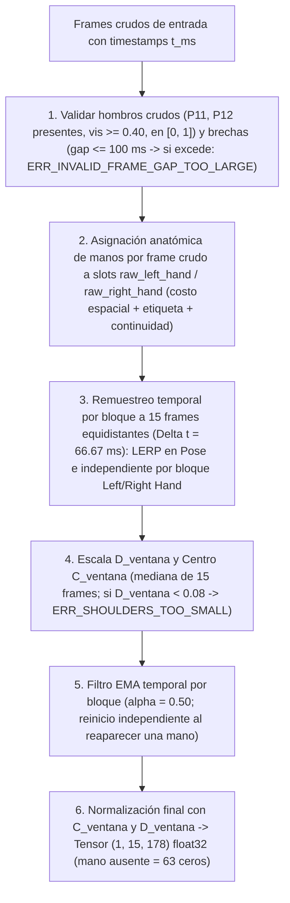

# Especificación Canónica del Vector de 178 Características — ExpresaT

- **Versión de la especificación (`feature_spec_version`):** `1.3.0` *(esquema `.raw.json` `1.3.1`; próxima revisión `1.4.0` definida en [PLAN_MEJORA.md](./PLAN_MEJORA.md))*
- **Estado:** Contrato técnico vigente entre Python (`expresat/models/feature_extractor.py`) y JavaScript (`expresat/frontend/src/engine/featureExtractor.js`).
- **Estado de C++ (`expresat-native/`):** **NO CONFORME CON FEATURE_SPEC v1.3.0** (`CPP_FEATURE_SPEC_CONFORMANCE = "NO_CONFORME_FEATURE_SPEC_1_3_0"`). El pipeline nativo C++ no implementa `ExtractWindow`. Por política de seguridad y fidelidad, `InferenceThread::run()` **rechaza activamente** la ejecución devolviendo el código explícito `ERR_CPP_NOT_CONFORMANT_FEATURE_SPEC_1_3_0` (y `normalize_to_shoulders` retorna `false` si la escala es insuficiente), en lugar de degradar con silent zero-filling.
- **Invariante del modelo:** Tensor tridimensional de entrada `(1, 15, 178)` en `float32`.

---

## 1. Evidencia Histórica de `letra_a_derecha_2.json` y Aislamiento en Cuarentena

### 1.1 Evidencia del Origen del Archivo Legacy
La inspección de git y del código fuente confirma que `expresat-dataset-generator/dataset/letra_a_derecha_2.json` fue generado de forma sintética:
- **Generador:** `expresat-dataset-generator/src/mediapipe_extractor.cpp` (compilado en modo stub con `EXPRESAT_STUB_EXTRACTOR`).
- **Algoritmo productor:** Ondas senoidales sintéticas sobre 33 puntos de pose ($0.5 + 0.15 \cos(t + 0.3i)$) y manos artificiales.
- **Augmentation distorsionador:** `expresat-dataset-generator/src/data_augmenter.cpp` (`applyScale` multiplicó uniformemente todos los canales por $[0.90, 1.10]$, provocando que la visibilidad desbordara hasta $1.0201$).
- **Commit de referencia:** `3bae2f14365509f9daa1db11b49751e1fb7cdac8` (`"Demo"`, 2026-11-05).
- **Discrepancia geométrica:** Los hombros en ese dataset tienen distancia inter-humeral media $D_{\text{norm}} \approx 0.0459$ (omitió la división por $D$). En un espacio normalizado por hombros, los hombros frontales deben situarse en $(\pm 0.5000, 0, 0)$ con $D = 1.0$.

### 1.2 Contrato Nuevo, Cuarentena y Verificación de `config_hash`
1. **Puesta en Cuarentena:** El archivo `letra_a_derecha_2.json` queda aislado en [`expresat-dataset-generator/dataset/quarantine/`](../../expresat-dataset-generator/dataset/quarantine/) y **no debe utilizarse para entrenar modelos productivos**.
2. **Contrato Vigente `1.3.0`:** La especificación v1.3.0 rige la extracción en `feature_extractor.py` y `featureExtractor.js`.
3. **Verificación de Versión y `config_hash` (Implementado vs. Planeado `v1.4.0`):**
   - **Implementado en `v1.3.0`:** `compute_config_hash()` en `feature_extractor.py` y `getCanonicalConfigObject()` en `featureExtractor.js` generan el diccionario canónico sellado (incluyendo `fixtures_sha256` sobre `tests/fixtures/feature_spec_cases.json`), verificado en `tests/test_feature_spec.py`.
   - **Planeado para Fase 2 (`v1.4.0`, [PLAN_MEJORA.md](./PLAN_MEJORA.md#fase-2-bug-de-conformidad-dt--100-ms-spec-140-mirrorconfig_hash-y-experimentos-ab-de-rendimiento)):** Desacoplar `config_hash` de `tests/fixtures/` (sellando en su lugar topología, parámetros y SHA256 de `.task`), persistir `feature_spec_version` y `config_hash` en `model_metadata.json` (`train_and_export.py`), y activar la validación estricta en runtime dentro de `InferenceEngine` (`inference_engine.py`) abortando con `IncompatibleFeatureSpecError` si no coincide `major.minor` o el hash. *(Nota: esta validación en runtime en `InferenceEngine` aún no está implementada en `v1.3.0`.)*

---

## 2. Resolución, Aspecto Fijo (640×480, 4:3), Rotación y Augmentation

1. **Resolución y Relación de Aspecto (4:3):**
   - La captura web opera a **$640 \times 480$** (relación de aspecto $A = 640/480 = 4/3 \approx 1.333333$).
   - **Regla contractual (pendiente de enforcement en `SignEngine`):** En captura dedicada se exige que `videoWidth` y `videoHeight` cumplan $|(W/H) - (4/3)| \le 0.05$, rechazando cualquier desvío con `ERR_INVALID_ASPECT_RATIO`. En `v1.3.1`, `DevRecorder` registra `videoWidth`, `videoHeight` y `effective_resolution` sin abortar automáticamente por aspecto.
2. **Centro de Rotación Rígida 2D para Data Augmentation:**
   - Toda rotación sintética de augmentation debe realizarse alrededor del **centro de los hombros** $C = (C_x, C_y)$ del sujeto en el frame original, preservando al firmante centrado.
   - Fórmula con aspecto corregido para un punto $(x, y)$ rotado por un ángulo $\theta$:
     $$x_{\text{rel}} = (x - C_x) \times A, \quad y_{\text{rel}} = y - C_y$$
     $$x_{\text{rot}} = x_{\text{rel}} \cos\theta - y_{\text{rel}} \sin\theta, \quad y_{\text{rot}} = x_{\text{rel}} \sin\theta + y_{\text{rel}} \cos\theta$$
     $$x' = C_x + (x_{\text{rot}} / A), \quad y' = C_y + y_{\text{rot}}$$
3. **Validación de Calidad en Frames Originales:**
   - **Regla inmutable:** Las compuertas de calidad (visibilidad de hombros $\ge 0.40$, hombros dentro del cuadro $[0, 1]$, brechas temporales $\le 100\text{ ms}$) se evalúan **exclusivamente sobre los frames originales crudos**, nunca sobre frames aumentados.
4. **Espejo en Crudo vs. en Features:**
   - En landmarks crudos: inversión horizontal $x \to 1.0 - x$, intercambio de landmarks bilaterales de pose e inversión de etiqueta (`'Left'` $\leftrightarrow$ `'Right'`).
   - En features normalizadas: $x' \to -x'$ e intercambio de los bloques izquierdo (`[52..114]`) y derecho (`[115..177]`).
   - Garantía matemática: $\text{Extract}(\text{Mirror}(\text{raw})) = \text{MirrorFeatures}(\text{Extract}(\text{raw}))$ con error $L_\infty \le 10^{-6}$. *(Nota de auditoría: `mirror_raw_frame` / `mirrorRawFrame` requieren corrección para objetos `{landmarks, categoryName}` en Fase 2; ver tests `xfail` activos.)*

---

## 3. Manifiesto del Detector de Visión

Los detectores MediaPipe Tasks Vision (`@mediapipe/tasks-vision@^1.0.1`) utilizan los siguientes artefactos versionados en `expresat/frontend/public/models/`:

### Modelos y Checksums Verificados (SHA256)
- **Detector de Manos:** [`expresat/frontend/public/models/hand_landmarker.task`](../../expresat/frontend/public/models/hand_landmarker.task)
  - **Tamaño en disco:** `7,819,105` bytes
  - **SHA256:** `fbc2a30080c3c557093b5ddfc334698132eb341044ccee322ccf8bcf3607cde1`
- **Detector de Pose:** [`expresat/frontend/public/models/pose_landmarker_lite.task`](../../expresat/frontend/public/models/pose_landmarker_lite.task)
  - **Tamaño en disco:** `5,777,746` bytes
  - **SHA256:** `59929e1d1ee95287735ddd833b19cf4ac46d29bc7afddbbf6753c459690d574a`

### Umbrales de Confianza y Delegado: Especificación vs. Código Vigente
- **Contrato objetivo para captura de dataset (`FEATURE_SPEC`):**
  - `minHandDetectionConfidence`: `0.50`, `minHandPresenceConfidence`: `0.50`, `minTrackingConfidence`: `0.50`
  - `minPoseDetectionConfidence`: `0.50`, `minPosePresenceConfidence`: `0.50`
  - `numHands`: `2`, `numPoses`: `1`, `delegate`: `'CPU'` (referencia determinista base), `runningMode`: `'VIDEO'`.
- **Valores vigentes actuales en código (brecha registrada para Fase 2/4):**
  - En `signEngine.js`: `HandLandmarker` opera con confianzas en `0.45` y `preferredDelegate = 'GPU'` (con fallback `'CPU'`, modificable vía `?delegate=CPU|GPU`), mientras `PoseLandmarker` usa `0.50`.
  - En `feature_extractor.py` (`compute_config_hash`): el parámetro por defecto actual es `delegate="GPU"`. La política final CPU vs. GPU y su tolerancia se recalibrarán con clip real en Fase 2 ([DECISIONES.md §1.7](./DECISIONES.md#1-contrato-técnico-y-topología-canónica)).

---

## 4. Composición del Vector y Marcos de Referencia

El vector contiene 178 elementos `float32`:
- `[0..51]` (52D): Upper Pose (13 landmarks $\times$ 4: $x, y, z, \text{visibility}$).
- `[52..114]` (63D): Mano Izquierda (21 landmarks $\times$ 3: $x, y, z$).
- `[115..177]` (63D): Mano Derecha (21 landmarks $\times$ 3: $x, y, z$).

### Normalización Canónica:
1. **Centro de hombros:** $C_x = (P_{11,x} + P_{12,x}) / 2$, $C_y = (P_{11,y} + P_{12,y}) / 2$, $C_z = (P_{11,z} + P_{12,z}) / 2$.
2. **Escala de hombros:** Distancia euclidiana 3D inter-humeral $D = \sqrt{\Delta x^2 + \Delta y^2 + \Delta z^2}$.
3. **Upper Pose (`[0..51]`):**
   $$x' = \frac{x - C_x}{D}, \quad y' = \frac{y - C_y}{D}, \quad z' = \frac{z - C_z}{D}, \quad \text{vis}' = \text{clamp}(\text{vis}, 0.0, 1.0)$$
4. **Manos (`[52..114]` y `[115..177]`):**
   - En el plano $XY$: $x' = (x_{\text{hand}, i} - C_x) / D, \quad y' = (y_{\text{hand}, i} - C_y) / D$.
   - En el eje $Z$: $z' = (z_{\text{hand}, i} - z_{\text{hand}, \text{wrist}}) / D$, donde $z_{\text{wrist}} = z_0$ de esa mano.
   - Si una mano está ausente: **63 ceros exactos (`0.0f`)**.

---

## 5. Algoritmo Canónico `ExtractWindow`: Secuencia Corregida por Bloques

Para evitar distorsiones o cruces fantasmas cuando el detector cambia el orden de las manos entre frames, el orden de operaciones es **estricto, por bloques anatómicos e inmutable**:



---

## 6. Algoritmo de Asignación Conjunta con Término de Etiqueta y Continuidad

### 6.1 Costo de Asignación Robusto
Para cada mano detectada $H_i$, se evalúa la asignación a las muñecas de pose $P_{15}$ (izquierda) y $P_{16}$ (derecha):
$$d_{\text{left}}(H_i) = \text{dist2D}(H_{i,0}, P_{15}), \quad d_{\text{right}}(H_i) = \text{dist2D}(H_{i,0}, P_{16})$$

#### Regla de Descarte por Desconexión
Si $\min(d_{\text{left}}, d_{\text{right}}) > 1.75 \cdot D$, **solo se descarta la mano si la visibilidad de la muñeca de pose correspondiente es confiable**:
$$\text{descartar}(H_i) \iff \min(d_{\text{left}}, d_{\text{right}}) > 1.75 \cdot D \;\land\; \text{vis}(P_{\text{cercano}}) \ge 0.50$$
Si $\text{vis}(P_{15}) < 0.50$ o $\text{vis}(P_{16}) < 0.50$, la pose no tiene suficiente confianza para descartar manos por desconexión.

#### Función de Costo Conjunto para 2 Manos ($H_0, H_1$)
$$\text{costo}_A = d_{\text{left}}(H_0) + d_{\text{right}}(H_1) + \text{PenalizaciónEtiqueta}(H_0 \to \text{izq}, H_1 \to \text{der}) + \text{PenalizaciónTemporal}(H_0, H_1)$$
$$\text{costo}_B = d_{\text{left}}(H_1) + d_{\text{right}}(H_0) + \text{PenalizaciónEtiqueta}(H_1 \to \text{izq}, H_0 \to \text{der}) + \text{PenalizaciónTemporal}(H_1, H_0)$$

Donde todas las magnitudes están expresadas en unidades de $D$:
- Convención de lateralidad en `v1.3.0` (sujeta a revisión empírica en `v1.4.0`, ver [DECISIONES.md §1.4](./DECISIONES.md#1-contrato-técnico-y-topología-canónica)):
  - `'Right'` $\to$ mano izquierda del firmante (penalización $+0.25 \cdot D$ si se asigna a mano derecha).
  - `'Left'` $\to$ mano derecha del firmante (penalización $+0.25 \cdot D$ si se asigna a mano izquierda).
- Término de continuidad temporal: penaliza la distancia euclidiana a la muñeca de la mano asignada en el frame previo ($+0.50 \cdot \text{dist2D}(H, H_{\text{prev}})$ en unidades de $D$).

#### Registro de Ambigüedad
Si $|\text{costo}_A - \text{costo}_B| < 0.15 \cdot D$ (manos cruzadas o en el centro del pecho), se incrementa el contador `ambiguous_handedness_count` en los diagnósticos/manifiesto, registrando ambos casos (1 mano y 2 manos).

---

## 7. Brechas Temporales y Tolerancia

- Regla contractual estricta: ningún intervalo entre frames consecutivos válidos debe superar **$100.0\text{ ms}$** ($\Delta t = t_{\text{siguiente}} - t_{\text{previo}} \le 100.0\text{ ms}$).
  - A 15 FPS ($\Delta t_{\text{nom}} \approx 66.7\text{ ms}$): sin pérdida de frames consecutivos, $\Delta t \le 100.0\text{ ms}$.
  - A 30 FPS ($\Delta t_{\text{nom}} \approx 33.3\text{ ms}$): hasta 2 frames perdidos consecutivos ($\Delta t \approx 100.0\text{ ms}$).
- **Delta conocida entre especificación e implementación `v1.3.0`:** Actualmente, `extract_window()` en `feature_extractor.py` y `featureExtractor.js` evalúa `(t_next - t_curr) - dt_nominal > 100.0` (con `dt_nominal = 66.67 ms`), lo cual permite brechas brutas de hasta `166.67 ms`. Esta desviación se corrige a comparación directa `(t_next - t_curr) > 100.0` en Fase 2 (`v1.4.0`, ver [PLAN_MEJORA.md](./PLAN_MEJORA.md#fase-2-bug-de-conformidad-dt--100-ms-spec-140-mirrorconfig_hash-y-experimentos-ab-de-rendimiento)).

---

## 8. Modos Declarativos por Clase y Duraciones Unificadas

Todas las tomas del dataset tienen una duración temporal unificada:
- **Duración máxima de toma:** **$2.5\text{ s}$ ($2500\text{ ms}$)**.
- **Margen de captura cruda:** $1.5\text{ s}$ a $2.5\text{ s}$.

| Modo | Definición | Requisito de Segmentación | Criterio de Aceptación |
|---|---|---|---|
| `"estatica"` | Seña en pose fija sin trayectoria (ej. A, B, C, 1, 2, 3) | El usuario debe **mantener la pose estable durante $\ge 1200\text{ ms}$**. | Varianza posicional articular $< 0.35 \text{ palmScale}/\text{s}$ durante la ventana central de 1000 ms. |
| `"dinamica"` | Seña con trayectoria cinemática (ej. J, Z, "hola", "gracias") | Movimiento con curva de aceleración y desaceleración. | Desplazamiento articular acumulado $\ge 0.15 \times D$ dentro de los 2500 ms. |

---

## 9. Tabla Única de Códigos de Error

| Código de Error | Condición Disparadora | Comportamiento |
|---|---|---|
| `ERR_POSE_MISSING` | `pose == null` o `len(pose) < 23` | Rechazar frame. |
| `ERR_SHOULDER_VISIBILITY` | $\text{vis}(P_{11}) < 0.40 \lor \text{vis}(P_{12}) < 0.40$ | Rechazar frame. |
| `ERR_SHOULDERS_TOO_SMALL` | $D_{\text{ventana}} < 0.08$ | Rechazar frame o ventana. Prohibido recortar con `std::max`. |
| `ERR_OUT_OF_BOUNDS` | Hombros fuera del cuadro ($x, y \notin [0.0, 1.0]$) | Rechazar frame. |
| `ERR_HAND_DISCONNECTED` | $\min(d_{\text{left}}, d_{\text{right}}) > 1.75 \cdot D \land \text{vis}(P_{\text{wrist}}) \ge 0.50$ | Descartar mano espuria. |
| `ERR_INVALID_FRAME_GAP_TOO_LARGE` | Brecha sin tracking $> 100 \text{ ms}$ *(ver §7 sobre v1.3.0 vs v1.4.0)* | Rechazar toma completa. |
| `ERR_INVALID_ASPECT_RATIO` | $\|(W/H) - (4/3)\| > 0.05$ *(especificación para captura dedicada)* | Rechazar captura de cámara. |
| `ERR_CPP_NOT_CONFORMANT_FEATURE_SPEC_1_3_0` | Invocación de inferencia nativa C++ en `v1.3.0` (`inference_thread.cpp`) | Rechazar ejecución con resultado de error explícito (`ERR_NOT_CONFORMANT`). |

---

## 10. Fixture Único Compartido, Tolerancia Elemento a Elemento ($L_\infty$) y `config_hash`

Las pruebas de conformidad en Python y JavaScript consumen el archivo canónico compartido [`tests/fixtures/feature_spec_cases.json`](../../tests/fixtures/feature_spec_cases.json).

### 10.1 Regla de Aceptación Numérica ($L_\infty$)
Para todo vector o tensor generado, la comparación con la salida esperada se evalúa **elemento a elemento** bajo la norma del supremo:
$$\|v_{\text{obtenido}} - v_{\text{esperado}}\|_\infty = \max_{i} |v_{\text{obtenido}, i} - v_{\text{esperado}, i}| \le 10^{-6}$$
Está prohibido evaluar únicamente la diferencia de normas escalares.

### 10.2 Cálculo Canónico de `config_hash`
En `v1.3.0`, `compute_config_hash()` (`expresat/models/feature_extractor.py`) calcula el digest SHA256 del JSON canónico ordenado que contiene:
1. `delegate`: `"GPU"` (valor por defecto actual en código) o `"CPU"`.
2. `duration_ms`: `1000.0`.
3. `feature_spec_version`: `"1.3.0"`.
4. `fixtures_sha256`: Digest SHA256 íntegro de `tests/fixtures/feature_spec_cases.json`.
5. `sequence_length`: `15`.
6. `shoulders_d_min`: `0.08`.
7. `target_fps`: `15`.
8. `total_features`: `178`.
9. `weight_label_penalty`: `0.25`.
10. `weight_temporal_continuity`: `0.50`.

*(En `v1.4.0` se desacoplará `fixtures_sha256` en favor de los hashes de modelos `.task` y parámetros completos de extracción; ver [PLAN_MEJORA.md](./PLAN_MEJORA.md).)*

---

## 11. Esquema Canónico de Tomas Crudas (`.raw.json`) y Auditoría por Segmentos

El esquema JSON normativo para tomas v1.3.x reside en [`tests/schemas/recording_raw.schema.json`](../../tests/schemas/recording_raw.schema.json) y es validado por [`tests/schemas/validate_recording.py`](../../tests/schemas/validate_recording.py).

### 11.1 Ejemplo de Estructura `.raw.json` (`v1.3.1`)
```json
{
  "version": "1.3.1",
  "type": "expresat_dev_recording_raw",
  "recorded_at": "2026-11-10T20:50:00.000Z",
  "delegate": "GPU",
  "duration_ms": 18000,
  "total_frames": 540,
  "avg_fps": 30.0,
  "min_fps_required": 15.0,
  "interval_metrics": {
    "p50_ms": 33.3,
    "p95_ms": 33.4,
    "max_ms": 35.1,
    "max_allowed_ms": 100.0,
    "gaps_over_100ms_count": 0
  },
  "valid": true,
  "error": null,
  "prompt_timeline": [...],
  "videoWidth": 640,
  "videoHeight": 480,
  "frames": [
    {
      "t_ms": 33.3,
      "videoWidth": 640,
      "videoHeight": 480,
      "hands": [
        {
          "landmarks": [{ "x": 0.45, "y": 0.60, "z": -0.02 }],
          "categoryName": "Left",
          "score": 0.98
        }
      ],
      "pose": [
        { "x": 0.51, "y": 0.35, "z": 0.10, "visibility": 0.99 }
      ]
    }
  ]
}
```
*(Nota: `DevRecorder` (`devRecorderUtils.js`) también adjunta `track_settings` en tiempo de captura; ten en cuenta que `recording_raw.schema.json` define `"additionalProperties": false` en la versión vigente.)*

### 11.2 Segmentos Temporales en `inspect_recording.py`
La utilidad [`expresat-dataset-generator/scripts/inspect_recording.py`](../../expresat-dataset-generator/scripts/inspect_recording.py) audita automáticamente grabaciones con `prompt_timeline` divididas en segmentos temporales (con ventana de gracia de 1500 ms tras cada transición):
- `reposo`: Sin manos detectadas o manos inactivas.
- `solo_derecha`: Mano derecha física del firmante activa.
- `solo_izquierda`: Mano izquierda física del firmante activa.
- `ambas`: Ambas manos activas en sus respectivos slots anatómicos sin ambigüedad.
- `cruce`: Ambas manos cruzadas en el centro del pecho (`is_ambiguous == True`).

